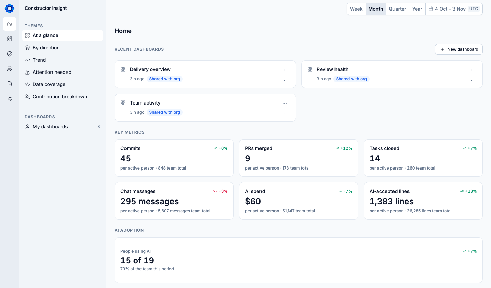

# Insight

Open-source engineering intelligence platform. Insight connects to the systems a company already runs, links each person's accounts across those systems into one profile, and measures productivity for people, teams and the whole organization.

[Try it locally](#try-it-locally) · [Deploy](#deploy) · [What's in this repo](#whats-in-this-repo) · [Contributing](CONTRIBUTING.md)



## What it does

- Connects code hosts, task trackers, chat, email and meetings, wikis, support desks, CRM, HR directories, developer portals, test reports and AI tools through ready connectors in [`src/ingestion/connectors/`](src/ingestion/connectors/). Any other system can push its own records through the API.
- Resolves identities in the `identity-resolution` service, so one person's metrics join across sources.
- Builds metrics in ClickHouse with dbt, from raw source tables (bronze) through unified tables (silver) to metrics (gold).
- Serves them in a web app with dashboards, alerts and an AI assistant. Agents can query the same data over MCP.

## Try it locally

You need Docker with Compose v2 and [`uv`](https://docs.astral.sh/uv/). Rust and Node builds run inside containers.

```bash
git clone https://github.com/constructorfabric/insight.git
cd insight
./dev-compose.sh up
```

The first run asks a few setup questions (Enter keeps the defaults), builds the stack (5–15 min cold), and seeds a demo dataset.

Open <http://localhost:3000>, click **Sign in**, and log in as `dev@company.nonpresent` with password `insight-dev`.

Compose does not run Airbyte or Argo Workflows. For ingestion work, use the [Kubernetes path](CONTRIBUTING.md#kubernetes--interactive). Ports, settings, the edit-build loop and troubleshooting are in [CONTRIBUTING.md](CONTRIBUTING.md).

## Deploy

Insight ships as one Helm chart:

```bash
helm install insight oci://ghcr.io/constructorfabric/charts/insight \
  --namespace insight --create-namespace \
  -f values.yaml
```

Add `--version <x.y.z>` to pin a release. Values, credentials and OIDC setup: [charts/insight/README.md](charts/insight/README.md).

[deploy/gitops](deploy/gitops/README.md) is a sample GitOps layout. It also deploys to a local Kubernetes cluster with `make deploy ENV=local`.

## What's in this repo

| Path | Contents |
|---|---|
| [`src/frontend`](src/frontend/README.md) | Web app: React, TanStack, Vite |
| [`src/backend/services`](src/backend/services) | Rust services (`analytics`, `authenticator`, `identity-resolution`, `insight-v3-core`, `git-cli-proxy`, `previews`), the nginx `gateway`, and the Keycloak chart used for local sign-in |
| [`src/ingestion`](src/ingestion/README.md) | Connectors, dbt models, and the reconcile loop that registers connectors in Airbyte |
| [`charts/insight`](charts/insight/README.md) | Umbrella Helm chart |
| [`deploy`](deploy/gitops/README.md) | Compose wizard and configs, sample GitOps layout |
| [`docs`](docs) | Specs, ADRs, API guideline, glossary, runbooks |
| [`tests`](tests/stand/README.md) | Stand and data-path tests against a running stack |

Some backend specs in `docs/` disagree with the code. [docs/components/backend/README.md](docs/components/backend/README.md) lists where.

## Contributing

Read [CONTRIBUTING.md](CONTRIBUTING.md) for the dev loop and [AGENTS.md](AGENTS.md) for code rules, then open a PR. Specs and ADRs follow the Constructor Studio kit in [`.cf-studio/`](.cf-studio/).

## License

[Apache 2.0](LICENSE)
