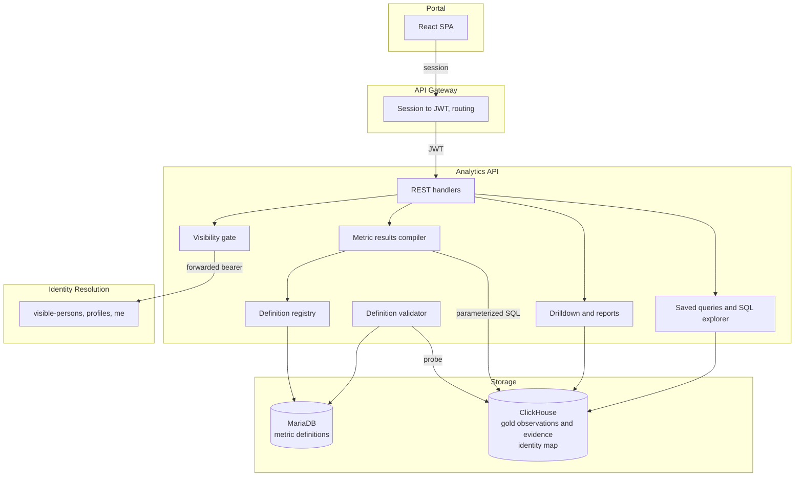
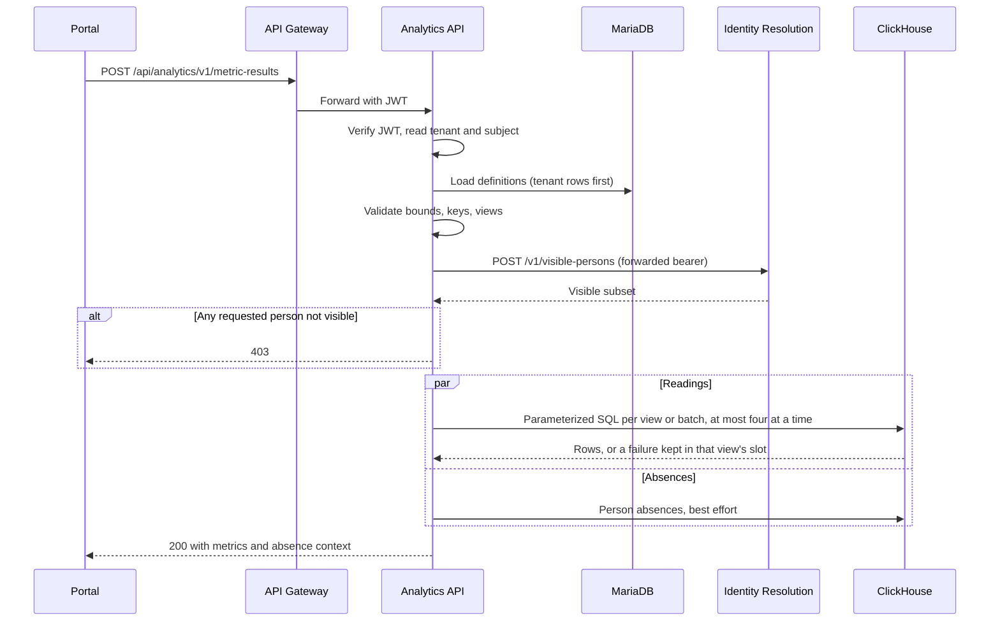
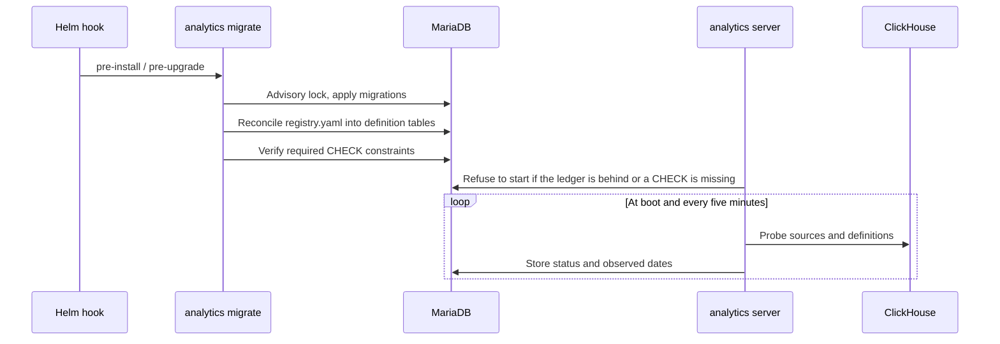

# Technical Design -- Analytics API

- [ ] `p1` - **ID**: `cpt-insightspec-design-analytics-api`

<!-- toc -->

- [1. Architecture Overview](#1-architecture-overview)
  - [1.1 Architectural Vision](#11-architectural-vision)
  - [1.2 Architecture Drivers](#12-architecture-drivers)
  - [1.3 Architecture Layers](#13-architecture-layers)
- [2. Principles & Constraints](#2-principles--constraints)
  - [2.1 Design Principles](#21-design-principles)
  - [2.2 Constraints](#22-constraints)
- [3. Technical Architecture](#3-technical-architecture)
  - [3.1 Domain Model](#31-domain-model)
  - [3.2 Component Model](#32-component-model)
  - [3.3 API Contracts](#33-api-contracts)
  - [3.4 Internal Dependencies](#34-internal-dependencies)
  - [3.5 External Dependencies](#35-external-dependencies)
  - [3.6 Interactions & Sequences](#36-interactions--sequences)
  - [3.7 Database schemas & tables](#37-database-schemas--tables)
  - [3.8 Deployment Topology](#38-deployment-topology)
- [4. Additional Context](#4-additional-context)
  - [Metric families specified beside this document](#metric-families-specified-beside-this-document)
  - [Known gaps](#known-gaps)
  - [Metric passports](#metric-passports)
- [5. Traceability](#5-traceability)

<!-- /toc -->

## 1. Architecture Overview

### 1.1 Architectural Vision

The Analytics API serves metric readings computed from the gold serving relations in ClickHouse. A metric is a **definition**, not a stored query: it names a source relation, the measures it reads, how they combine (sum, ratio, median, percentile, distinct count, standard deviation) and the dimensions a reader may group or filter by. Built-in definitions are declared in `registry.yaml` beside the code and reconciled into MariaDB by the `migrate` job; a tenant adds its own definitions, each backed by a single read-only SQL observation, through the custom-metric API.

A request names the metrics, the people or the tenant, a period and the views it wants (period value, peer comparison, time series, breakdown, rollup, histogram). The service compiles each view into parameterized ClickHouse SQL over `insight.<family>_metric_observations`, resolving source accounts to canonical people inside the query through `identity.account_assignment` and `identity.person_map`. People are never resolved before the query, so a reading and its peer cohort are always resolved against the same identity state.

Authorization and computation fail differently. Before any ClickHouse work the requested people are checked, in one call, against the set identity says the caller may see, and one invisible id refuses the whole request. Once authorized, a view whose ClickHouse query fails answers in its own slot with a stable error code, and the rest of the response stands; a request that cannot be planned, or a view that exceeds its row limit, fails as a whole.

Around that core the service carries the surfaces that read the same relations or the same definitions: evidence drilldown and its export, metric report preview and export, saved ad-hoc queries, an AI explanation of one reading, product-usage recording, connector sync history and bronze ingestion intensity. The API Gateway mounts it at `/api/analytics`; every route is versioned under `/v1/...`.

### 1.2 Architecture Drivers

The service has no PRD of its own; the drivers below are the product behaviours it exists to serve. The metric families specified beside this document (see section 4) carry their own PRDs.

#### Functional Drivers

| Driver | Design Response |
|--------|-----------------|
| Dashboards read one metric at person, peer and tenant level over any period | One request carries many metrics and views; the compiler batches period and peer views per source and runs at most four view queries at a time per request, beside one absence query |
| Metric meaning is owned by the server, not the portal | Labels, descriptions, explanations, formats and direction live in the definition and reach the portal through `GET /v1/metric-definitions` |
| A person's several source accounts count as one person | Evidence is keyed by source identity; resolution to the canonical person happens at read time through the identity map |
| A reader may only see people the org chart lets them see | Requested person ids pass the identity visibility gate before any query runs |
| A tenant can add metrics without a release | Custom definitions with their own SQL observation, gated and probed before they are stored |
| A reading can be traced to the records behind it | Drilldown reads the paired `<family>_metric_evidence` relation with the same resolution |
| Readings leave the product as files | Report and drilldown exports in CSV and XLSX, bounded in rows, bytes and time |

#### NFR Allocation

| NFR | Summary | Allocated To | Design Response | Verification Approach |
|-----|---------|--------------|-----------------|----------------------|
| Query safety | No SQL injection through request values | Metric results compiler, drilldown compiler | Every request value is a bound parameter; keys rendered into SQL are escaped literals; failures log a SQL hash, not the SQL | Compiler unit tests; HTTP live tests |
| Person-level authorization | No reading about a person the caller may not see | Visibility gate | Whole-request refusal on any invisible id; an identity that cannot answer is a server error, never a permit | Gate unit tests; stand API tests |
| Failure isolation | One broken metric cannot take down a dashboard | Metric results handler | A failed ClickHouse query becomes a per-view `error` variant with a stable code, detail only for admins; a relation not built yet becomes a `not_ready` view; planning errors and the per-view row limit still fail the whole request | Failure-mapping unit tests |
| Bounded work | No request can hold unbounded warehouse or memory resources | Metric results, drilldown, reports, SQL explorer, AI | Per-request caps on metrics, people, period, filters and rows; per-query ClickHouse limits; per-process semaphores on exports and explanations. Saved-query runs are the exception: the service buffers the whole result with no row or byte cap of its own, and only the query's ClickHouse execution-time and memory limits apply (section 4) | Validation unit tests; configuration defaults |
| Schema drift is visible | A definition whose relation changed reports itself unavailable instead of failing every read | Definition validator | Periodic probe of each source relation and definition; status stored on the definition | Validator unit and live tests |

### 1.3 Architecture Layers

- [ ] `p1` - **ID**: `cpt-insightspec-tech-analytics-layers`

| Layer | Responsibility | Technology |
|-------|---------------|------------|
| API | Route registration, request parsing, authentication, error envelopes, OpenAPI | Constructor Gears api-gateway host, Axum |
| Domain | Definition registry and validation, metric results compilation, drilldown, reports, SQL gate | Rust, pure functions over request and definition values |
| Infrastructure | MariaDB access, ClickHouse client and query execution, identity client, Anthropic client | SeaORM, insight-clickhouse, reqwest |
| Authentication | JWT verification and claim mapping per request | oidc-authn-plugin, single-tenant tenant resolver |

## 2. Principles & Constraints

### 2.1 Design Principles

#### Definitions, Not Raw Tables

- [ ] `p1` - **ID**: `cpt-insightspec-principle-analytics-views`

The portal never names a ClickHouse relation. It asks for metric keys; the definition decides which relation, which measures and which aggregation answer. A built-in definition is data in `registry.yaml`, reconciled on every `migrate`; a definition removed from the registry is disabled, not deleted.

**Why**: The meaning of a number is owned in one place. A relation can be rebuilt or renamed without a portal release, and the validator reports a definition the relation no longer serves.

#### Authorization Is Whole-Request, Computation Is Per-View

- [ ] `p1` - **ID**: `cpt-insightspec-principle-analytics-security-filters`

Requested person ids are checked against identity's answer to "which of these may this caller see" before any warehouse work. One id outside the answer refuses the whole request with 403; a partial response would be indistinguishable from absent data. Reaching identity is required: an unconfigured or failing identity service is a server error, never a permit. On readings and drilldown, callers authenticated as `service` subjects bypass the gate; reports have no bypass.

Once authorized, a ClickHouse failure while computing one view answers 200 with a `view: "error"` variant in that slot, carrying a stable code. A source relation the warehouse has not built yet is not a failure: the view answers `view: "not_ready"` with reason `SOURCE_RELATION_MISSING`, and drilldown, saved-query runs and report previews carry the same marker beside empty rows. A relation whose columns disagree with the code still fails. A request that cannot be planned, or a view over its row limit, is refused as a whole. The message carries the underlying description only when identity confirms the caller holds the admin role; an identity that cannot answer the role check degrades the message to generic text and never turns a partial answer into a server error.

**Why**: Permission must never leak through a partial answer, and one broken metric must never blank a dashboard.

#### The Portal Speaks Canonical Person Ids

- [ ] `p1` - **ID**: `cpt-insightspec-principle-analytics-person-ids`

The portal sends canonical person UUIDs. Source accounts, e-mail addresses and logins stay inside the warehouse: managed evidence is keyed by source identity and resolved to the person in the same query that reads it, first through account assignments where a source carries account ids, then through the e-mail map. An account assigned to the reserved excluded person resolves to nobody. Custom SQL sources and tenant-level reads are taken as already canonical: custom SQL must emit canonical person ids itself. A person id that is not a UUID is a 400.

**Why**: One key across every route, and a reading and its peer cohort resolved against the same identity state.

#### Peer Statistics Need a Pool

- [ ] `p1` - **ID**: `cpt-insightspec-principle-analytics-peer-floor`

A peer view compares a person against the cohort `insight.metric_entity_cohorts_current` assigns them: their department under the `org_chart` visibility policy, the whole tenant under `flat`. A peer view on a definition without a cohort key is a 400. Its median, quartiles and range are withheld until at least five cohort members have data.

**Why**: Peer aggregates cover people the caller is not individually authorized to see; a minimum pool keeps one person's value from being read back out of a statistic.

### 2.2 Constraints

#### The Server Never Migrates Itself

- [ ] `p1` - **ID**: `cpt-insightspec-constraint-analytics-migrate-job`

Schema changes and built-in definition reconciliation run only in the `migrate` subcommand, which Helm runs as a pre-install and pre-upgrade hook under a MariaDB advisory lock. The server refuses to start when the migration ledger is behind the build, and refuses to start when a CHECK constraint the definition tables rely on is missing.

#### Warehouse Writes Are Limited to Usage Events

- [ ] `p1` - **ID**: `cpt-insightspec-constraint-analytics-warehouse-writes`

The service reads the gold, silver, identity and ingestion-history relations and writes nothing there. Its only ClickHouse write is product-usage beacons into `product_usage.usage_events`, using ClickHouse asynchronous inserts; a failed write is logged and the beacon dropped, and with usage recording off the route answers 204 and records nothing.

#### Tenant Comes From the Signed Token

- [ ] `p1` - **ID**: `cpt-insightspec-constraint-analytics-tenant-claim`

The tenant is the signed `tenant_id` claim of the gateway JWT, resolved by the single-tenant resolver; there is no tenant header. Every read of readings, drilldown, reports and absences carries the tenant predicate bound to the session tenant; there is no switch to turn it off. Custom SQL observations carry whatever tenant their author emits. Saved queries, the SQL explorer, connector health and ingestion intensity are not filtered by tenant.

## 3. Technical Architecture

### 3.1 Domain Model

**Technology**: Rust structs, YAML registry, MariaDB rows

**Location**: [registry.yaml](../../../../src/backend/services/analytics/src/domain/metric_definitions/registry.yaml), [builtin.rs](../../../../src/backend/services/analytics/src/domain/metric_definitions/builtin.rs), [metric results DTOs](../../../../src/backend/services/analytics/src/domain/metric_results/dto.rs)

**Core Entities**:

| Entity | Description | Schema |
|--------|-------------|--------|
| Source | A serving relation pair: observations for readings, evidence for drilldown. Managed sources name a gold relation; a custom source carries its own SQL | [builtin.rs](../../../../src/backend/services/analytics/src/domain/metric_definitions/builtin.rs) |
| Measure | One `measure_key` a source emits, with its evidence granularity, alias collapse and evidence presentation | [builtin.rs](../../../../src/backend/services/analytics/src/domain/metric_definitions/builtin.rs) |
| Definition | A metric: key, label and explanation, format, direction, entity type, computation, optional value transform, optional peer cohort key | [definition.rs](../../../../src/backend/services/analytics/src/domain/metric_definitions/definition.rs) |
| Input | The role a measure plays in a definition: value, numerator or denominator | [builtin.rs](../../../../src/backend/services/analytics/src/domain/metric_definitions/builtin.rs) |
| Metric results request | Entity (people or tenant), period, optional comparison period, metrics with filters and views | [dto.rs](../../../../src/backend/services/analytics/src/domain/metric_results/dto.rs) |
| View result | One view's rows, or an error variant with a stable code | [dto.rs](../../../../src/backend/services/analytics/src/domain/metric_results/dto.rs) |

**Relationships**:

- Source → Measure: a source emits many measures; a measure belongs to one source.
- Definition → Input → Measure: a definition reads one measure (value) or two (numerator and denominator).
- Definition → Dimension: the dimensions a reader may filter or group by, a subset of the source's dimensions.
- Definition → Tag: free tags returned with the listing.
- A tenant definition with the same key as a built-in one takes its place for that tenant while it is usable; a disabled or failing tenant row falls back to the built-in one.

Direction (`higher_is_better`, `lower_is_better`, `neutral`) is descriptive: it is returned with every reading and used in no computation.

### 3.2 Component Model

#### Definition Registry

- [ ] `p1` - **ID**: `cpt-insightspec-component-analytics-view-registry`

##### Why this component exists

Every reading starts from a definition, and the definitions come from two places: the built-in registry shipped with the code and the custom metrics a tenant adds.

##### Responsibility scope

Embed `registry.yaml` at build time and reconcile it into the definition tables on `migrate`: upsert sources, measures and dimensions; replace each definition with its inputs, dimensions and tags in one transaction; disable built-in rows the registry no longer lists. Resolve the definitions a request names, preferring a usable tenant row to the built-in one and falling back to the built-in row when the tenant row is disabled or in error; refuse a key with no usable row. A row is usable when it is enabled, its schema status is `ok` or `unchecked`, and its source and measures are enabled and not in error. Serve the full listing to the portal. Accept, gate, probe, store, import and export custom metrics. Render the metric passports document from the registry.

##### Responsibility boundaries

Does not execute readings. Does not decide authorization. Does not probe managed relations (Definition Validator).

##### Related components (by ID)

- `cpt-insightspec-component-analytics-query-engine` -- called by: resolves the definitions a request names
- `cpt-insightspec-component-analytics-definition-validator` -- shares model with: the validator writes the status the registry reads

#### Definition Validator

- [ ] `p1` - **ID**: `cpt-insightspec-component-analytics-definition-validator`

##### Why this component exists

A gold relation can change shape after a definition was written. Without a probe every read of such a definition fails at query time.

##### Responsibility scope

At boot, and every five minutes unless periodic validation is turned off, probe each managed source's observation and evidence relations, the cohort relation and the identity map; probe each definition's measures over the whole relation and its dimension coverage over the 35 days up to the newest row; store the source, evidence and definition status with an error code, the oldest observed date and a monotonic newest observed date.

##### Responsibility boundaries

Does not probe custom SQL sources, so custom definitions stay `unchecked` and never qualify for drilldown, which requires `ok`. A probe that cannot run leaves the stored status unchanged.

##### Related components (by ID)

- `cpt-insightspec-component-analytics-view-registry` -- owns data for: definition and source status

#### Metric Results Compiler

- [ ] `p1` - **ID**: `cpt-insightspec-component-analytics-query-engine`

##### Why this component exists

Turns a validated request into the ClickHouse queries that answer it.

##### Responsibility scope

Validate request bounds. Plan queries, batching period and peer views per source and filter set. Compile each view into parameterized SQL over the source's observation relation or custom SQL, with person resolution, dimension filters, value transforms, peer cohorts and the five-member peer floor. Execute rankings first, then the remaining views four at a time; answer a missing source relation with a `not_ready` view and map every other ClickHouse failure to a per-view error code; attach person absences from `silver.class_person_absences` on a best-effort basis.

##### Responsibility boundaries

Does not authorize people (Visibility Gate). Does not read definitions from storage directly (Definition Registry).

##### Related components (by ID)

- `cpt-insightspec-component-analytics-view-registry` -- depends on: definitions
- `cpt-insightspec-component-analytics-visibility-gate` -- depends on: authorization before execution

#### Visibility Gate

- [ ] `p1` - **ID**: `cpt-insightspec-component-analytics-visibility-gate`

##### Why this component exists

Every person-keyed read must be limited to the people the caller may see, and that answer belongs to identity.

##### Responsibility scope

Ask identity which requested people the caller may see (`POST /v1/visible-persons` for readings and drilldown, `POST /v1/profiles/batch` for reports), refuse the request on any miss, refuse tenant-level reads while tenant metrics are disabled, and answer whether a caller is an admin through `GET /v1/me`.

##### Responsibility boundaries

Holds no visibility rules of its own; never caches an answer.

##### Related components (by ID)

- `cpt-insightspec-component-analytics-query-engine` -- called by: authorization before any query
- `cpt-insightspec-component-analytics-evidence-and-reports` -- called by: authorization before any query

#### Evidence and Reports

- [ ] `p2` - **ID**: `cpt-insightspec-component-analytics-evidence-and-reports`

##### Why this component exists

A reading must be traceable to its records, and readings must leave the product as files.

##### Responsibility scope

Drilldown authorizes the requested people first, then pages through `insight.<family>_metric_evidence` with the same person resolution, pinned to the relation snapshot it started on; it requires the definition and its evidence to be `ok`. Report preview and export run the time-series compiler over many people and metrics. Exports write CSV or XLSX off the async runtime, under row, byte, time and concurrency bounds.

##### Responsibility boundaries

Does not define metrics; reads the same definitions as the compiler.

##### Related components (by ID)

- `cpt-insightspec-component-analytics-query-engine` -- shares model with: definitions and the time-series compiler

#### Saved Queries and SQL Explorer

- [ ] `p2` - **ID**: `cpt-insightspec-component-analytics-sql-surfaces`

##### Why this component exists

Analysts read the warehouse directly, through stored queries in the portal and through an MCP tool or a token-protected HTTP endpoint.

##### Responsibility scope

Store, list, update, delete and run saved queries per tenant; allow a single SELECT, and require the admin role to create, update or run SQL that names `product_usage` or a `bronze_*` database. Run the SQL explorer on its own listener with its own ClickHouse user, gating each statement and bounding SQL size, result size and fetch time.

##### Responsibility boundaries

Does not apply a tenant row filter to the SQL it runs. The saved-query gate does not refuse external table functions the custom-metric and MCP gates refuse.

##### Related components (by ID)

- `cpt-insightspec-component-analytics-view-registry` -- shares model with: the SQL gate used for custom metric SQL

#### AI Explanation

- [ ] `p3` - **ID**: `cpt-insightspec-component-analytics-ai-explain`

##### Why this component exists

A reader can ask for a plain-language explanation of one reading.

##### Responsibility scope

Build a prompt from the reading the client sends, the tenant's system prompt and its context entries; call the Anthropic API with a stand-wide key or the caller's own key, sealed at rest with AES-256-GCM; bound in-flight calls and output length.

##### Responsibility boundaries

Does not read the warehouse. Every route but its configuration answers 404 when the feature is off.

##### Related components (by ID)

- `cpt-insightspec-component-analytics-visibility-gate` -- depends on: the admin check for tenant-wide settings

#### Operational Reads

- [ ] `p3` - **ID**: `cpt-insightspec-component-analytics-operational-reads`

##### Why this component exists

Admins need to see how the product is used, whether connectors sync and what users report.

##### Responsibility scope

Record usage beacons and serve admin summaries over `product_usage.usage_events`; serve connector sync history from `ingestion_history.sync_events` and bronze ingestion intensity from `insight.bronze_insert_events`; store feedback and list it for admins.

##### Responsibility boundaries

Every read but the usage configuration is admin-only; nothing here feeds metric readings.

##### Related components (by ID)

- `cpt-insightspec-component-analytics-visibility-gate` -- depends on: the admin check

### 3.3 API Contracts

- [ ] `p1` - **ID**: `cpt-insightspec-interface-analytics-views`

- **Technology**: REST/JSON, RFC 9457 problem details
- **Location**: [openapi.json](openapi.json), generated from the route table and drift-checked in CI; where this table and the contract disagree, the contract is right
- **Auth**: every route requires an authenticated caller; "admin" marks routes that also require the admin role

**Endpoints Overview**:

| Method | Path | Description | Auth |
|--------|------|-------------|------|
| `POST` | `/v1/metric-results` | Compute readings for people or the tenant | authenticated |
| `GET` | `/v1/metric-definitions` | List every definition the tenant can read | authenticated |
| `GET`, `POST` | `/v1/metrics` | List or create the tenant's custom metrics | authenticated |
| `GET`, `PUT`, `DELETE` | `/v1/metrics/{metric_key}` | Read, replace or delete one custom metric | authenticated |
| `GET` | `/v1/metrics/export` | Export custom metrics | authenticated |
| `POST` | `/v1/metrics/import` | Import custom metrics | authenticated |
| `POST` | `/v1/metric-drilldown` | Page the evidence behind a reading | authenticated |
| `POST` | `/v1/metric-drilldown/export` | Export that evidence | authenticated |
| `POST` | `/v1/reports/preview`, `/v1/reports/export` | Preview or export a metric report | authenticated |
| `GET`, `POST` | `/v1/queries` | List or create saved queries | authenticated; admin when the SQL names restricted data |
| `GET`, `PUT`, `DELETE` | `/v1/queries/{id}` | Read, update or delete a saved query | authenticated; admin to update with restricted data |
| `POST` | `/v1/queries/{id}/run` | Run a saved query | authenticated; admin when it names restricted data |
| `GET` | `/v1/ai/config` | Whether AI explanation is on | authenticated |
| `GET`, `PUT`, `DELETE` | `/v1/ai/credentials` | The caller's own Anthropic key | authenticated |
| `GET`, `PUT`, `DELETE` | `/v1/ai/settings` | The tenant's system prompt | read authenticated; write admin |
| `GET`, `POST` | `/v1/ai/context` | List or add context entries an explanation reads | authenticated; tenant-wide entries admin |
| `PATCH`, `DELETE` | `/v1/ai/context/{id}` | Edit or remove a context entry | authenticated; tenant-wide entries admin |
| `POST` | `/v1/ai/explain` | Explain one reading | admin unless opened to all |
| `POST` | `/v1/usage/events` | Record usage beacons | authenticated |
| `GET` | `/v1/usage/config` | Whether usage is recorded | authenticated |
| `GET` | `/v1/usage/summary`, `/people`, `/pages`, `/actions` | Usage read model | admin |
| `GET` | `/v1/connector-health` | Recorded sync state of every connector | admin |
| `GET` | `/v1/connector-health/{connector}/syncs` | Recent syncs of one connector | admin |
| `GET` | `/v1/ingestion/intensity` | Bronze extraction intensity | admin |
| `POST`, `GET` | `/v1/feedback` | Send feedback; list it | send authenticated; list admin |

The SQL explorer listens separately: an MCP tool authenticated by an OAuth access token with the `mcp:query` scope, and an HTTP query endpoint authenticated by a static bearer token.

**Error responses** (the contract lists every status per route): 400 for a malformed request, an unknown or unavailable metric key, or a view over its row limit; 401 without a valid token; 403 for an invisible person, a missing admin role, or a tenant-level read while tenant metrics are off; 404 for a missing saved query or custom metric, and for AI routes while the feature is off; 409 for a custom metric key already taken; 415 for a body that is not JSON; 429 when export, drilldown or explanation capacity is exhausted; 500 when identity cannot answer an authorization question.

### 3.4 Internal Dependencies

| Dependency Module | Interface Used | Purpose |
|-------------------|----------------|---------|
| Identity Resolution | `POST /v1/visible-persons`, `POST /v1/profiles/batch`, `GET /v1/me`, with the caller's bearer forwarded | Person authorization and the admin check |
| API Gateway | Signed JWT on every request | Caller, tenant and subject type |
| dbt gold and identity layers | `insight.<family>_metric_observations`, `insight.<family>_metric_evidence`, `insight.metric_entity_cohorts_current`, `identity.person_map`, `identity.account_assignment`, `identity.identity_persons` | Readings, drilldown and person display names |
| dbt silver layer | `silver.class_person_absences`, `silver.contract_version` | Absence context on readings; a periodic, logged-only contract version check |
| Ingestion | `product_usage.usage_events`, `ingestion_history.sync_events`, `insight.bronze_insert_events` | Usage, connector health and ingestion intensity |

### 3.5 External Dependencies

#### ClickHouse

| Dependency Module | Interface Used | Purpose |
|-------------------|----------------|---------|
| insight-clickhouse | HTTP, bound parameters, per-query settings | Readings, drilldown, reports, saved queries, usage writes and reads, connector health, person names |

#### MariaDB

| Dependency Module | Interface Used | Purpose |
|-------------------|----------------|---------|
| SeaORM | Connection pool, migrations, advisory lock | Definitions, saved queries, feedback, AI settings and keys |

#### Anthropic API

| Dependency Module | Interface Used | Purpose |
|-------------------|----------------|---------|
| reqwest | Messages API | AI explanation of one reading |

### 3.6 Interactions & Sequences

#### Metric Readings for People

**ID**: `cpt-insightspec-seq-analytics-query-person`

**Description**: Definitions are resolved before authorization so an unknown key is a 400 whatever the caller can see; no warehouse query runs until every requested person is visible.

#### Built-in Definitions Reach the Database

**ID**: `cpt-insightspec-seq-analytics-reconcile`

**Description**: The server never changes schema or built-in definitions; it only reads them and records their validity.

### 3.7 Database schemas & tables

- [ ] `p1` - **ID**: `cpt-insightspec-db-analytics`

The analytics database is `mariadb.database` in a chart install and `analytics` in the compose stack. Migrations under `src/backend/services/analytics/src/migration` are the column-level source of truth.

#### Definition Tables

| Table | Holds | Written by | Read by |
|-------|-------|------------|---------|
| `metric_sources` | One row per source: kind (managed or custom SQL), observation and evidence relation or inline SQL, origin, schema status | Reconcile, custom-metric API, validator | Registry, drilldown capability, listing |
| `metric_source_measures` | Measures per source with evidence granularity, alias collapse and presentation | Reconcile, custom-metric API | Registry |
| `metric_source_dimensions` | Dimensions a source exposes | Reconcile, custom-metric API | Registry |
| `metric_definitions` | Definitions: key, labels, format, direction, entity type, computation, transform, peer cohort key, origin, enabled flag, schema status, observed dates | Reconcile, custom-metric API, validator | Metric results, listing, drilldown, reports |
| `metric_definition_inputs` | Measure bindings by role | Reconcile, custom-metric API | Registry, drilldown capability |
| `metric_definition_dimensions` | Dimensions a definition allows | Reconcile, custom-metric API | Registry |
| `metric_definition_tags` | Tags per definition | Reconcile, custom-metric API | Listing |

Built-in rows carry a NULL tenant and `origin = 'builtin'`; a tenant's rows carry its id and `origin = 'custom'`. A stored generated sentinel stands in for the NULL tenant so a key is unique among built-in rows and within each tenant; a tenant row may reuse a built-in key. CHECK constraints on these tables pin key shapes and enumerated values, and the startup probe refuses to run without them. Triggers reset a source's evidence status to unchecked when its relations, measures, granularity or presentation change.

#### Product Tables

| Table | Holds | Written by | Read by |
|-------|-------|------------|---------|
| `saved_queries` | Per-tenant named SQL | `/v1/queries` | `/v1/queries` |
| `feedback` | Feedback submissions | `POST /v1/feedback` | Admin list |
| `ai_context_entries` | Context an explanation reads, per person or tenant-wide | `/v1/ai/context` | Explanation, listing |
| `ai_credentials` | A person's Anthropic key, sealed with a per-write nonce | `/v1/ai/credentials` | Explanation |
| `ai_settings` | The tenant's system prompt | `/v1/ai/settings` | Explanation |

### 3.8 Deployment Topology

- [ ] `p2` - **ID**: `cpt-insightspec-topology-analytics`

One Deployment behind the gateway, plus the `migrate` hook Job that runs before each install and upgrade. The SQL explorer, when enabled, listens on its own port inside the same process. Durable state lives only in MariaDB and ClickHouse; report exports spool to a pod-local temporary volume. Every concurrency cap — exports, drilldown queries, report generations, AI calls — is per process, so the effective limit grows with the replica count. Identity is called with the caller's bearer forwarded.

## 4. Additional Context

### Metric families specified beside this document

`specs/ai-cost/` carries the AI development cost family — PRD, design, decomposition and the audit behind them — with [ADR-0003](specs/ADR/0003-price-card-per-person-token-cost.md) on pricing. It specifies `insight.ai_cost_metric_evidence` and `insight.ai_cost_metric_observations`, a separate evidence family because seat measures are monthly snapshots rather than daily activity and one evidence relation binds per source. `specs/connector-health/` carries the connector sync history read model. Those documents are written against the code they ship with; where they and this document disagree, they are the newer of the two.

### Known gaps

The code as it stands, recorded so a reader does not assume otherwise:

- **Any authenticated caller can redefine a built-in metric for the tenant.** The custom-metric routes carry no admin check, and a custom metric may reuse a built-in key, which then takes its place for every reader in the tenant.
- **Saved-query runs are loosely bounded.** The whole result is buffered with no row, byte or concurrency cap beyond the ClickHouse execution-time and memory limits; the gate does not refuse external table functions; and a failing run logs its full SQL.
- **The SQL explorer and saved queries read across tenants.** Neither applies a tenant filter; they rely on their ClickHouse grants.
- **No caching.** A Redis URL setting and dependency exist; nothing reads or writes Redis.

### Metric passports

`passports.md` beside the registry is a generated, human-readable rendering of every built-in definition — source, inputs, formula and shape. A drift test fails when it and the registry disagree.

## 5. Traceability

- **API contract**: [openapi.json](openapi.json)
- **Definition registry**: [registry.yaml](../../../../src/backend/services/analytics/src/domain/metric_definitions/registry.yaml)
- **Metric passports**: [passports.md](../../../../src/backend/services/analytics/src/domain/metric_definitions/passports.md)
- **ADRs**: [ADR/](specs/ADR/)
- **Metric families**: [ai-cost](specs/ai-cost/DESIGN.md), [connector-health](specs/connector-health/DESIGN.md)

| Design Element | Realized In |
|---|---|
| Definition Registry (3.2) | `src/backend/services/analytics/src/domain/metric_definitions/`, `src/backend/services/analytics/src/domain/metric_crud.rs` |
| Definition Validator (3.2) | `src/backend/services/analytics/src/domain/metric_definitions/validator.rs` |
| Metric Results Compiler (3.2) | `src/backend/services/analytics/src/domain/metric_results/` |
| Visibility Gate (3.2) | `src/backend/services/analytics/src/domain/person_visibility.rs`, `src/backend/services/analytics/src/domain/metric_access.rs` |
| Evidence and Reports (3.2) | `src/backend/services/analytics/src/domain/metric_drilldown/`, `src/backend/services/analytics/src/domain/reports/` |
| Saved Queries and SQL Explorer (3.2) | `src/backend/services/analytics/src/api/saved_queries.rs`, `src/backend/services/analytics/src/sql_explorer/`, `src/backend/services/analytics/src/domain/query_gate.rs` |
| Startup gates (2.2) | `src/backend/services/analytics/src/gear.rs`, `src/backend/services/analytics/src/infra/db/` |
