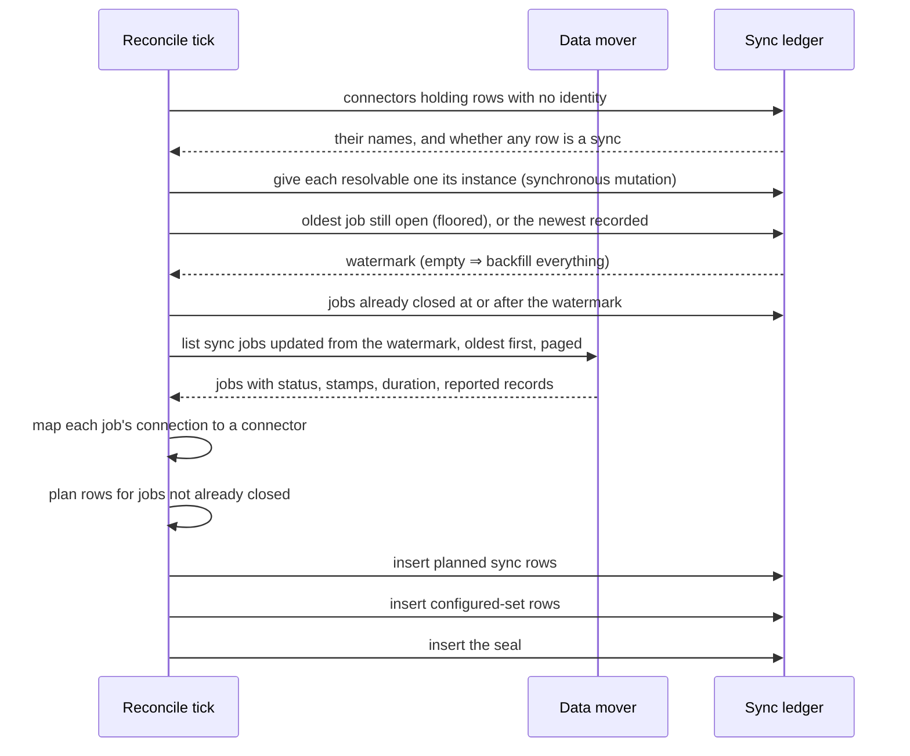
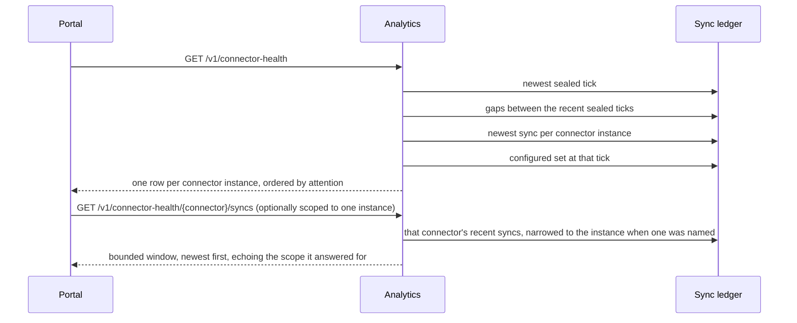

# DESIGN — Connector Health


<!-- toc -->

- [1. Architecture Overview](#1-architecture-overview)
  - [1.1 Architectural Vision](#11-architectural-vision)
  - [1.2 Architecture Drivers](#12-architecture-drivers)
  - [1.3 Architecture Layers](#13-architecture-layers)
- [2. Principles & Constraints](#2-principles--constraints)
  - [2.1 Design Principles](#21-design-principles)
  - [2.2 Constraints](#22-constraints)
- [3. Technical Architecture](#3-technical-architecture)
  - [3.1 Domain Model](#31-domain-model)
  - [3.2 Component Model](#32-component-model)
  - [3.3 API Contracts](#33-api-contracts)
  - [3.4 Internal Dependencies](#34-internal-dependencies)
  - [3.5 External Dependencies](#35-external-dependencies)
  - [3.6 Interactions & Sequences](#36-interactions--sequences)
  - [3.7 Database schemas & tables](#37-database-schemas--tables)
  - [3.8 Deployment Topology](#38-deployment-topology)
  - [3.9 Reconcile schedule application](#39-reconcile-schedule-application)
- [4. Additional context](#4-additional-context)
  - [4.1 What was deliberately not built](#41-what-was-deliberately-not-built)

<!-- /toc -->

Realises [PRD.md](PRD.md). Scoped addition to the
[Analytics service design](../../DESIGN.md) on the read side and to the reconcile loop on the
write side. Everything the parent design already specifies — the admin gate, error taxonomy,
OpenAPI registration — applies unchanged; this document adds the sync history, requested
schedule storage, API routes, and one portal pane.

## 1. Architecture Overview

### 1.1 Architectural Vision

The page must answer from facts that were recorded when they were true, not gathered when the
operator asks. Two routes were rejected for that reason.

**Reading the mover on the request path** couples the page's availability to the mover's, and
its listing is orders of magnitude slower than a warehouse read. An operator opening the page
during an incident is exactly when the mover is least likely to answer.

**Reading storage metadata on the request path** cannot be done by a reader that holds no
data access: row visibility in the warehouse's parts metadata follows real access, so a
metadata-only grant is not a reachable permission state. Widening the read-only query-path
role to see bronze is not acceptable for a page that reports on it.

What remains is a ledger: the reconcile loop reads the mover's job history on its own cadence
and records what it found. The health request path then touches one relation and nothing else, and
the page stays up when everything above it is down.

The ledger buys a second thing the mover cannot: **history that outlives its source.** Delete
a connection in the mover and its job history goes with it; the ledger keeps six months.

### 1.2 Architecture Drivers

#### Functional Drivers

- Every sync in the mover's history is recorded, whatever started it (FR-1) — drives the
  sweep and its job coverage.
- History is bounded and survives the mover (FR-2) — drives retention and the decision to
  copy rather than proxy.
- First sweep backfills retained history (FR-3) — drives the watermark, whose empty state is
  what makes the first sweep read the mover's whole retained window.
- The configured set is recorded (FR-4) — drives the sealed per-tick snapshot.
- Facts, not verdicts (FR-7) — drives a health wire shape that ships observations and no state enum.
- The read path depends on nothing external (FR-11) — drives the single-relation read.
- A stopped recorder is visible (FR-12) — drives serving the age of the last read beside the
  facts it produced.

#### NFR Allocation

- **NFR-1 interactive read** — one relation, a sort key whose leading column every read
  filters on, aggregates rather than sorts, and no measurement taken while the operator waits.
  Measured at 42 ms and 5 MiB over two million recorded syncs.
- **NFR-2 recording never breaks reconciliation** — the sweep's own entry point reports a
  failed or partial tick, and the shell that calls it swallows that deliberately, so the tick
  around it cannot abort because observability broke.
- **NFR-3 idempotent sweep** — coverage is keyed on the mover's own job identity, so
  re-reading the same history adds nothing.
- **NFR-4 bounded storage** — its own database, outside anything customer-facing, with a TTL.

### 1.3 Architecture Layers

| Layer | This change adds |
|---|---|
| Ingestion control | the sweep inside the reconcile tick |
| Warehouse | `ingestion_history.sync_events` and one grant |
| Analytics service | a domain read module and two admin routes |
| Portal | the Connector health pane, replacing Data health |

## 2. Principles & Constraints

### 2.1 Design Principles

#### The seam is a table, not an API

- [ ] `p1` - **ID**: `cpt-insightspec-connhealth-principle-seam-is-a-table`

The writer and the reader never meet. The reconcile loop knows nothing about the analytics
service; the analytics service knows nothing about the mover. Either side can change, fail,
or be replaced without the other noticing, and the page answers from the table while
everything above the seam is down (FR-11).

#### Recording is subordinate to the recorded

- [ ] `p1` - **ID**: `cpt-insightspec-connhealth-principle-recording-subordinate`

A sweep failure is logged and swallowed, never propagated: no reconcile tick aborts because
observability broke (NFR-2). The cost of that choice is that a tick can leave a gap. The next
tick repairs it, because the mover's history is still there to re-read — which is the reason
the sweep reads a source it does not own rather than recording as it goes.

#### The page reports the mover's account as the mover's account

- [ ] `p1` - **ID**: `cpt-insightspec-connhealth-principle-account-not-verdict`

Every fact on this page comes from one source that reports on itself. Nothing corroborates
it, so nothing on the page may read as corroborated: a successful sync is shown as a
successful sync, and the record count is labelled as reported. The page never says a
connector is delivering, because it does not know (FR-7).

#### Absence is representable

- [ ] `p1` - **ID**: `cpt-insightspec-connhealth-principle-absence-representable`

Every column whose value can genuinely be missing is nullable, so "nobody measured this" and
"this was zero" are different values in the table rather than a distinction reconstructed at
read time. A job the mover has not started has no start time and no duration; storing the
epoch or a zero there would make the page state something nobody recorded.

### 2.2 Constraints

#### Instance-wide, operator-gated

- [ ] `p1` - **ID**: `cpt-insightspec-connhealth-constraint-instance-wide`

Bronze schemas are not tenant-partitioned, so the surface cannot be scoped by tenant. It is
gated on the operator role and reports the whole install (FR-9). The refusal names the
surface the caller was refused, so an operator who followed a link knows what to ask for.

#### Append-only, no updates

- [ ] `p1` - **ID**: `cpt-insightspec-connhealth-constraint-append-only`

No writer updates or deletes ledger rows. A job seen mid-flight and later seen finished
yields two rows; reads take the newest per job identity. This is what makes NFR-3 hold by
construction — a repeated sweep can only add rows that resolve to the same answer.

#### The reader holds no bronze access

- [ ] `p1` - **ID**: `cpt-insightspec-connhealth-constraint-no-bronze-grant`

The read-only query-path role gains exactly one thing: `SELECT` on the ledger database. It is
not a read-only role in general — other databases are create/insert-only for it, which that
role's own test pins — but on the ledger it reads and nothing more, and a static test over the
role definition fails the moment that changes.

#### No compose-stand behaviour beyond degradation

- [ ] `p2` - **ID**: `cpt-insightspec-connhealth-constraint-no-compose`

Compose stands run no mover, so nothing records and the ledger stays empty. The surface is
required only to degrade honestly there (FR-10), and the stand tests assert that degradation
rather than any recorded figure.

## 3. Technical Architecture

### 3.1 Domain Model

One table holds three kinds of row, told apart by `event`.

| Event | Written when | Carries |
|---|---|---|
| `sync.completed` | the sweep sees a job in the mover's history | job identity, connector, outcome, timestamps, duration, reported records |
| `connector.configured` | each tick, one row per configured connector instance | the instance identity, tick identity, applied schedules, timezone, schedule origin and suspension read from its live CronWorkflow |
| `sweep.completed` | each tick, last | tick identity — the marker that seals the snapshot |

**Configured is what it means to the reconcile loop: a shipped descriptor that has a
Kubernetes Secret on this install.** The two differ by most of the list — descriptors are
every connector the product knows how to run, and reconcile cascade-deletes the mover
resources of any without a Secret rather than driving it. Recording the descriptor set would
fill the page with connectors the install never had, each correctly reported as never synced
and none of them anything an operator can act on. A connector whose Secret lookup fails is
neither in nor out: the tick records nothing at all, because dropping it would seal a snapshot
saying it is no longer configured and the read surface takes a sealed snapshot as
authoritative.

**What each event writes.** One table serving three row classes means every column needs a
defined value on every one of them. A column left to the implementation's judgement is a
column the reader and the writer will disagree about.

| Column | `sync.completed` | `connector.configured` | `sweep.completed` |
|---|---|---|---|
| `tick_id` | the tick that recorded it | the tick | the tick |
| `job_id` | the mover's job identity | empty | empty |
| `connector` | the synced connector | the member connector | empty |
| `tenant_id` | the instance's tenant | the instance's tenant | empty |
| `source_id` | the instance's source id | the instance's source id | empty |
| `status` | the mapped outcome | empty | empty |
| `started_at` | the job's own start, else its first attempt's; NULL if not started | NULL | NULL |
| `job_updated_at` | always present | NULL | NULL |
| `duration_ms` | between the mover's own two stamps; NULL until terminal | NULL | NULL |
| `records_reported` | the last attempt's count; NULL if it reported none | NULL | NULL |
| `schedules` | empty array | live CronWorkflow `spec.schedules`; empty array if unreadable or missing | empty array |
| `schedule_timezone` | empty | live CronWorkflow `spec.timezone`; empty if absent, unreadable or missing | empty |
| `schedule_origin` | empty | live CronWorkflow annotation `insight.cyberfabric.com/schedule-origin` (`api`, `annotation`, `descriptor`, `default`); empty if absent, unreadable or missing | empty |
| `schedule_suspended` | false | live CronWorkflow `spec.suspend`; false if absent, unreadable or missing | false |

Reconcile writes `spec.timezone: UTC` on every connector CronWorkflow, so the recorded
cron expressions read in UTC. The sweep still reads the live value: a CronWorkflow
applied before this change may lack a timezone and records an empty string, which the
API and page continue to treat as controller time.

Empty strings and arrays, or false for suspension, rather than NULL where these columns are
inapplicable to a row class. Every read filters by `event` before touching them, so an
absent-value type would buy nothing and cost a nullable read on the hot path.

**Every value is range-checked before it is written.** ClickHouse does not reject an
out-of-range one — it clamps a `DateTime64` and wraps a `UInt64`. A year-1000 stamp lands as
1900 and a count above 2^64 lands as a different number, and the page would label both as
what the mover reported. A stamp or a count the column cannot hold is therefore treated as
absent, and a job carrying no usable moment at all is not recorded.

**The unit is the connector instance, not the connector.** One connector can be configured
more than once — a second Secret naming its own source id, reading a different account of the
same vendor — so its name identifies the software, not the thing that synced. Every read
therefore keys on `(connector, tenant_id, source_id)`. Keyed on the name alone, two instances
resolve to a single newest sync and whichever ran last stands for the pair, so a failing
instance reads as healthy because its sibling succeeded.

Rows recorded before the ledger carried the identity hold it empty. The reconcile sweep fills
them in from evidence, in order of how directly the answer is known:

1. the Secret the install configures now, for a connector it configures exactly once;
2. the identity the connector's own bronze data was recorded under, read from the relation its
   descriptor names — which is what outlives the Secret;
3. the naming this install demonstrably follows (`<connector>-main` under one tenant), and only
   for a connector that recorded no sync at all, and only while every instance the install can
   read agrees on it. One counter-example turns this rung off for the whole install.

A removed Secret does not by itself end the question: a departed connector that ever moved a
row said which instance it was, in that row.

What stays empty is what cannot be shown. A connector configured twice is refused — the
connection that told its instances apart is not in the rows. And a connector whose
unidentified rows include a **sync** is never given an inferred identity, however unanimous the
naming: there the identity decides whose work that sync was, and a wrong answer is
indistinguishable from a right one ever after. Rung 3 is the only rung that infers rather than
reads, which is why it reaches nothing but `connector.configured` snapshots — rows about
membership, with no sync to misattribute. Every connector left unidentified is named in the
tick's log, once per tick rather than once per connector.

**An instance's existence is established, never inferred, before anything is deleted.** The
sweep records; the reconcile loop around it removes — a connector with no Secret loses its
sources, and one instance whose own Secret is gone loses only its own. Both read whose a source
is from the `sourceDefinitionId` Airbyte created it against, matched to the custom definition
published under the connector's name. The source's name is a fallback for a definition already
deleted, and it answers only where exactly one connector could have written it: a source is
`{connector}-{source_id}-{tenant}` and a source id is arbitrary, so one connector's source can
spell another connector's name exactly. A definition listing that cannot be read — an error, an
empty array, no bytes at all — stops the removal rather than falling back to the name, since
falling back would delete on the weaker evidence precisely when the stronger became
unavailable.

**Resolution.** The summary takes, per connector instance, the newest `sync.completed` by the
mover's own last-update stamp for the job; the configured set is the membership of the newest
*sealed*
tick. Sealing
matters: without keying on the marker, a snapshot still being written would read as the whole
set, and a connector removed a moment ago would come back for one tick.

**Status vocabulary.** The mover's own six words, stored verbatim: `pending`, `running`,
`incomplete`, `succeeded`, `failed`, `cancelled` — plus `unknown` for a word outside that set.
Nothing is translated on the way in. A surface reporting someone else's account should not
paraphrase it, and a translation table is one more place for a meaning to be lost: rewriting
`succeeded` as `ok` would be this service asserting something the mover did not say. What the
boundary does instead is close the set, so nothing downstream holds a value it cannot read.

`unknown` is neither a failure nor a success, and it does not sort a connector as quiet — the
page shows it as a state it could not read. It is also not terminal: coverage fails closed, so
a status the sweep could not read is one it keeps re-reading until it becomes one it can.

**Two timestamps, kept apart.** `started_at` is when the mover says the sync began, and is
absent for a job it has not started. `job_updated_at` is the mover's last word about the job
— its last update, or its start when the mover has not updated it — which is the field the listing is ordered and filtered by — and therefore the axis
the sweep's own watermark moves along. Substituting one for the other would report a start
that never happened and still leave the cursor on the wrong axis.

**The listing reports no creation time, and this is load-bearing.** It accepts a creation
filter, so a creation stamp looks available from the query surface alone; the entries carry a
start and a last update and nothing else. A sweep that asks by one field and reads back
another refuses every entry, and the page then reports every configured instance as never
synced —
which is indistinguishable from a mover that has run no syncs at all. The sort key, the
filter and the field read off an entry are therefore one stamp, and both halves of that are
asserted: the request's shape in the mover's tests, the response's shape in the planner's.

The mover also answers `200` and **ignores a query parameter it does not recognise** rather
than refusing it. A filter renamed by a later release would therefore stop filtering
silently, and the read would restart at the beginning of history. Each tick counts the
entries that came back older than the watermark it sent, and **treats any as a failed read**
— it plans nothing and does not seal. Logging it would not be enough: every terminal job
below the watermark would be recorded again on every tick, because the closed-job read is
bounded by that same watermark and so cannot filter them out; and a capped pass would stop
short of the newest jobs while still sealing, leaving the page dated as freshly checked on
facts it never reached.

**A job in flight carries no update stamp at all**, only a start — the mover reports an
update once it has one to report. Refusing such an entry costs the state the page exists for:
the connector reads as last synced whenever it last finished, while a sync is in flight or
stuck. So the planner falls back to the start, and the fallback is not a guess — the listing
places such an entry around its start, serving it when the filter begins at or before that
moment and withholding it when the filter begins after. Recording the start therefore keeps
the watermark on the axis the filter runs on.

**`job_updated_at` is never NULL on a sync row.** Every entry the mover returns carries one of
the two stamps; the column is nullable only because snapshot and seal rows are not about a job
at all. An entry carrying neither is one the planner cannot place in time, so it is skipped and
logged rather than written with a NULL.

**The resolution is one aggregate over an ordering tuple.** Per connector the newest row wins
by `argMax` over
`(coalesce(job_updated_at, ts), toUInt64OrZero(job_id), status IN (terminal), ts)`.

Every component earns its place, and each closes a wrong answer that was measured first:

- **`coalesce(job_updated_at, ts)`** — a defence against a NULL this writer no longer produces
  and a reader cannot survive. Rows recorded before the placement rule settled still hold one,
  and NULLs sort last in ClickHouse in BOTH directions: such a row does not merely lose the
  comparison, a different and older job wins it, and the page presents a stale success as the
  current state. Falling back to when the row was recorded places it by a real recorded moment
  instead.
- **`toUInt64OrZero(job_id)`** — the mover's ids are numbers stored as text, so comparing them
  as text makes `"9"` newer than `"10"`.
- **the terminal flag** — within one job a final row outranks a provisional one whatever the
  clocks say. Two rows of one job can share a millisecond, and without this the answer is
  decided by physical row order.
- **`ts`** — the last resort, newest recorded wins.

**One tuple, not one `argMax` per column.** `argMax` ignores rows whose value argument is
NULL, so six independent calls answer from six independently-chosen rows: one column from the
newest job beside another from an older one whose value happened not to be NULL, producing a
row that never existed. The tuple is never NULL, so one row wins all six.

**An aggregate rather than a sort, for a measured reason.** Ordering the relation by a column
outside its sort key reads and sorts the whole retention window to answer with one row per
connector instance. At two million rows that was 259 MiB and 541 ms against 5 MiB and 42 ms for the
aggregate — and the service caps its own query memory, so the page whose reason for existing
is answering during an incident would be the thing that fails first.

### 3.2 Component Model

#### Job Sweep

- [ ] `p1` - **ID**: `cpt-insightspec-connhealth-component-job-sweep`

##### Why this component exists

The mover is the only account of what synced, its history is bounded, and it disappears with
a deleted connection. Something has to copy that account somewhere durable, on a cadence, and
the reconcile loop already authenticates to the mover and ticks.

##### Responsibility scope

Each tick: resolve the configured set, hand any history still holding an empty identity to the
instance the evidence names, resolve the watermark from the ledger, page the mover's job
listing forward from it, map each job's connection to a connector, plan one row per job the
ledger does not already hold with a terminal outcome, plan the configured-set snapshot, write
the rows, then write the seal.

The planning is a pure function over values — the shell gathers, the planner decides, and the
planner is what the tests exercise. Its rules are the change's densest logic: which jobs to
cover, which recorded rows already close a job, which jobs cannot be placed in time at all.

##### Responsibility boundaries

Records; never reads back for the page. Cannot abort the reconcile tick around it: the shell
that calls it returns 0 on every path, and a failure to read any input means the tick records
nothing rather than sealing a partial picture. The sweep itself reports the failure, so the
swallow is visible at the call site rather than hidden in the worker.

##### Related components (by ID)

- Writes the table read by `cpt-insightspec-connhealth-component-read-model`.

#### Health Read Model

- [ ] `p1` - **ID**: `cpt-insightspec-connhealth-component-read-model`

##### Why this component exists

The page needs one merged answer from several statements over the ledger — newest sync per
connector instance, the sealed configured set, the recent syncs of a connector or of one
instance of it — which is domain logic that belongs in one tested module, not in a handler.

##### Responsibility scope

A handful of reads per request, all over the ledger alone. Pure functions merge them into
connector summaries, resolve the quiet states from the configured set, order rows by
attention (FR-8), and mark unknowns explicitly (FR-7). Serves the bounded sync history for
the expansion (FR-6), and measures the interval between the recent sealed ticks so the pane
can date the picture it is showing (FR-12). The configured-set read carries the recorded
applied schedule, timezone, origin and suspension from that same sealed tick (FR-13).

##### Responsibility boundaries

Holds no bronze access; never calls the mover; never classifies freshness; ships no verdict
enum — the attention order sorts the rows and is not serialised, and neither is the judgement
that recording has stopped. A missing ledger table leaves nothing to serve: the endpoint
answers an empty list rather than erroring (FR-10).

##### Related components (by ID)

- Serves `cpt-insightspec-connhealth-component-health-pane`.

#### Connector Health Pane

- [ ] `p2` - **ID**: `cpt-insightspec-connhealth-component-health-pane`

##### Why this component exists

The Manage zone needs one place that answers "is ingestion working", replacing a pane that
answered a different question.

##### Responsibility scope

One row per connector instance with the fields of FR-5; a row expands to the recent syncs of
that instance, not of every instance sharing its connector's name. Two installations of one
connector are told apart by the identity cell. The Next sync column immediately after it
shows roughly how long until the earliest start strictly after the viewer's clock across
all recorded expressions. It is computed when the row renders, without a live timer or
updates when the tooltip opens. Below one minute the interval reads `in < 1 min`.
Otherwise, round the delay to the nearest whole minute, with half units rounded up,
and use minutes while that rounded value is under 60. Beyond that, round the delay
to whole hours and use hours while that rounded value is under 24; otherwise use
rounded whole days. Rounding precedes unit selection: 59 minutes 45 seconds reads
`in ~1 h`, and 23 hours 50 minutes reads `in ~1 d`.
The table does not display the applied schedule origin; the API still serves it.
A null schedule renders as `—` without a tooltip (FR-13). Header text may wrap onto two
lines in this table; body cells retain their existing wrapping.

A non-null schedule has a focusable button with `aria-describedby` linking to a tooltip
on hover or keyboard focus. The tooltip shows the recorded cron expressions, one per line
in monospace, with a muted line below: the timezone or `controller time`. When `suspended`
is true the muted line appends ` · suspended`. Column text and tooltip explanations follow
this precedence:

1. Suspended: `Suspended`, with `Suspended: no run is scheduled.` in the tooltip.
2. Null timezone: `Unknown`, with `Next run unknown: this schedule runs in the Argo controller's timezone, which is not recorded.` in the tooltip.
3. Any unreadable expression: `Unknown`, with `Next run unknown: a recorded expression cannot be read.` in the tooltip.
4. Parsed expressions with no occurrence are skipped when taking the earliest live start.
   If none runs: `Unknown`, with `No next run: the recorded expressions never run.` in the tooltip.
5. Otherwise: the approximate relative interval, with the recorded schedule in the tooltip.

Croner uses five fields and day-of-month/day-of-week OR semantics to match Argo's
robfig/cron v3, including `@hourly`, `@daily`, `@weekly`, `@monthly` and `@yearly`.
Unreadable expressions such as `@every 5m` never throw through rendering. The next sync is
a forecast from recorded facts, never a measured fact or a late, fresh or stale verdict.
Argo's `concurrencyPolicy: Forbid` skips a start while the previous run of that CronWorkflow
is still going, so a forecast start may not happen.

Decides the displayed state from the served facts in one documented function, so the
precedence lives in one place rather than scattered across cells. Every state carries words
as well as a tone, so colour is never the only signal. Dates
the whole page by when the mover was last read, and says so when that read stands out against
the ones before it (FR-12).

##### Responsibility boundaries

Renders; computes no cadence and asserts no freshness. Where a served value is absent it
prints unknown rather than a zero.

##### Related components (by ID)

- Reads `cpt-insightspec-connhealth-component-read-model`.

### 3.3 API Contracts

Realises `cpt-insightspec-connhealth-interface-read-surface`, and consumes
`cpt-insightspec-connhealth-contract-mover-history` on the write side.

Two admin routes on the analytics service, registered like every other route in the parent
design.

`GET /v1/connector-health` — the whole install:

```json
{
  "as_of": "2026-01-15T09:12:00Z",
  "checked_at": "2026-01-15T09:06:00Z",
  "typical_read_interval_ms": 900000,
  "history_available": true,
  "connectors": [
    {
      "connector": "example-tracker",
      "tenant_id": "example-tenant",
      "source_id": "example-tracker-main",
      "configured": true,
      "schedule": {
        "crons": ["0 22 * * *"],
        "timezone": "Europe/Sofia",
        "origin": "annotation",
        "suspended": false
      },
      "schedule_request": {
        "crons": ["0 3 * * *"],
        "status": "pending",
        "updated_at": "2026-01-15T09:10:00Z",
        "updated_by": "00000000-0000-4000-8000-000000000001",
        "revision": 2,
        "applied": null,
        "inherited": null,
        "error": null
      },
      "last_sync": {
        "job_id": "8412",
        "status": "succeeded",
        "started_at": "2026-01-15T09:00:00Z",
        "duration_ms": 142000,
        "records_reported": 12400
      }
    }
  ]
}
```

`GET /v1/connector-health/{connector}/syncs` — one connector's recent syncs, newest first,
bounded. `tenant_id` and `source_id` are optional query parameters that narrow the window to
one installation; both or neither, because a source id is unique only within a tenant, and
half an identity is refused rather than widened back to every installation. The pair is echoed
in the answer, so a caller can tell a window about one installation from a window about all of
them:

```json
{
  "connector": "example-tracker",
  "tenant_id": "example-tenant",
  "source_id": "example-tracker-main",
  "window": 50,
  "syncs": [
    {
      "job_id": "8412",
      "status": "succeeded",
      "started_at": "2026-01-15T09:00:00Z",
      "duration_ms": 142000,
      "records_reported": 12400
    }
  ]
}
```

The examples above are illustrative. The authority is the generated contract in
[`openapi.json`](../../openapi.json), which these routes join like every other; where the two
disagree, the generated one is right.

Shape rules that the generated contract enforces:

| Field | Type | Description |
|---|---|---|
| `schedule` | object or null | Applied schedule from the configured-instance records of the last completed pass. |
| `schedule_request` | object or null | Request and acknowledgement record for `(connector, source_id)`; null when the instance has no source id or the read is unavailable. |
| `schedule_request.crons` | array of strings | Requested UTC expressions; empty for a clear. |
| `schedule_request.status` | string | `error`, `pending`, `inherited` or `applied`, using the same revision rules as the schedule API. |
| `schedule_request.updated_at` | timestamp or null | Last real request change; null without a request row. |
| `schedule_request.updated_by` | UUID string or null | Admin who made that change; null without a request row. |
| `schedule_request.revision` | unsigned integer | Current requested revision, or zero without a request row. |
| `schedule_request.applied` | object or null | Acknowledged crons, timezone, origin, suspended state, revision and `observed_at`. |
| `schedule_request.inherited` | object or null | Deployment fallback crons and origin from the acknowledgement record. |
| `schedule_request.error` | object or null | Last failed attempt: `attempted_revision`, `attempted_at`, `message`. |

- **Nullable fields are always emitted.** No field is skipped when absent, so a client sees
  `null` rather than a missing key. The generated contract still marks them optional, which is
  what every other DTO on this service does — a lone shape with its own nullability convention
  would cost more than the looser contract does, since handling `null` handles both.
- `last_sync` is null for a configured connector that has never synced.
- Requests and acknowledgement records are joined in one batched MariaDB query for the whole
  health response, including clears and inherited instances without request rows. A failed read
  leaves every `schedule_request` null and keeps sync facts readable. Observations carry their own timestamps.
- `schedule` is the applied schedule recorded in the newest sealed configured set, dated by
  `checked_at`, never an intended schedule. It is null outside that set or when its row has
  an empty `schedules` array, including rows predating those columns. Otherwise `crons` is
  the non-empty list as recorded; `timezone` is null for an empty recorded value, meaning
  the Argo controller's timezone. `origin` is `api`, `annotation`, `descriptor`, or `default`, and
  null for an empty or unknown recorded value. `suspended` is an always-present boolean
  read from `schedule_suspended`, defaulting to false. No value is inferred (FR-13).
- **`as_of` and `checked_at` are different clocks and both are needed.** `as_of` is when the
  service computed the answer; `checked_at` is the newest sealed tick's own stamp — when the
  mover was last read. `as_of` dates the answer, `checked_at` dates the facts in it, and the
  gap between them is the age of the recording, which is what the page prints and what FR-12
  reads. Serving the reader's clock as `checked_at` would make every answer read as "just
  now" however long ago the controller last ran.
- `typical_read_interval_ms` is the median gap between the recent sealed ticks, or null where
  too few are recorded to establish one. It is measured, not configured: nothing on this path
  knows what cadence was intended, and reading one from chart values would assert a schedule
  the surface cannot verify.
- **No field says recording has stopped.** The service ships the two clocks and the interval;
  the pane words the conclusion. Same rule as the attention order, which sorts the rows and is
  never serialised — a verdict on the wire is a verdict some other client will read
  differently (FR-7).
- `history_available` is false when nothing has been recorded at all, so the page can say so
  instead of implying health.
- `window` is the largest number of rows the per-connector list can hold, so the page can say
  the list is a window rather than the whole retained history (FR-6).
- **The summary carries a row cap too.** The set is one row per connector instance, and an
  install decides how many instances it has: a descriptor can be configured as often as
  Secrets name it, so the cap is reachable by configuration in principle rather than only by
  accumulating identities in the ledger that no build ships. It sits far above what an install
  of this shape holds, which is what makes it a backstop rather than a page — and because it
  is reachable, the read logs when it truncates rather than dropping rows silently. The cap
  applies to the merged answer, not only to the statement that reads the syncs: the summary is
  the union of two relations, and bounding one of them bounds nothing.

The schedule request contract (FR-13, UC-2) adds admin-only
`GET /v1/connectors/{connector}/{source_id}/schedule`, `PUT` and `DELETE`
on the same path. A read returns `requested`, the recorded `applied` schedule, `revision`,
`status`, `inherited` and `error`. Writes require a strong quoted revision in `If-Match`:
missing is 428, malformed is 400, and a stale revision is 412. The comparison and write are
atomic for every real change. A 412 includes the current revision in `context.revision` and
as a strong quoted `ETag`. With a matching `If-Match`, a `PUT` equal to the stored ordered
list after horizontal whitespace normalization, or a `DELETE` of an absent or already
cleared request, returns 200 with the current state and revision without writing or updating
audit metadata. Every real change advances the revision; concurrent real changes against
the same revision have exactly one winner. Clearing retains the revision so an older edit
cannot recreate an override unnoticed.
Stored requests remain keyed by `(connector, source_id)` across removal and reconfiguration:
GET and DELETE accept an unconfigured pair with a stored row (acknowledged observations,
`If-Match` and revision rules), PUT still requires configuration, every verb returns the existing
404 when both are absent. The configured-instance record in the latest completed sync history
pass remains the membership check.

`PUT` accepts only a JSON object containing `crons`, a list of one to ten distinct five-field
UTC expressions (each at most 100 characters). Duplicates are compared after horizontal
whitespace normalization. Invalid JSON, missing or mistyped fields, unknown fields and cron
violations return canonical invalid-argument 400 responses with field violations. Unknown
`timezone` explains that schedules are always UTC. Missing or wrong `Content-Type` returns
a canonical 415 with detail that `application/json` is required. Cron violations name
`crons[index]` (zero-based), the expression index and text, and the cron field by name;
path violations name `connector` or `source_id`. A 404 identifies the requested
`connector/source_id`, says it is not configured on this install, and directs the admin to
Connector health for configured instances by connector and source id.

Expressions that can never fire are rejected with a reason naming the impossible calendar
condition. Calendar validation follows robfig/cron v3.0.1
[`dayMatches`](https://github.com/robfig/cron/blob/v3.0.1/spec.go) and the
[parser's star bit](https://github.com/robfig/cron/blob/v3.0.1/parser.go): a wildcard day field
retains the star bit with no step or step 1, a larger step clears it, and list items combine
bits. When either day field retains the star bit, both day fields must match; otherwise they
are ORed. Under AND semantics, at least one listed day of month must exist in a listed
month (February permits 29). An explicit full weekday range is restricted for this purpose.

`requested` preserves request audit metadata, including empty-array clear tombstones.
The schedule API and health rows' `schedule_request` derive status from the acknowledgement
record in this order:

| Order | Condition | Status |
|---|---|---|
| 1 | No request row or a cleared request, and no acknowledgement record | `inherited` |
| 2 | `last_error` is present and `attempted_revision` equals the current requested revision | `error` |
| 3 | No acknowledgement record, no applied revision, or the requested revision exceeds it | `pending` |
| 4 | No override remains, including an acknowledged clear | `inherited` |
| 5 | The current override revision has been verified | `applied` |

A newer save remains pending even if its crons equal an older applied revision. An older failed
attempt does not mask that pending save. A missing acknowledgement record leaves `applied`,
`inherited` and `error` null; it never supplies an assumed default. With no request or a
cleared request and no acknowledgement, status is `inherited` because the deployment
schedule is not recorded yet. An override request with revision greater than zero and no
acknowledgement remains `pending`.

`applied` contains acknowledged `crons`, nullable `timezone`, `origin`, `suspended`, `revision`
and `observed_at`. `inherited: {crons, origin}` is the deployment fallback from the same record.
`error: {attempted_revision, attempted_at, message}` preserves the last failed attempt even
when it belongs to an older revision.
A failed attempt preserves the previous successful observation.

Analytics only migrates and reads acknowledgement records. Ingestion writes them (§3.9):
after applying a CronWorkflow it reads it back and verifies identity, schedules, timezone and
origin before advancing the applied revision and observation time. It acknowledges the
snapshot revision it applied; a concurrent newer save stays pending. A clear applies the fresh
deployment fallback before it is acknowledged.

The expanded row places a Schedule pane left of Recent syncs. When the table overflows its
scroll container, the expanded pane stays sticky at the left edge and fits the container's
visible width minus cell padding, with both cards shrinking or stacking without horizontal
scrolling inside the pane. Runs now uses recorded health
facts; Requested appears only while a saved request differs, with attribution
from identity me. Both show recognised UTC preset words and muted cron expressions.
Pending says `Saved. Until the request is applied, the current schedule keeps running. The change applies within about a minute.`
Its header chip says `● Pending`. Error shows the acknowledgement message and attempt time
and invites the admin to edit and save again; Save stays enabled for an unchanged errored request.
The header chips read `Error`, `Applied` or `Inherited` for the other statuses.
Status is in a polite live region.
An applied transition is dated with the acknowledgement’s `observed_at` and stays announced
until collapse. Edit is available for every loaded schedule.
Collapsed Next sync cells retain their forecast text and recorded-schedule tooltip,
with a reserved status slot below for a change-pending or Error chip from the summary’s
request state. Error’s title includes the message and attempt time; the slot stays reserved
when no chip is visible. The deployment-schedule line and reset destination read the
top-level `inherited` fallback, independently of the last successful `applied` observation.

Every schedule status chip, in the pane header and collapsed row's reserved slot, is a
focusable tooltip trigger linked by `aria-describedby`. One shared helper builds separate,
vertically stacked lines from the API's requested, applied, inherited, error and revision
facts: attribution and the older running revision and crons for Pending, the checked running
revision and overridden deployment origin for Applied, the failed attempt and older running revision
for Error, and the deployment origin and crons for Inherited. Missing records are stated
explicitly. Collapsed chips use the summary's request state without loading the detailed
schedule; timestamps use the page's UTC format.

The editor replaces the pane and uses existing themed UI controls. Presets cover every N
hours (1, 2, 3, 4, 6, 8, 12), every day at a UTC time, weekdays at a UTC time,
and one to ten custom UTC cron rows, each with an English reading from cronstrue.
Prefill picks a preset only if it reproduces the ordered list exactly.
It previews the saved UTC crons. Every preset stays offered.
The page does not duplicate API cron validation. Writes use the last read's ETag.
A 400 shows all field descriptions without changing input; a 412 refetches values
and ETag into the open editor and dates the concurrent change. Other failures retain input.
PUT and DELETE invalidate summary and row schedule queries. Save, Cancel and Escape return
focus to Edit. The page polls the summary
and open schedule every 30 seconds while a visible request is pending or errored;
afterwards schedule polling stops and summary returns to its existing one-minute cadence.

#### Applying a request

The one-minute schedule-only loop reads requests, instance annotations, descriptors,
managed connector CronWorkflows and acknowledgement records after acquiring the same
release-scoped mutex as full reconciliation. It resolves every instance before changing
anything; a failed read fails the tick without a fallback. It patches only schedules,
timezone and schedule-origin, with UID and resourceVersion fencing, and reads the object
back before writing its snapshot revision to the acknowledgement record. A failed attempt
preserves the last successful observation. Matching instances need no patch or write;
missing CronWorkflows receive an attempt error until a full pass creates them.

The loop never contacts Airbyte, creates or deletes CronWorkflows, sweeps sync history or
submits a full pass. Expected latency is 0–60 seconds plus pod startup and application;
serialization can delay it up to the full pass's 1,800-second deadline. See
[ADR-0004](../ADR/0004-schedule-only-application-loop.md).

### 3.4 Internal Dependencies

- The analytics service's existing warehouse client, admin-role gate, and OpenAPI
  registration — the summary and the per-connector history are two more routes.
- The portal's Manage-zone navigation: the `data-health` item is replaced by this pane; the
  admin-gate wrapper is reused as-is.
- The reconcile loop's existing mover authentication and tick scheduling.
- The deployed-stand suite's endpoint coverage gate: contract tests accompany the routes. They
  assert the shape, the gate and the two honesty properties, and no figure — a compose stand
  runs no mover, so the ledger is legitimately empty there and a count would pin the suite to
  a stand that happened to have been seeded.

### 3.5 External Dependencies

#### Data mover job listing

The sweep reads the mover's public job listing, paged, with five query parameters: the job
type, ascending update order, the page's size and offset, and an update-time floor. Per entry
it takes the job's identity, its connection, its status, its start and last-update stamps, its
duration and its reported record count — all flat on the entry, all as the listing spells
them. The listing reports no creation time, so nothing here reads one.

Two of those parameters carry the correctness of the whole read. **Ascending order** is what
makes a capped pass safe: whatever the cap leaves unread is newer than everything collected,
so the next tick resumes at that edge rather than the watermark stepping over a gap. **The
update-time floor** is what keeps a steady tick from re-reading the whole retained history to
find the handful of jobs it has not seen. Both name the same stamp as the field read back off
an entry, which is what makes the second claim true of the first.

The floor is sent in the listing's own stamp format, which differs from the ledger's by a
separator. Sending the ledger's form is silent rather than loud — the listing does not filter
on it — so the conversion lives in one named function rather than at the call site. So is
sending a parameter name the listing does not know: it answers `200` and drops it. Each tick
therefore counts what came back below the floor it sent and refuses the read if anything did,
which is the only thing that separates an ignored filter from a quiet mover.

Nothing richer is read. Per-job detail exists and is not contract-stable across mover
upgrades; the value of this ledger is that it keeps saying what a changing source said.
Unavailable ⇒ the sweep records nothing this tick and the page serves the last recorded
facts.

#### Warehouse

Holds the ledger. Unavailable ⇒ the sweep skips the tick and the read surface fails like any
other warehouse-backed read.

### 3.6 Interactions & Sequences

#### Sweep tick

- [ ] `p1` - **ID**: `cpt-insightspec-connhealth-seq-sweep-tick`



**The watermark is the oldest job still open, and only the newest job recorded when nothing
is open.** The newest recorded job is the one most likely still running, so a watermark
standing on it would never let a later tick see how that job ended — the page would show a
sync running for ever. Standing on the oldest open job leaves every unfinished job at or above
the line, to be re-read until it closes, at the cost of one duplicate row per tick while it
runs. No assumption about how many jobs the mover runs at once is needed for that to hold.

A job the ledger already holds with a terminal status is planned away rather than re-recorded,
so the re-read costs rows only for jobs that are genuinely still open.

**The watermark is floored a bounded distance behind the newest recorded job.** Without a
floor one job that can never close pins the read start for ever, and three inputs produce one:
a connection deleted while a job was running, so the mover drops the job and its last recorded
word stays provisional; a status word a later mover release adds, stored as `unknown`, which
is deliberately non-terminal; and a creation stamp the column cannot hold. Once the start is
pinned and more jobs than one tick may read sit above it, the newest syncs stop being read at
all and the page freezes on stale data with only a log line to say so.

**The floor's cost is paid explicitly.** A job open longer than the floor will never be asked
about again, so its last provisional word would stand as the page's answer indefinitely — the
page reporting a sync as running long after it stopped being visible. Each tick therefore
names the jobs that have fallen below its own read start and records their state as `unknown`:
not a failure, not a success, a state that can no longer be read. That marker also takes the
job out of the search, so it is written once rather than once a tick.

**The read is bounded in time as well as in pages.** The page cap alone bounds nothing in
wall-clock: enough slow pages outlive the tick's own deadline, and a tick killed part-way
never reaches its summary — so the run reads as aborted and the next one is skipped by the
concurrency policy. Returning success from every sweep path does not protect a tick from a
sweep that simply takes too long.

**A tick that did not read the mover does not seal.** The seal is what dates the page, so
sealing anyway would keep an install whose mover is unreachable reporting that it was just
checked — and the page could then never say recording had stopped (FR-12). The configured-set
snapshot goes unwritten with it: an unsealed snapshot is unreadable by construction, so
writing one would be recording nothing anybody reads.

Otherwise the seal is written last, so a snapshot read never names a tick whose rows are still
arriving.

#### Page read

- [ ] `p2` - **ID**: `cpt-insightspec-connhealth-seq-page-read`



The sealed tick is resolved first and bound into the configured-set read. Resolving it per
statement would let a sweep landing between two of them answer with the newer configured set
beside the older facts — a state that never existed on any tick.

The remaining three run concurrently once the tick is known. The gap measurement is bound to
nothing, which is correct: it describes the recorder's own cadence rather than any tick's
facts.

### 3.7 Database schemas & tables

Analytics owns `connector_schedules` in its MariaDB database, keyed by
`(connector, source_id)`, with requested cron expressions, revision, caller and update time.
An empty retained row requests inheritance and still participates in revision checks.

The analytics migrator creates all three relations in one forward migration,
`m20261103_000001_connector_schedules`. The two additional relations are:

- `connector_schedule_requests_v1` is a `SQL SECURITY DEFINER` view exposing exactly
  `connector, source_id, revision, crons`, including clears. Its columns are frozen; an
  incompatible change requires another version. Ingestion reads the view directly from MariaDB;
  there is no schedule reader HTTP endpoint or service-principal reader role check in analytics.
- `connector_schedule_acknowledgements` stores one acknowledgement record per
  `(connector, source_id)`, using the request table's ASCII binary identity types, without a
  foreign key. Nullable successful observation fields are `applied_revision` (unsigned bigint),
  `applied_crons` (JSON array), `applied_timezone` (varchar 64), `applied_origin` (varchar 16),
  `suspended` (boolean), and `observed_at` (datetime with millisecond precision). Deployment
  fallback fields are `deployment_crons` (JSON array) and `deployment_origin` (varchar 16).
  Attempt fields are `attempted_revision` (unsigned bigint), `attempted_at` (datetime with
  millisecond precision), and nullable `last_error` (varchar 512). Revision zero represents
  inheritance without a request row; an applied revision cannot exceed the attempted revision.
  Origins are `api`, `annotation`, `descriptor`, or `default`; deployment fallback excludes `api`.
  JSON-array, origin and revision CHECKs are registered with the startup probe.

The following rows are synthetic examples. Each request is shown beside its acknowledgement;
analytics derives the status using the rules in §3.3. An empty cron array is a clear.

| Connector | Source ID | Request revision / crons | Applied revision / crons / origin | Attempted revision | Last error | Derived status |
|---|---|---|---|---|---|---|
| `example-hr` | `example-hr-main` | 29 / `["1 3 * * *"]` | 29 / `["1 3 * * *"]` / `api` | 29 | — | `applied` |
| `example-tracker` | `main` | 3 / `["0 6 * * *"]` | 2 / `["0 4 * * *"]` / `api` | 2 | — | `pending` |
| `example-chat` | `main` | 5 / `["0 */6 * * *"]` | 4 / `["0 3 * * *"]` / `api` | 5 | `schedule readback mismatch` | `error` |
| `example-git` | `main` | 2 / `[]` | 2 / `["0 */4 * * *"]` / `descriptor` | 2 | — | `inherited` |
| `example-wiki` | `main` | no request | 0 / `["0 4 * * *"]` / `descriptor` | 0 | — | `inherited` |

Ingestion writes acknowledgement records with its own MariaDB account (§3.9): SELECT on the
versioned view and SELECT/INSERT/UPDATE on acknowledgements. Analytics does not write them.

#### `ingestion_history.sync_events`

- [ ] `p1` - **ID**: `cpt-insightspec-connhealth-dbtable-sync-events`

Its own database, deliberately: the presentation database is swept by metric exports and
customer extracts, which must never carry service rows.

| Column | Type | Notes |
|---|---|---|
| `event_id` | `UUID DEFAULT generateUUIDv4()` | makes the sort key unique; nothing reads it |
| `ts` | `DateTime64(3, 'UTC') DEFAULT now64(3)` | insert time |
| `tick_id` | `String` | the sweep tick that wrote the row; what a sealed snapshot is keyed on |
| `job_id` | `String` | the mover's job identity; empty on rows that are not about a job |
| `connector` | `LowCardinality(String)` | hyphenated connector name; empty on the seal row |
| `tenant_id` | `LowCardinality(String)` | the instance's tenant; empty on the seal row, and on history no instance can be shown to own |
| `source_id` | `LowCardinality(String)` | the instance's own id within that tenant; empty on the same rows |
| `event` | `LowCardinality(String)` | `sync.completed` \| `connector.configured` \| `sweep.completed` |
| `status` | `LowCardinality(String)` | on a sync row, the mover's own word or `unknown`; empty elsewhere |
| `started_at` | `Nullable(DateTime64(3, 'UTC'))` | when the mover says the sync began; NULL for a job it has not started |
| `job_updated_at` | `Nullable(DateTime64(3, 'UTC'))` | the mover's last word about the job — its last update, or its start while it is still in flight. The axis the watermark moves along and the field the listing is ordered and filtered by; never NULL on a sync row |
| `duration_ms` | `Nullable(UInt64)` | between the mover's own start and end stamps; NULL while a job is in flight and where either stamp is missing, which a zero could not express |
| `records_reported` | `Nullable(UInt64)` | the mover's own count; NULL where it reported none |
| `schedules` | `Array(String) DEFAULT []` | on configured rows, `spec.schedules` read from the instance's live CronWorkflow; empty otherwise or when unreadable or missing |
| `schedule_timezone` | `LowCardinality(String) DEFAULT ''` | on configured rows, the live CronWorkflow's `spec.timezone`; empty otherwise or when absent, unreadable or missing |
| `schedule_origin` | `LowCardinality(String) DEFAULT ''` | on configured rows, the live CronWorkflow's `insight.cyberfabric.com/schedule-origin` annotation; empty otherwise or when absent, unreadable or missing |
| `schedule_suspended` | `Bool DEFAULT false` | on configured rows, the live CronWorkflow's `spec.suspend`; false otherwise or when absent, unreadable or missing |

`ENGINE = /*@@REPLICATED@@*/MergeTree` (`MergeTree` on a single node, `ReplicatedMergeTree` on a
cluster), `PARTITION BY toYYYYMM(ts)`,
`ORDER BY (event, connector, ts, event_id)`, `TTL toDateTime(ts) + INTERVAL 6 MONTH`.

The identity is deliberately outside the sort key. The engine is the plain `MergeTree` family, not
a `Replacing*` one, so the key buys
read locality rather than identity, and `connector` already narrows a per-instance read to the
handful of rows the aggregate then groups — while rewriting the key on an install that already
holds months of history would buy that install nothing.

`event` leads the sort key because every read filters on it first and the three row classes
have nothing to say to each other:

| Read | Narrowed by |
|---|---|
| the newest sealed tick | `event`, then one row off the top |
| the gaps between the recent sealed ticks | `event`, then twenty rows off the top |
| the newest sync per connector instance | `event`, then aggregated by the whole identity |
| one connector's recent syncs | `event`, `connector`, and the identity when the caller named one |
| the configured set of a given tick | `event`; `tick_id` is filtered, not indexed |

Only the last falls back to a filter. Leading with `tick_id` instead would narrow it at the
cost of the per-connector expansion — the one read an operator actually waits on — so the
filter stays, bounded by the size below rather than by the key.

**Size.** Two row classes, and neither grows without a bound.

Sync rows arrive at one or two per sync — one when a job is first seen in flight, one when it
ends — plus one per tick for as long as a job stays open. A job that never closes would
therefore accrue a row per tick indefinitely, which is what the sweep's read floor exists to
bound rather than the table.

Snapshot rows arrive at one per configured connector instance per tick plus one seal, so at
the chart's default reconcile cadence of every fifteen minutes that is 96 × (instances + 1)
rows a day,
against roughly 17,500 ticks inside a six-month retention. The snapshot class dominates and is
what retention is sized against. If it ever stops being negligible, writing the snapshot only
when the managed set changes removes the class without changing what any read resolves.

The migration is idempotent and re-runs on every deploy: this channel keeps no ledger of
applied files, so every statement in it is written to be safe to repeat.

#### Grants

- [ ] `p1` - **ID**: `cpt-insightspec-connhealth-dbtable-grants`

| Role | Grant | Why |
|---|---|---|
| read-only query-path role | `SELECT ON ingestion_history.*` | everything the read surface needs |

The grant lives with the role definition rather than in the migration, beside every other
grant the query path holds, and re-applies on each deploy along with them.

The writer takes no grant here: the reconcile loop authenticates as the ingestion user, which
owns the database already. The query-path role must not be given anything that writes, and an
opt-in test against a real server asserts exactly that — it assigns the role to a throwaway
user and checks that `SELECT` is allowed while `INSERT`, `CREATE`, `DROP`, `TRUNCATE` and
`ALTER` are all refused.

### 3.8 Deployment Topology

| Change | Where it lands |
|---|---|
| ledger table | ClickHouse migration, applied by the post-upgrade hook |
| ledger grant | the query-path role's definition, applied by the same hook before the migrations |
| sweep | the reconcile loop's existing image and CronWorkflow |
| schedule application | one-minute schedule-only CronWorkflow sharing reconciliation's mutex |
| health and schedule routes | analytics service |
| requested schedules | analytics MariaDB migration |
| pane | portal bundle |

Analytics editing, the reconcile database reader and schedule-account provisioning
are always enabled. The chart generates schedule credentials when credential
autogeneration is enabled and reuses them through Secret lookup on upgrades;
supplied credentials take precedence.

### 3.9 Reconcile schedule application

Reconcile and adopt read one complete, bounded PyMySQL snapshot from the
`SQL SECURITY DEFINER` view `connector_schedule_requests_v1` per pass. Its frozen
columns are `connector, source_id, revision, crons`; empty arrays carry clear revisions.
The view exposes no audit identities. A nonempty request for the exact instance wins
before the Secret annotation, descriptor schedule and midnight UTC default. Resolve
annotation → descriptor → default separately as the deployment fallback, even when
a request is effective. Neither fallback fields nor historical warning comparisons
are added to sync history.

Any connection, authorization, limit or row-validation failure refuses the whole
snapshot. That pass applies no connector CronWorkflow, still removes deleted
instances and performs its other work, then reports failure. A failed annotation
or descriptor read stops the instance's application rather than selecting defaults.
Dry runs read and resolve without acknowledging.

After apply, reconcile reads the same CronWorkflow back and verifies name,
namespace, connector, tenant and source identity, `spec.schedules`, UTC timezone
and schedule-origin. A verified observation upserts the applied snapshot revision,
crons, timezone, origin, suspension, deployment crons/origin, `observed_at`, attempt
revision/time and a null error. It never rereads the request to label success:
applying snapshot N while N+1 is saved acknowledges N, leaving N+1 pending.
Instances without a request use revision zero. A clear acknowledges its own revision
after applying the newly resolved deployment fallback, then reads as inherited.

Failed apply or readback upserts only attempt revision/time and a bounded generic
`last_error` on an existing acknowledgement record, preserving successful observation
and deployment fields. A first failed attempt has no successful observation.
A write failure fails the pass. Every later full pass reapplies, reads back and upserts,
including unchanged revisions, so drift and interrupted writes retry idempotently.

A dedicated MariaDB account and default role per Kubernetes stand grant SELECT on the view
and SELECT/INSERT/UPDATE on `connector_schedule_acknowledgements` only. Acknowledgement
SELECT supports MariaDB's upsert privilege checks and skipping matching acknowledgement
records in the schedule-only loop. It has no base-table, DELETE or DDL
privileges. Credentials come from environment or files and never appear in arguments
or diagnostics. Runtime pods receive only
this account's credentials. A separate provisioning hook at weight 15 runs after
the analytics migration job at 10; hook-visible credential twins exist at weight -5.
When no account Secret is supplied, the hook generates the password once, stores it in
the Secret and reuses it on later runs; a supplied Secret wins. The local Kubernetes
initializer persists a separate password, which GitOps composition turns into that
Secret. External databases require
an administrator with permission to provision these equivalent grants.

## 4. Additional context

### 4.1 What was deliberately not built

- **Tenant scoping.** The schedule key and reads have no tenant predicate; every install has one
  tenant.
- **Verifying that a sync's data reached storage.** It needs a measurement taken at sync
  time, inside the ingestion pipeline, against a window that has passed by the time a sweep
  runs. That puts recording code on the critical ingestion path, where a recorder appended
  after the work it records becomes the only task its DAG's phase is read from — and one
  succeeding after a failure would mask that failure. The capability is worth having; it is
  not worth carrying that hazard for a first iteration.
- **Transform outcome.** Same reason: only the pipeline knows it.
- **How a sync was started.** The mover's listing does not say, and inferring it means
  correlating against the workflow layer's own records — a second uncertain source, needing its
  own rules about how far back an absence counts as evidence, to answer a question the page
  cannot act on without the transform outcome anyway.
- **Per-stream volume.** Reading it means either granting the reader bronze access, which the
  constraint above forbids, or recording it per tick, which grows the table with streams
  rather than with syncs.
- **Freshness verdicts** — the declared thresholds have no runtime source. The page shows
  when the last sync started and a bounded window of recent ones, which lets an operator
  judge cadence without the product asserting one.
