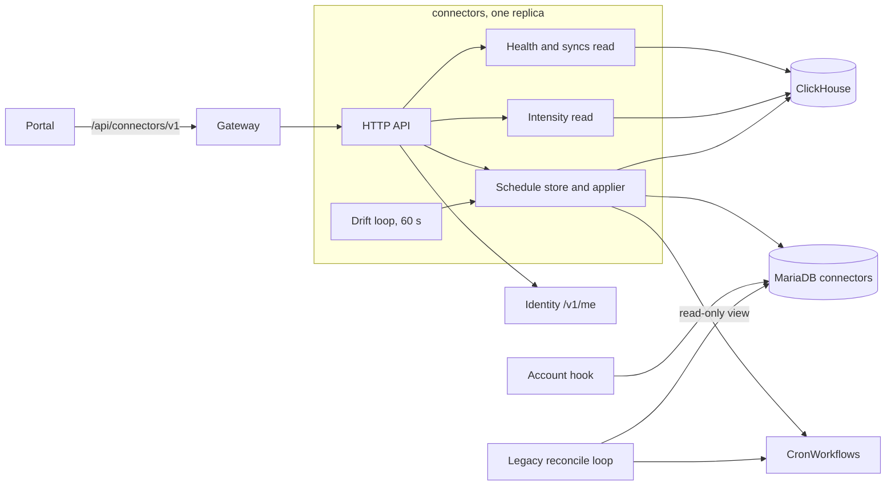

# DESIGN — Connector Management (`connectors`)


<!-- toc -->

- [1. Architecture Overview](#1-architecture-overview)
  - [1.1 Architectural Vision](#11-architectural-vision)
  - [1.2 Goals, Non-Goals and Anti-Goals](#12-goals-non-goals-and-anti-goals)
  - [1.3 Architecture Layers](#13-architecture-layers)
- [2. Principles & Constraints](#2-principles--constraints)
- [3. Technical Architecture](#3-technical-architecture)
  - [3.1 Domain Model](#31-domain-model)
  - [3.2 Component Model](#32-component-model)
  - [3.3 API Contracts](#33-api-contracts)
  - [3.4 Applying a Schedule](#34-applying-a-schedule)
  - [3.5 The Legacy Reconcile Honours Saved Schedules](#35-the-legacy-reconcile-honours-saved-schedules)
  - [3.6 Database](#36-database)
  - [3.7 Deployment Topology](#37-deployment-topology)
  - [3.8 Interactions & Sequences](#38-interactions--sequences)
- [4. Compose Stand and CI](#4-compose-stand-and-ci)
- [5. Testing Strategy](#5-testing-strategy)
- [6. Rollout and Rollback](#6-rollout-and-rollback)
- [7. Phase 2: Reconcile in Rust](#7-phase-2-reconcile-in-rust)
- [8. Additional context](#8-additional-context)

<!-- /toc -->

A new backend service, `connectors`, owned by ingestion. Version 1 does two things:

1. It takes over the connector routes from analytics — Connector health, a connector's syncs and
   ingestion intensity — with no change in behaviour: they still read ClickHouse.
2. It lets an admin change a connector instance's sync schedule from the portal. The service stores
   the request, applies it to the instance's CronWorkflow at once, reads the CronWorkflow back and
   says whether it took. The bash reconcile loop keeps owning everything else and honours saved
   schedules when it re-renders CronWorkflows.

Moving reconcile itself into the service is **Phase 2**, a separate plan made after schedules ship
(Section 7). Version 1 depends on none of it.

The read-side contract of the health page is [connector-health/DESIGN.md](connector-health/DESIGN.md)
and its PRD, which move here from `docs/components/backend/connectors/specs/connector-health/`.

## 1. Architecture Overview

### 1.1 Architectural Vision

Today analytics serves the Connector health page and ingestion intensity from ClickHouse, and the
bash reconcile loop (CronWorkflow `<release>-reconcile-loop`, every 15 minutes) renders one
CronWorkflow per connector instance with the schedule from the Secret annotation
`insight.cyberfabric.com/schedule`, else the descriptor, else `0 0 * * *`. An admin cannot change a
schedule without editing a Secret in GitOps.

The earlier attempt put schedule requests in analytics' MariaDB, had the bash loop read them through
a view, applied them with a one-minute CronWorkflow, and wrote acknowledgements back into analytics'
database. Version 1 keeps the parts of that work that were sound and changes where they live:

- the requests live in the database of a service that ingestion owns;
- that service applies a request to the CronWorkflow in the save request and reads it back, so the
  one-minute loop and the acknowledgement write disappear;
- the bash loop reads the same requests through the same kind of read-only view, now in the
  service's database, so its next render agrees with the save.

| Product decision | Consequence in version 1 |
|---|---|
| D1 a separate service, run entirely by ingestion | `src/backend/services/connectors`, gateway `/api/connectors` |
| D2 analytics keeps the minimum; the UI shows sync status and schedules from the new service | the Sources & connectors and Ingestion lenses call `/api/connectors/v1/...`; analytics loses three routes |
| D3 credentials stay in GitOps | the service needs no Secret and no Secret key an install does not already have |
| D4 the minimal service plus changing schedules | exactly that |
| D5–D7 reconcile and history move into the service | re-scoped by the product owner to Phase 2 |
| D8 everything connector-related that exists today moves | the health, syncs and intensity routes move first, unchanged |
| D9 Rust on Gears; D10 the name `connectors` | a Gears host like analytics and previews |
| Re-scope: apply-failure behaviour | a save the cluster refuses is kept, reported as `error`, and retried |

### 1.2 Goals, Non-Goals and Anti-Goals

- [ ] `p1` - **ID**: `cpt-insightspec-connectors-goals`

**Goals.**

1. The three routes move to `connectors` with identical contracts, operation ids and problem
   namespaces. The portal calls them on `/api/connectors/v1`.
2. An admin replaces or clears one connector instance's schedule from the page. The answer says what
   the live CronWorkflow runs and whether that matches the request.
3. A saved schedule survives every legacy reconcile pass and is restored within a minute if anything
   else changes it.

**Non-goals for version 1.** Reconcile in Rust, sync history in MariaDB, Grafana changes,
destructive-operation safety, dbt status, manual sync, credentials, schedule frequency policy. All
reconcile work is Phase 2.

**Anti-goals** — version 1 has failed if:

| ID | … |
|---|---|
| A1 | an upgrade fails because the chart expects a Secret or Secret key the install was never asked to create |
| A2 | the schedule API reports `applied` for a schedule the live CronWorkflow does not run |
| A3 | the service and the legacy loop keep overwriting each other's schedule |
| A4 | the service changes any CronWorkflow field other than the schedule fields, or creates or deletes a CronWorkflow |
| A5 | an outage of the service's database makes the legacy loop fall back to default schedules |
| A6 | a moved route answers differently from analytics today |

### 1.3 Architecture Layers

| Layer | Version 1 adds or changes |
|---|---|
| Portal | the two lenses repointed to `/api/connectors/v1`; the schedule pane |
| Gateway | route `/api/connectors` → `http://<release>-connectors:8088`, always rendered with the service |
| Service | Gears host: REST API and a 60-second drift loop |
| Service storage | MariaDB database `connectors`: schedule requests, applications, and the frozen view the legacy loop reads |
| Warehouse | read-only, unchanged: `ingestion_history.sync_events` and `insight.bronze_insert_events` |
| Cluster | connector CronWorkflows: read, and patch of the schedule fields only |
| Legacy reconcile | reads saved schedules through the view; renders a `deployment-schedule` annotation |

## 2. Principles & Constraints

- **Apply, then read back.** A schedule is `applied` only when the live CronWorkflow, read in the same
  request, runs it. A write that returned success is not evidence.
- **Own only the schedule.** The service patches `spec.schedules`, `spec.timezone` and the
  `insight.cyberfabric.com/schedule-origin` annotation of a CronWorkflow that already exists, and
  nothing else. Creating, rendering and deleting CronWorkflows stays with the legacy loop.
- **One precedence, evaluated by one party.** Saved > Secret annotation > descriptor > `0 0 * * *`.
  The legacy loop evaluates it when it renders; the service never re-implements the fallback — it
  reads the fallback the loop recorded on the CronWorkflow (Section 3.5).
- **No new Secret.** The service reads its MariaDB and ClickHouse passwords by `secretKeyRef` from
  `mariadb.passwordSecret` and `clickhouse.passwordSecret` (`insight-db-creds` by chart convention,
  required on every install). The read-only account the legacy loop uses is generated by a chart hook,
  which also creates the Secret that holds it; operators provide nothing.
- **Fail closed.** The admin gate is identity `GET /v1/me` (admin role id
  `a4d11000-0000-4000-8000-000000000001`); an unconfigured or unreachable identity service is a 500.
  A legacy pass that cannot read the saved schedules leaves every CronWorkflow as it is.
- **Gears and the workspace.** Rust on `cf-gears-toolkit =0.12.0`, `kube 5.0`, `sea-orm 2.0`,
  `clickhouse 0.15`, no new crate: CronWorkflows go through `kube::api::DynamicObject` and
  `Patch::Merge`. Clippy pedantic; no comments outside the repository's tagged forms.
- **Public repository.** Synthetic fixtures only (`example-tracker`); no stand data anywhere.

## 3. Technical Architecture

### 3.1 Domain Model

| Concept | Identity | Notes |
|---|---|---|
| Connector instance | `(connector, source_id)` within the install's tenant | configured when the newest sealed sweep tick in `ingestion_history.sync_events` lists it, as the health page reads it |
| Instance CronWorkflow | `<connector>-<label>-<tenant8>-sync` | `label` is the source id without a leading `<connector>-`; `tenant8` the first 8 characters of the tenant with trailing `-`/`.` stripped; verified by its labels (`insight.cyberfabric.com/connector`, `insight.cyberfabric.com/tenant`, `app.kubernetes.io/component: connector-sync`) and its `insight_source_id` parameter |
| Schedule request | `(connector, source_id)`, a revision | 1–10 five-field UTC crons; a cleared request is a tombstone (empty list) that keeps the revision counting |
| Deployment schedule | rendered by the legacy loop | the annotation > descriptor > default fallback, recorded on every CronWorkflow it renders as annotation `insight.cyberfabric.com/deployment-schedule` |
| Application | `(connector, source_id)` | the service's last observation of the CronWorkflow and its last attempt |

**Schedule status**, computed from the request, the live CronWorkflow and the last attempt:

| Status | When |
|---|---|
| `applied` | a request with crons, and the live CronWorkflow runs exactly those crons, `timezone: UTC`, origin `api` |
| `inherited` | no request or a tombstone, and the live CronWorkflow's origin is `annotation`, `descriptor` or `default` |
| `error` | the last attempt at the current revision failed and the live object does not match the request; carries the attempt's fixed message |
| `pending` | anything else, with `pending_reason`: `no_cronworkflow` (none exists yet; the legacy loop creates it with the saved schedule), `awaiting_reconcile` (the CronWorkflow was rendered by a loop that does not read saved schedules yet, or a tombstone has no recorded deployment schedule to restore), `applying` |

The four values the pane already knows (`applied`, `inherited`, `error`, `pending`) are unchanged;
`pending_reason` is new.

### 3.2 Component Model



| Component | Responsibility |
|---|---|
| Health and syncs read | `domain/connector_health/` moved from analytics as is: ClickHouse ledger, attention order, caps |
| Intensity read | `api/ingestion.rs` moved as is: `insight.bronze_insert_events`, 4-permit semaphore, per-query limits `with_query_max_threads(4)`, `with_query_max_memory_bytes(1_610_612_736)` |
| Schedule store and applier | validation, revisions and DTOs from the store branch; the save sequence of Section 3.4 |
| Drift loop | a `stateful` Gears capability task: every 60 seconds, compares each saved request with its live CronWorkflow and re-applies on drift |
| Account hook | a chart hook that creates the read-only account for the legacy loop and its Secret (Section 3.5) |

### 3.3 API Contracts

The service serves `/v1/*`; the gateway strips `/api/connectors`. Every route requires a gateway JWT
(401 from the host) and the admin role (403), and answers errors as `application/problem+json`.

| Method | Path | Operation id |
|---|---|---|
| GET | `/v1/connector-health` | `analytics_api.connector_health.summary` |
| GET | `/v1/connector-health/{connector}/syncs` | `analytics_api.connector_health.syncs` |
| GET | `/v1/ingestion/intensity` | `analytics_api.ingestion.intensity` |
| GET, PUT, DELETE | `/v1/connectors/{connector}/{source_id}/schedule` | `connectors_api.schedules.get` / `.put` / `.delete` |

**Moved routes.** Paths, parameters, bodies, status codes, caps, operation ids and problem
namespaces (`gts.cf.insight.analytics_api.connector_health.v1~`,
`gts.cf.insight.analytics_api.ingestion.v1~`) are exactly analytics' today. Two additions arrive with
schedules: `schedule.origin` accepts `api`, and each `ConnectorHealth` row gains a nullable
`schedule_request {revision, crons, last_observation: {status, observed_at}}` read from the service's
own database. The summary never calls the cluster (connector-health FR-11); its schedule status is
dated by `observed_at`, at most about a minute old, and the pane reads the live state when opened.

**Schedule routes.** The path keeps the store branch's `/v1/connectors/{connector}/{source_id}/schedule`
so the editor's client and mocks change only their base URL.

- `GET` → 200 `ScheduleResponse`, `ETag: "<revision>"`.
- `PUT` — `If-Match: "<revision>"` (one quoted decimal; `"0"` before the first save),
  `Content-Type: application/json`, body `{"crons": [...]}` (`deny_unknown_fields`, 1–10 items) →
  200 with the new `ETag`.
- `DELETE` — `If-Match` — writes a tombstone → 200.

```json
{
  "connector": "example-tracker",
  "source_id": "main",
  "revision": 3,
  "requested": {"crons": ["0 6 * * 1-5"], "updated_by": "00000000-0000-4000-8000-000000000001", "updated_at": "2026-01-15T09:12:00.000Z"},
  "live": {"crons": ["0 6 * * 1-5"], "timezone": "UTC", "origin": "api", "suspended": false, "observed_at": "2026-01-15T09:12:01.204Z"},
  "inherited": {"crons": ["0 4 * * *"], "origin": "descriptor"},
  "status": "applied",
  "pending_reason": null,
  "error": null
}
```

`live` is the CronWorkflow read in this request (null when none exists); `inherited` is its
`deployment-schedule` annotation (null when absent); `error` is `{attempted_revision, attempted_at,
message}` for a failed attempt at the current revision.

**Order of checks** on `PUT` and `DELETE`: admin (403) → body and cron validation (400, with
`crons[i]` field names; robfig-compatible five-field subset from the store branch's
`validation.rs`; no `@` descriptors, `TZ=`, L/W/#, seconds or never-firing calendars; a `timezone`
field refused) → `Content-Type` (415) → `If-Match` present (428) → the instance is configured, or for
`DELETE` has a stored request (404) → instance lock (503 when busy for 10 seconds) → revision (412
with the current `ETag`; 409 when the counter is exhausted) → write → apply (Section 3.4) → answer.

| Status | When |
|---|---|
| 400 / 415 / 428 | as above |
| 403 | not an admin |
| 404 | unconfigured instance; for `GET`/`DELETE`, neither configured nor stored |
| 409 | revision counter exhausted |
| 412 | stale `If-Match`; carries the current `ETag` and `context.revision` |
| 500 | identity unconfigured or unreachable |
| 503 | the database is unavailable, the instance lock is busy, or (`GET` only) the cluster cannot be read |

A refused apply never changes the status code: the save stands and the body says `error`.

### 3.4 Applying a Schedule

- [ ] `p1` - **ID**: `cpt-insightspec-connectors-seq-apply`

The save sequence, all under the instance lock (MariaDB `GET_LOCK`, name scoped to the install's
database, held on one pinned connection):

1. Compare `If-Match` with the stored revision; write the request, or the tombstone. An identical
   normalised list keeps the revision.
2. **Re-read** the stored request and the instance's identity: compute its CronWorkflow name, read the
   live object, and check its labels and `insight_source_id` parameter (the trigger branch's
   `identity_matches` rules).
3. Decide what to write:
   - a request with crons → those crons, `timezone: UTC`, origin `api`;
   - a tombstone → the crons and origin of the CronWorkflow's `deployment-schedule` annotation;
   - nothing when no CronWorkflow exists (`pending`, `no_cronworkflow`), when it lacks the
     `deployment-schedule` annotation (`pending`, `awaiting_reconcile`: the loop that rendered it does
     not read saved schedules, so a patch would be undone at its next pass), or when it already
     matches.
4. Patch with a JSON merge patch carrying `metadata.uid` and `metadata.resourceVersion` as read in
   step 2, plus `spec.schedules`, `spec.timezone` and the origin annotation. The API server refuses
   the patch if the object changed or was replaced since the read; this is the same guard as the
   trigger branch's JSON-patch `test` operations, without the kube `jsonpatch` feature. A conflict is
   retried once from step 2.
5. Read the CronWorkflow back and record the observation; record the attempt — success clears the
   error, a failure stores a fixed message (`the cluster refused the schedule`,
   `the CronWorkflow could not be read back`, `read back a different schedule`; never the API
   server's text). An attempt is recorded only if its revision is at least the stored one.
6. Release the lock; answer with the status computed from the read-back.

**Why a tombstone restores from the annotation.** The fallback is annotation > descriptor > default,
evaluated by the legacy loop. The service could evaluate it itself, but that would need the
descriptor tree in its image, read access to connector Secrets and a second implementation of a rule
the loop already applies — two evaluators that can disagree. Leaving the clear to the next legacy
pass is simpler still, but makes the admin wait up to a pass interval. Having the loop record its own
evaluation on the CronWorkflow (`deployment-schedule`) gives the service the loop's answer at no
extra cost, makes a clear take effect immediately, and gives the pane its "deployment schedule" line.
The recorded value can be one pass old if a Secret annotation changed since; the next legacy pass
renders the current one, because the tombstone means "no saved schedule".

**The drift loop.** Every 60 seconds the service lists CronWorkflows labelled
`app.kubernetes.io/component=connector-sync` once, and for each stored request (tombstones included)
whose instance is configured, compares the live schedule fields with what step 3 would write. On a
difference it runs steps 2–5 under the instance lock. It also refreshes every observation, which is
what the health summary's `last_observation` reads. Failed attempts are retried here, so a save the
cluster refused becomes `applied` within a minute of the cluster accepting it.

**The race it covers.** The legacy loop reads saved schedules once at the start of its pass and
renders CronWorkflows minutes later. A save in between is overwritten by that pass with the older
schedule; the drift loop restores it within 60 seconds, and the loop's next pass reads the new
request. A pass that sees the saved schedule renders exactly what the service wrote, so steady state
is quiet.

### 3.5 The Legacy Reconcile Honours Saved Schedules

- [ ] `p1` - **ID**: `cpt-insightspec-connectors-legacy-reader`

The reconcile branch's work, retargeted from analytics' database to `connectors` and without the
acknowledgement write:

- **Reader.** `python/read_connector_schedules.py` (PyMySQL, pinned in
  `src/ingestion/scripts/bootstrap-db/pins.env` and installed by hash in the toolbox) reads
  `connector_schedule_requests_v1` once per pass, bounded (10,000 rows, 4 MiB, 10-second statement
  time). `lib/connector-schedules.sh` exposes the lookup; an empty list is a tombstone and falls
  through to the deployment schedule.
- **Precedence.** `reconcile_resolve_schedule` returns saved (`api`) > annotation > descriptor >
  default, and `reconcile_resolve_deployment_schedule` the last three. A failed read of the Secret or
  descriptor never falls through to a default.
- **Fail closed (A5).** When the view cannot be read, the pass leaves every CronWorkflow's apply out
  and counts one failure; running CronWorkflows keep their schedules. New instances get their
  CronWorkflow on the next pass that reads the view.
- **Deployment schedule annotation.** `render_cronworkflow.py` and `cron-workflow.yaml.tpl` gain
  `insight.cyberfabric.com/deployment-schedule`, a JSON string `{"origin": …, "crons": […]}` rendered
  as a quoted YAML scalar, on every CronWorkflow. It doubles as the signal that the renderer reads
  saved schedules (Section 3.4 step 3).
- **Read-only account.** `charts/insight/templates/connector-schedules-account-job.yaml`
  (pre-install/pre-upgrade hook Job at weight 15, after the service's migrate hook at 10, with its own
  ServiceAccount and Role) runs `provision_schedule_secret.py` from the toolbox image as MariaDB root
  (`insight-db-creds` key `mariadb-root-password`, which the svcdbs hook already uses). It reads the
  Secret `insight-schedule-db` or, when absent, generates a password and creates it; then creates or
  updates user `insight_schedule` with a role holding exactly `SELECT ON connectors.connector_schedule_requests_v1`.
  The reconcile CronWorkflow gets `CONNECTOR_SCHEDULES_DB_*` from that Secret and the chart.
- **Only with the ingestion templates.** The hook and the env are rendered only with
  `ingestion.templates.enabled`; without the env the loop reads no schedules and behaves as today.
- **Dropped from the branch.** `acknowledge_connector_schedule.py`, `read_schedule_cronworkflow.py`,
  the acknowledgement grant, `test_schedule_acknowledgements.py`, the `schedule-db-password` key in
  `insight-db-creds` and the `compose-app-secrets.sh` / `insight-init.sh` changes (the hook generates
  the credential), the unrelated `service_token.rs` change, everything in analytics.

### 3.6 Database

Database `connectors` on the install's MariaDB, always created by `mariadb-init-svcdbs-job.yaml`. One migration, `m2026MMDD_000001_connector_schedules`, arriving with the schedule API:

| Object | Columns | Writer |
|---|---|---|
| table `connector_schedules` | `connector`, `source_id` (PK, ascii), `crons JSON` (CHECK array; empty = tombstone), `revision BIGINT UNSIGNED` (CHECK ≥ 1), `updated_by BINARY(16)`, `updated_at DATETIME(3)` | the API |
| view `connector_schedule_requests_v1` | `connector`, `source_id`, `revision`, `crons`; `SQL SECURITY DEFINER` | — (read by the legacy loop) |
| table `connector_schedule_applications` | `connector`, `source_id` (PK); `observed_crons JSON NULL`, `observed_timezone`, `observed_origin`, `observed_suspended`, `observed_at`; `attempted_revision`, `attempted_at`, `last_error VARCHAR(512) NULL` | the API and the drift loop |

The view is a frozen contract: a change ships as `connector_schedule_requests_v2` beside it. Rows
of instances unconfigured for six months are removed by the drift loop once a day.

### 3.7 Deployment Topology

| Aspect | Value |
|---|---|
| Image | `src/backend/Dockerfile` targets `build-connectors` / `connectors`; binary `/app/connectors`; port 8088 |
| Chart | subchart `src/backend/services/connectors/helm` (`insight-connectors`); umbrella dependency alias `connectors`, always deployed |
| Gateway | route `/api/connectors` with `stripPrefix: true`, `timeoutMs: 135000` (as `/api/analytics`, for intensity), always rendered with the service; the compose table has the same route |
| Replicas | exactly 1 (the render fails otherwise), `strategy: Recreate`; capabilities `[rest, stateful]` |
| Database and passwords | host, port, user and names from `mariadb.*`, `clickhouse.*`, `connectors.databaseName` into the ConfigMap; passwords by `secretKeyRef` from `mariadb.passwordSecret` and `clickhouse.passwordSecret`; the migrate hook (weight 10) uses the same env; nothing added to `templates/secrets.yaml` or `compose-app-secrets.sh` |
| RBAC | Role `<release>-connectors`: `argoproj.io` `cronworkflows` `get`, `list`, `watch`, `patch`. No Secrets, no Workflows, no create or delete |
| Probes | `/health`; the gear reports degraded when the drift loop has not completed in five minutes |

Configuration keys (`APP__gears__connectors__config__…`): `database_host`, `database_port`,
`database_user`, `database_name`, `database_password` (or `database_url` in compose);
`clickhouse_url`, `clickhouse_database`, `clickhouse_user`, `clickhouse_password`; `identity_url`;
`tenant_id` (`ingestion.reconcile.tenantId`); `namespace`; `cluster__enabled` (false in compose);
`drift__interval_secs` (60).

### 3.8 Interactions & Sequences

```mermaid
sequenceDiagram
    participant P as Portal
    participant S as connectors
    participant D as MariaDB
    participant K as Kubernetes
    participant L as Legacy loop

    P->>S: PUT schedule (If-Match "2")
    S->>D: lock; revision 2 → 3; re-read
    S->>K: get CronWorkflow; merge patch (uid, resourceVersion); read back
    S->>D: record; unlock
    S-->>P: 200 applied
    L->>D: read view (revision 3)
    L->>K: kubectl apply, origin api, same crons — no change
    Note over S,K: had L read before the save, it renders the old crons;<br/>the drift loop restores within 60 s
```

## 4. Compose Stand and CI

**Compose** runs the service (the Manage lenses and the stand suite need it) with
`cluster.enabled: false`: `connectors-migrate` and `connectors` in `docker-compose.yml`,
`deploy/compose/connectors-fullauth.yaml`, the database in `deploy/compose/mariadb-init.sql` and,
for existing volumes, in `dev-compose.sh`, the gateway route, `CONNECTORS_PORT`/`CONNECTORS_IMAGE` in
`.env.compose.example`. A save in compose is stored and answered `error` with the fixed message
`schedules cannot be applied: this install has no cluster connection`. The store branch's fixture
`tests/stand/fixtures/connector-schedules.sql` (configured instances in `ingestion_history`) is
loaded by `dev-compose.sh` so the routes have instances to address.

**Stand tests.** `tests/stand/api/connectors/test_connector_health.py` and `test_ingestion.py`
(moved from analytics, unchanged assertions); `test_schedules.py` (the store branch's, retargeted:
403, each 400 class, 415, 428, 404, `GET` shape and `ETag`, `PUT` → 200 `error` with revision + 1,
412 with the current `ETag`, identical body keeps the revision, `DELETE` tombstone);
`tests/stand/api/operations.py` rows for the 401 sweep; `tests/lib/insight_stand/api.py`
(`CONNECTORS_PREFIX`); `tests/generate_schemas.py` target; `tests/lib/insight_stand/coverage.py`
reading the connectors spec too.

**CI registrations.** `src/backend/Cargo.toml` member; `scripts/ci/components.py` entry
(`live_db`, `live_ch`, `cover: False`, `drift_test`, paths including its `openapi.json`); the logging
bar's two test files; `GEARS_SERVICES` in the identity-resolution helm test;
`.github/workflows/build-images.yml` jobs and their `needs`, `release-helm.yml`,
`.github/workflows/scripts/bump-service-appversions.sh`, `ghcr-cleanup.yml`, `trivy-images.yml`,
`gateway.yml` add-hosts, `e2e-stand.yml` and `scripts/ci/prebuilt_images.py`, `insight-helm.yml`
pytest list. The reconcile branch's CI job (MariaDB + PyMySQL live tests) stays.

**Guards.** OpenAPI drift; the rendered chart references no Secret beyond those the umbrella already
requires plus the hook-created `insight-schedule-db`; one replica with `Recreate`; the service, route and database always render; the service Role has no verb beyond `get`, `list`, `watch`, `patch` on
CronWorkflows (A4).

## 5. Testing Strategy

Every new test is shown failing against a deliberately broken implementation first.

| Level | Covers |
|---|---|
| Unit (Rust) | validation (store branch, as is), revisions, status (every row of the table), CronWorkflow naming against cases taken from `argo.sh`, identity match, the patch body, tombstone restore from the annotation, the drift decision |
| Handler tests | the router over a loopback Kubernetes stub: applied; refused (403, 422, 500) → `error` and kept; conflict retried; missing CronWorkflow → `pending`; annotation absent → `pending` without a write; read-back mismatch; two saves acquiring the lock in reverse order (the older never wins); the drift loop restoring a reverted schedule |
| Live MariaDB | the migration whole; the store branch's revision, no-op, removal and storage suites; the view's columns; the lock across connections |
| Live ClickHouse | the moved health and intensity suites; the membership read |
| Bash / Python | the reconcile branch's `test_connector_schedule_runs.py` (precedence, failure isolation, dry-run origin), `test_connector_schedule_client.py`, `test_schedule_account.py` (live grant test: the account can `SELECT` the view and nothing else), `test_schedule_secret.py`, `test_schedule_pass_interleavings.py` minus the acknowledgement cases; new: the `deployment-schedule` annotation renders as valid YAML for every origin; a failed view read changes no CronWorkflow |
| Frontend | the editor branch's suites, repointed |
| Stand | Section 4 |

**End to end on a local Kubernetes stand** (single node, for example OrbStack, with the harness's mock
source, mock connector and Airbyte fault proxy):

| # | Scenario | Pass when |
|---|---|---|
| E1 | save `*/5 * * * *` for a mock instance in the UI | the pane says `applied`; the CronWorkflow shows it with origin `api` within a minute |
| E2 | run a legacy reconcile pass | the schedule stays; the CronWorkflow carries the `deployment-schedule` annotation |
| E3 | save while a legacy pass is held mid-pass at a proxy barrier, then release it | the pass renders the old schedule; within 60 s the service restores the new one; `applied` |
| E4 | clear the schedule | `inherited` immediately; the descriptor's schedule with origin `descriptor` |
| E5 | remove `patch` from the service Role, save, restore the Role | `error` with the fixed message, the save kept; `applied` within a minute of the restore |
| E6 | let the `*/5` schedule fire | a Workflow runs `ingestion-pipeline`; the Airbyte job succeeds; after the next sweep the health row shows it `succeeded` |
| E7 | inject a failure through the proxy: rewrite the job's `status` to `failed` in `GET /api/public/v1/jobs`; separately `auth_reject` on the mock source | the next sweep records `failed`; the row sorts first and shows it |
| E8 | make the view unreadable (revoke the account's grant), run a legacy pass | no CronWorkflow changes; the pass counts one failure |

## 6. Rollout and Rollback

- The service release changes nothing for the legacy loop. Schedules can be saved as soon as the
  schedule API is released; until the loop that reads the view is released, live CronWorkflows lack
  the `deployment-schedule` annotation, so the service writes nothing and saves stay `pending`
  (`awaiting_reconcile`). The first pass of the new loop renders saved schedules itself.
- Rolling the loop back (an older toolbox) brings CronWorkflows without the annotation on its next
  pass; the service then stops writing, and nothing fights. Saved schedules stay stored.
- Rolling the whole chart back past the schedule API leaves CronWorkflows on their saved schedules
  until the loop's next pass renders the deployment schedule.
- Image rollback within a release needs nothing: the migration is additive, and an older image starts
  over a newer schema.

## 7. Phase 2: Reconcile in Rust

- [ ] `p2` - **ID**: `cpt-insightspec-connectors-phase2`

A separate plan, made after schedules ship. The product owner's decisions for it:

| | Decision |
|---|---|
| (a) | Orphan GC is report-only, and the orphan's CronWorkflow is suspended automatically; deletion only through `connectors reconcile --gc-delete` |
| (b) | Decided in version 1: a refused save is kept with status `error` and retried |
| (c) | Sync history moves to MariaDB through a ClickHouse import plus a delta at every handoff |
| (d) | Grafana reads the service's MariaDB through a MySQL datasource, with a read-only user created by a chart hook |
| (e) | Before an install switches reconcile owner, a shadow dry run there shows an empty plan for 24 hours |

Material carried from the earlier draft, to be re-checked against main when Phase 2 starts:

- **Parity contract.** Port first; only safety fixes in the port (reads that become creates,
  credential-rotation order, backups before every destructive path, GC safety); every other
  difference deferred and listed. A parity oracle — a fake Airbyte and Kubernetes driving today's bash
  and the Rust port, comparing normalised requests and end state — exists before any port code. YAML
  loading matches PyYAML (merge keys resolved depth-first; scalars compared over every shipped
  manifest). cfg-hash matches Python's `json.dumps` defaults, including `ensure_ascii`.
- **Destructive operations.** Every delete of a source, connection or definition is a persisted phase
  machine: quiesce the CronWorkflow and running jobs, export state to MariaDB, delete, create the
  replacement inactive, restore and verify, activate; resumable after a crash or a lost response.
- **Owner switch and handoff.** `connectors.reconcile.owner` (`legacy`, `none`, `service`), changed
  only through a drained handoff run by a pre-install/pre-upgrade/pre-rollback hook that suspends the
  legacy loop and waits for its runs (manual submissions included); two steps to hand back; one
  replica with `Recreate`; live passes run only by the service's loop; install-scoped locks.
- **History.** Shadow writing, a verified import, a read switch gated on it, deltas at each handoff.
- **What version 1 leaves in place for it.** Saved schedules, their view and the precedence rule carry
  over unchanged; Phase 2 replaces the bash reader with the service's own renderer and retires the
  account hook.

## 8. Additional context

**Builder's calls in version 1** (change nothing anyone relies on): the drift loop also refreshes
observations for the health summary; the merge patch with `uid` and `resourceVersion` instead of a
JSON patch with `test` operations; the `deployment-schedule` annotation as both the restore source
and the "loop reads saved schedules" signal; compose answers a save with `error` rather than refusing
it; the summary's dated `last_observation`.

**Review findings that still apply to version 1** and where they are handled: no new Secret (§2,
§3.7); one replica with `Recreate` (§3.7); lock first, then re-read request and identity, before
rendering (§3.4); status from the live CronWorkflow only (§3.1); separate paths are moot (no
descriptions are mounted); the remaining findings concern the reconcile port and are carried into
Phase 2 (§7).

**Not built in version 1.** Reconcile in Rust and everything in Section 7; dbt status; manual sync;
credentials; schedule frequency policy.
