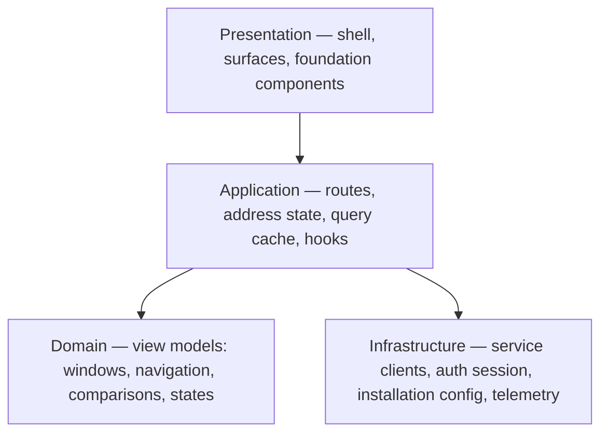
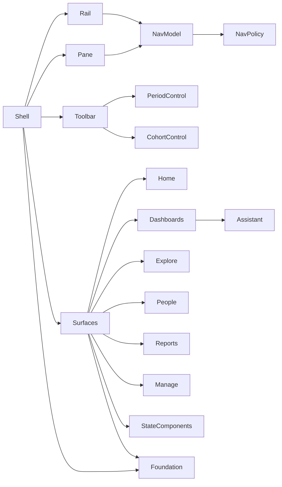
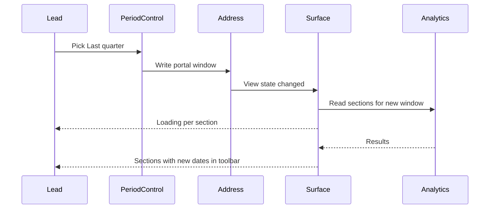
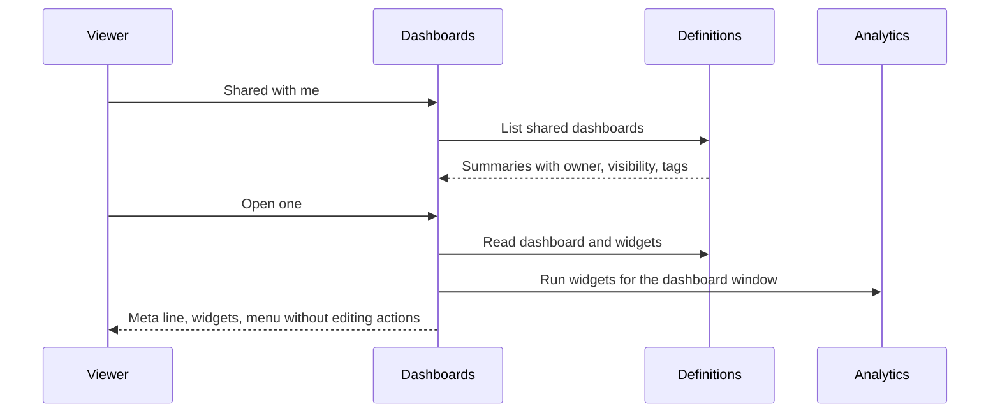
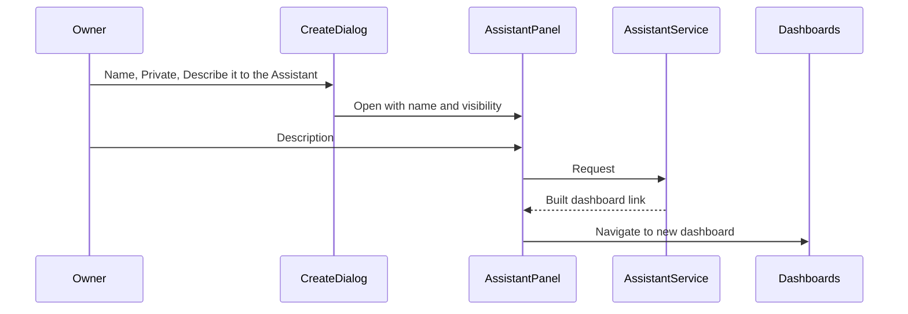

# Technical Design — Insight Portal User Interface

- [ ] `p3` - **ID**: `cpt-insightspec-portal-design-ui`

<!-- toc -->

- [1. Architecture Overview](#1-architecture-overview)
  - [1.1 Architectural Vision](#11-architectural-vision)
  - [1.2 Architecture Drivers](#12-architecture-drivers)
  - [1.3 Architecture Layers](#13-architecture-layers)
- [2. Principles & Constraints](#2-principles--constraints)
  - [2.1 Design Principles](#21-design-principles)
  - [2.2 Constraints](#22-constraints)
- [3. Technical Architecture](#3-technical-architecture)
  - [3.1 Domain Model](#31-domain-model)
  - [3.2 Component Model](#32-component-model)
  - [3.3 API Contracts](#33-api-contracts)
  - [3.4 Internal Dependencies](#34-internal-dependencies)
  - [3.5 External Dependencies](#35-external-dependencies)
  - [3.6 Interactions & Sequences](#36-interactions--sequences)
  - [3.7 Database schemas & tables](#37-database-schemas--tables)
  - [3.8 Deployment Topology](#38-deployment-topology)
- [4. Additional context](#4-additional-context)
  - [4.1 Visual Source](#41-visual-source)
  - [4.2 Colour Tokens](#42-colour-tokens)
  - [4.3 Type Roles](#43-type-roles)
  - [4.4 Scale and Shell Grid](#44-scale-and-shell-grid)
  - [4.5 Shared Components](#45-shared-components)
  - [4.6 Cross-Cutting Concerns](#46-cross-cutting-concerns)
- [5. Traceability](#5-traceability)

<!-- /toc -->

## 1. Architecture Overview

### 1.1 Architectural Vision

The portal is a single-page application whose every view is named by its address. The address is the only source of truth for what is on screen — rail destination, pane item, reporting window, org scope, cohort, folder and tag filters — so a view can be bookmarked, shared and restored, and two parts of the screen can never disagree about the window or scope they show. Browser storage holds only per-person preferences: theme, whether planned surfaces are shown, focus mode, explanations, the Assistant's collapsed state, presentation choices, and the last-used portal window — which is read only when an address carries no window, and is then written into the address, so an address always fully determines its view.

The services enforce reach and compute every figure. The portal turns service responses into view models with pure functions — window labelling, navigation filtering, comparisons, state classification — and draws them with one component library and one token set. Hiding a destination the viewer may not use is a courtesy over the services' refusal, never the control.

The visual layer is one foundation: semantic colour tokens defined once for light and dark, seven type roles, a small spacing and radius scale, Lucide icons, and components taken from the FrontX kit where it has them. The shell fixes a rail, a pane, a pinned toolbar and, on Dashboards surfaces, an Assistant column; every surface renders inside that shell.

### 1.2 Architecture Drivers

**ADRs**: `cpt-insightspec-portal-adr-one-period-control`

#### Functional Drivers

| Requirement | Design Response |
|-------------|------------------|
| `cpt-insightspec-portal-fr-rail` | Rail model derives destinations from the zones the viewer may reach and the installation policy; planned destinations use the rail item's planned state. |
| `cpt-insightspec-portal-fr-pane` | One pane component renders titled groups of pane items from a navigation model per rail destination; counts render as a count badge. |
| `cpt-insightspec-portal-fr-narrow-screens` | Shell layout tiers switch the pane between in-flow, off-canvas and a drawer holding both navigation levels; a leaf pick dismisses the drawer. |
| `cpt-insightspec-portal-fr-period-control` | One period control component with a preset list resolved by the services; used on every surface that shows period figures. |
| `cpt-insightspec-portal-fr-period-scope` | Portal window and dashboard window are separate address parameters read by separate hooks; both feed the same control. |
| `cpt-insightspec-portal-fr-cohort` | Toolbar renders the cohort control beside the period control on comparison surfaces, writing the cohort to the address; a help tooltip states what it controls; disabled with its reason when only one cohort exists. |
| `cpt-insightspec-portal-fr-org-scope` | Scope lives in the address and is written by the work chart and the person page's Team action; scoped views render their scope label. |
| `cpt-insightspec-portal-fr-browse` | Browse selection lives in the address; the pane group and the chip row both read and write it. |
| `cpt-insightspec-portal-fr-share` | Share dialog driven by the sharing service's grant model and the dashboard's may-share flag. |
| `cpt-insightspec-portal-fr-states` | State components classify each section's read into loading, empty, not connected, refused and failed, each with its own presentation. |
| `cpt-insightspec-portal-fr-planned` | Navigation policy and the per-person "show planned" preference filter every navigation model; planned is never a default item. |
| `cpt-insightspec-portal-fr-a11y` | Shell supplies a skip link and current-destination semantics; components come from an accessible kit; state components announce. |
| `cpt-insightspec-portal-fr-period-semantics` | Presets are tokens resolved by the services; the period control labels each preset with dates from one shared resolution rule kept in step with the services by a contract test. |
| `cpt-insightspec-portal-fr-session` | Shell shows a session-ended notice when refresh fails, then starts sign-in; the sign-in error page covers denied and retryable failures. |
| `cpt-insightspec-portal-fr-not-found` | A catch-all route and unknown-item resolution render the not-found state component instead of redirecting. |
| `cpt-insightspec-portal-fr-view-as` | Shell renders the view-as banner with an exit and the demonstration-data banner above the toolbar. |
| `cpt-insightspec-portal-fr-dashboards-access`, `cpt-insightspec-portal-fr-open-dashboard`, `cpt-insightspec-portal-fr-create-dashboard`, `cpt-insightspec-portal-fr-widgets`, `cpt-insightspec-portal-fr-orphaned` | Dashboards surface renders actions from the definition and sharing services' per-dashboard permissions; member reads go through the dashboard-scoped widget routes with no drill-down. |
| `cpt-insightspec-portal-fr-lenses`, `cpt-insightspec-portal-fr-evidence`, `cpt-insightspec-portal-fr-ai-cost` | Explore surface's lens renderers and evidence dialog; follow-backs and cost render only where the analytics service returns them for the viewer's grants. |
| `cpt-insightspec-portal-fr-person`, `cpt-insightspec-portal-fr-team` | People surface; the members grid opens sorted by name. |
| `cpt-insightspec-portal-fr-manage`, `cpt-insightspec-portal-fr-ingestion-health`, `cpt-insightspec-portal-fr-identities` | Manage surface; default item resolution skips placeholders. |
| `cpt-insightspec-portal-fr-destructive` | Confirm dialog with destructive styling for deletion; widening warnings in the share and move-to-folder flows. |

#### NFR Allocation

| NFR ID | NFR Summary | Allocated To | Design Response | Verification Approach |
|--------|-------------|--------------|-----------------|----------------------|
| `cpt-insightspec-portal-nfr-honest-states` | Failed or refused never renders as empty or zero | State components; view-model functions | Every section read is classified before rendering; a missing reading maps to "not tracked", never to zero | Component tests per state; fault-injected stand journeys |
| `cpt-insightspec-portal-nfr-reach` | Nothing drawn outside the viewer's reach | Service clients; view models | Views render only service responses; refusals render the refusal; navigation hiding is cosmetic | Stand API and UI suites per persona |
| `cpt-insightspec-portal-nfr-bounded-requests` | Requests per list page constant in item count | List surfaces; service clients | List responses carry each card's display fields; cards never fetch individually | Network assertions in component tests |
| `cpt-insightspec-portal-nfr-feedback-latency` | Loading state within 200 ms | Router pending state; state components | Router pending view and per-section spinners appear on any unresolved read | UI journey timing checks |
| `cpt-insightspec-portal-nfr-accessibility` | WCAG 2.2 AA in both themes | Foundation tokens; kit components; shell | Kit components carry roles and names; shell adds skip link and current markers; token pairs that fall short of AA are listed in §4.2 as an open design decision | Automated accessibility scan per surface and theme; keyboard walkthrough |
| `cpt-insightspec-portal-nfr-exports` | Exports carry only what is shown | Evidence dialog; report builder | Export writes the rows already returned to the screen; each export records a usage event naming the surface | Component tests comparing exported rows with rendered rows |
| `cpt-insightspec-portal-nfr-screen-widths` | Usable from 360 px with no page scroll | Shell layout tiers; tables and charts | Phone tier drawer; toolbar scrolls sideways; wide content scrolls in its own frame | Viewport tests at 360, 768 and 1440 px |
| `cpt-insightspec-portal-nfr-installation-policy` | Hide or plan any surface by configuration | Navigation policy | Policy paths per zone, item, direction, lens, section and metric, applied to every navigation model | Policy unit tests; configured stand check |

### 1.3 Architecture Layers

- [ ] `p3` - **ID**: `cpt-insightspec-portal-tech-stack`

| Layer | Responsibility | Technology |
|-------|---------------|------------|
| Presentation | Shell, surfaces, foundation components, charts, themes | React, Tailwind CSS, FrontX UI kit, Base UI primitives, Recharts, Lucide icons, Inter |
| Application | Routing, address state, data fetching and caching, per-person preferences | TanStack Router, TanStack Query, browser storage |
| Domain | Window labelling, navigation filtering, comparisons, state classification | TypeScript pure functions |
| Infrastructure | Service clients, session refresh, installation configuration, usage telemetry, error reporting | Fetch-based clients, runtime configuration script, Sentry |

## 2. Principles & Constraints

### 2.1 Design Principles

#### The Address Is the State

- [ ] `p1` - **ID**: `cpt-insightspec-portal-principle-address-state`

Everything that decides what a view shows is an address parameter; browser storage holds only preferences that do not change what a shared address shows. Components read view state from the address and write it through navigation actions.

**ADRs**: `cpt-insightspec-portal-adr-one-period-control`

#### Services Decide Reach

- [ ] `p1` - **ID**: `cpt-insightspec-portal-principle-services-decide`

The portal renders what the services return for the signed-in person and shows their refusals; it never filters a broader response down and never infers that data does not exist from its absence.

#### One Foundation

- [ ] `p2` - **ID**: `cpt-insightspec-portal-principle-one-foundation`

Colour, type, spacing and radius come only from the foundation tokens and type roles in §4; a component that needs a new value adds a token, never a literal.

#### Kit First

- [ ] `p2` - **ID**: `cpt-insightspec-portal-principle-kit-first`

A control the FrontX kit provides is used from the kit through a local wrapper; a local component exists only where the kit has none.

#### Classify Before Drawing

- [ ] `p1` - **ID**: `cpt-insightspec-portal-principle-classify-states`

Every independently loaded section classifies its read — loading, empty, not connected, refused, failed — before drawing, and each class has exactly one presentation across the portal.

#### Planned Is Policy

- [ ] `p2` - **ID**: `cpt-insightspec-portal-principle-planned-policy`

Whether a surface is hidden, planned or live is decided by the navigation policy and a surface's built state, never by a branch in a view.

### 2.2 Constraints

#### FrontX Kit

- [ ] `p2` - **ID**: `cpt-insightspec-portal-constraint-kit`

The portal builds on the FrontX UI kit and its theme; foundation tokens layer over the kit's theme and must not fork its components.

#### UTC Days

- [ ] `p1` - **ID**: `cpt-insightspec-portal-constraint-utc`

The services bucket every day at UTC midnight; the portal resolves and labels every window in UTC.

#### Public Repository

- [ ] `p1` - **ID**: `cpt-insightspec-portal-constraint-public`

The portal's source, fixtures, stories and screenshots are public; every example name, figure and person in them is synthetic.

#### Configuration at Load

- [ ] `p2` - **ID**: `cpt-insightspec-portal-constraint-config-load`

Installation configuration arrives once when the portal loads; a policy change takes effect on the next load.

## 3. Technical Architecture

### 3.1 Domain Model

**Technology**: TypeScript types

**Location**: [src/frontend/src/types](../../../../src/frontend/src/types), [src/frontend/src/lib/portal](../../../../src/frontend/src/lib/portal)

**Core Entities**:

| Entity | Description | Schema |
|--------|-------------|--------|
| ViewState | The address parameters of the current view: rail destination, pane item, direction, lens, repository, scope, cohort, folder, tags, window | [portal-search.ts](../../../../src/frontend/src/lib/portal/portal-search.ts) |
| ReportingWindow | A preset token or a custom from–to pair, resolved to UTC dates | [period-to-date-range.ts](../../../../src/frontend/src/api/period-to-date-range.ts), [time-range.ts](../../../../src/frontend/src/lib/custom/time-range.ts) |
| RailItem | A top-level destination with its zones and planned state | [rail-model.ts](../../../../src/frontend/src/lib/portal/rail-model.ts) |
| PaneGroup, PaneItem | A titled group of pane destinations with icon, count, badge, readiness, gates | [nav-model.ts](../../../../src/frontend/src/lib/portal/nav-model.ts) |
| NavPolicy | Installation paths hidden or planned | [nav-policy.ts](../../../../src/frontend/src/lib/portal/nav-policy.ts) |
| LensConfig, SectionSpec | A lens and its ordered sections by kind | [lens-configs.ts](../../../../src/frontend/src/lib/portal/lens-configs.ts) |
| DashboardSummary | A dashboard's id, name, owner, change time, visibility and tags as listed. Introduced by this design: today's listing carries id and name only | [custom-types.ts](../../../../src/frontend/src/api/custom-types.ts) |
| ReadState | The classified outcome of a section's read: loading, empty, not connected, withheld, refused, failed. Introduced by this design: today each surface classifies ad hoc and renders through a placeholder card | [coming-soon.tsx](../../../../src/frontend/src/components/widgets/coming-soon.tsx) |

**Relationships**:
- RailItem → PaneGroup: a rail destination owns the pane groups of its zones.
- PaneItem → NavPolicy: a pane item is filtered and marked by the policy.
- ViewState → ReportingWindow: the portal window and a dashboard window are separate fields of the view state.
- LensConfig → SectionSpec: a lens renders its sections in order; each section produces one ReadState.
- DashboardSummary → ViewState: browse selection, folder and tags in the view state select the summaries listed.

### 3.2 Component Model

#### Shell

- [ ] `p1` - **ID**: `cpt-insightspec-portal-component-shell`

##### Why this component exists

Every surface needs the same navigation, view controls, banners and scroll behaviour in the same place.

##### Responsibility scope

Lays out rail, pane and content; titles Home's pane with the product name and every other pane with its rail item's name; owns the scroll container so the toolbar pins above scrolling content; switches layout tier by width — phone below 768 px (no rail, drawer with both navigation levels), narrow 768–1023 px (rail, off-canvas pane), wide from 1024 px (rail and pane in flow); holds in the toolbar the cohort control, where the surface draws comparisons and the organisation has more than one cohort, followed by the period control; shows the impersonation and mock-data banners; supplies the skip link; hosts the settings menu and feedback dialog.

##### Responsibility boundaries

Does not decide which destinations exist (navigation model) or what a surface shows; holds no view state outside the address.

##### Related components (by ID)

- `cpt-insightspec-portal-component-nav-model` — depends on
- `cpt-insightspec-portal-component-period-control` — hosts
- `cpt-insightspec-portal-component-foundation` — styled by

#### Navigation Model and Policy

- [ ] `p1` - **ID**: `cpt-insightspec-portal-component-nav-model`

##### Why this component exists

Six rail destinations, their panes and every direction and lens must be filtered by reach, installation policy and the person's planned preference in one consistent way.

##### Responsibility scope

Defines rail destinations and pane groups; applies the installation policy (hide, planned) by typed path — zone, item, direction, lens, section, metric; partitions planned items into a trailing Planned group; resolves the default item as the first live, shown item the viewer may open; exposes counts and badges.

##### Responsibility boundaries

Does not render; does not enforce access — gates on admin role or previews are display courtesies over the services.

##### Related components (by ID)

- `cpt-insightspec-portal-component-shell` — consumed by

#### Period Control

- [ ] `p1` - **ID**: `cpt-insightspec-portal-component-period-control`

##### Why this component exists

One reporting-window control replaces per-area controls with different preset lists.

##### Responsibility scope

Draws Last 7 days and Last 30 days as a segmented pair, a More menu listing every preset with its resolved dates and a check on the current one, the active range button with a calendar icon and UTC marker, and a range calendar with Apply, Cancel and Clear; refuses a custom range over the maximum length with the reason; reads and writes the window of the scope it is given — portal or one dashboard.

##### Responsibility boundaries

Does not compute figures; does not decide which window a surface uses — the surface passes its window binding.

##### Related components (by ID)

- `cpt-insightspec-portal-component-shell` — hosted by
- `cpt-insightspec-portal-component-dashboards` — bound to a dashboard window by

#### Home Surface

- [ ] `p2` - **ID**: `cpt-insightspec-portal-component-home`

##### Why this component exists

The landing view answering what to look at.

##### Responsibility scope

Composes, in order: starter dashboard cards; the three most recently changed dashboards the viewer owns with New Dashboard; per-person headline tiles with change; attention grouped by metric with people counts; AI adoption; direction cards. Overview themes reuse the lens renderer.

##### Responsibility boundaries

Owns no data shape of its own; each block reads through its section's renderer.

##### Related components (by ID)

- `cpt-insightspec-portal-component-explore` — shares the lens section renderers with
- `cpt-insightspec-portal-component-dashboards` — links to

#### Dashboards Surface

- [ ] `p1` - **ID**: `cpt-insightspec-portal-component-dashboards`

##### Why this component exists

The single home of everything a person can view, save, share and author.

##### Responsibility scope

Pane with Browse (All, My dashboards, Shared with me, Starred, Starter, with counts), Folders, Catalogue (Metrics, Widgets, Datasets, Alerts) and Pinned; list page with search, tag filter, count, browse chips mirroring the pane, and dashboard cards; open dashboard with meta line (owner, visibility, source chips, updated), Edit, menu and widgets in stored order; create dialog (name, visibility, starting point); share dialog; folder, tag and pin actions; catalogue lists and item pages; definition editor in form and text views; alert list, page and form.

##### Responsibility boundaries

Does not decide ownership, grants or what a person may do — renders the sharing service's model and may-share and may-edit flags.

##### Related components (by ID)

- `cpt-insightspec-portal-component-assistant` — hosts
- `cpt-insightspec-portal-component-period-control` — binds a dashboard window to

#### Assistant Panel

- [ ] `p2` - **ID**: `cpt-insightspec-portal-component-assistant`

##### Why this component exists

Describing a dashboard is the main way one is made; the conversation must stay at hand across Dashboards surfaces.

##### Responsibility scope

A right column on Dashboards surfaces: collapsed to a 48 px strip with an open button by default, 320 px when open, below the content on narrow screens; keeps one conversation mounted across Dashboards navigation; renders replies with their kind, prose, result rows and links to what was built; restores a refused question to the input; accepts a starting name and visibility from the create dialog.

##### Responsibility boundaries

Does not apply changes itself; the Assistant service creates or replaces definitions.

##### Related components (by ID)

- `cpt-insightspec-portal-component-dashboards` — hosted by

#### Explore Surface

- [ ] `p1` - **ID**: `cpt-insightspec-portal-component-explore`

##### Why this component exists

Directions and AI & Cost are read lens by lens over the org scope.

##### Responsibility scope

Pane with direction folders (lens counts, lens rows) and AI & Cost (Overview, AI adoption, Cost). Person-grain lens renderer for the section kinds headline, stat tiles, trend, distribution, concentration, composition, event histogram, dimension table, ownership, contributors, heatmap by hour, participation, attention, direction cards, coverage levels; organisation-grain renderer for CI-style lenses; repository drill-down; AI & Cost view; evidence dialog with people list, per-person records and CSV / Excel export.

##### Responsibility boundaries

Does not define metrics or their sections' meaning — lens configuration names the metrics; the services compute them.

##### Related components (by ID)

- `cpt-insightspec-portal-component-states` — uses

#### People Surface

- [ ] `p1` - **ID**: `cpt-insightspec-portal-component-people`

##### Why this component exists

Person-level and team-level reading within the viewer's reach.

##### Responsibility scope

Pane with Views (Me, My team, Roster · by role; Overview and Roster in a flat organisation), the person's Sections with data-state marks, and the work chart (tree rooted at the viewer, or an alphabetical list when flat) with search. Person page, section page, team view with summary, attention and sortable members grid, and roster table with search and role grouping. Writes org scope from the work chart and the Team action.

##### Responsibility boundaries

Does not decide reach or cohort membership.

##### Related components (by ID)

- `cpt-insightspec-portal-component-explore` — shares section renderers with

#### Reports Surface

- [ ] `p3` - **ID**: `cpt-insightspec-portal-component-reports`

##### Why this component exists

Figures leave the product as spreadsheets.

##### Responsibility scope

Report builder: grain toggle, granularity toggle limited by the window, metric picker by family with search, preview dialog, CSV / Excel download, bottom action bar with selection count, blockers and cancel. Planned items show as planned rows.

##### Responsibility boundaries

Does not shape export rows; the analytics service returns them.

##### Related components (by ID)

- `cpt-insightspec-portal-component-nav-model` — planned rows from

#### Manage Surface

- [ ] `p2` - **ID**: `cpt-insightspec-portal-component-manage`

##### Why this component exists

One place for installation health and configuration.

##### Responsibility scope

Groups Data, People & access and Platform; connector health table with expandable recent syncs; identity review queue and lookups; ingestion trends with live view and per-connector drill; previews; AI assistant configuration; What's new; portal usage. Lands on the first working destination.

##### Responsibility boundaries

Role gates are display courtesies; every operation is authorised by the services.

##### Related components (by ID)

- `cpt-insightspec-portal-component-nav-model` — items and gates from

#### State Components

- [ ] `p1` - **ID**: `cpt-insightspec-portal-component-states`

##### Why this component exists

Loading, empty, not connected, refused and failed must look the same everywhere and never be confused.

##### Responsibility scope

Spinner with a loading announcement; empty card; not-connected card naming the missing source; withheld card stating the group-size reason; refusal card showing the service's reason; error card with retry; planned row and badge; the not-found view; the session-ended notice. Card, chip and row densities.

##### Responsibility boundaries

Does not classify reads — surfaces classify and pass the class.

##### Related components (by ID)

- `cpt-insightspec-portal-component-foundation` — styled by

#### Foundation

- [ ] `p1` - **ID**: `cpt-insightspec-portal-component-foundation`

##### Why this component exists

One set of tokens, type roles and components keeps every surface visually consistent in both themes.

##### Responsibility scope

Semantic colour tokens for light and dark, type roles, spacing, radius and control sizes, shell dimensions, icon set and stroke, and the shared components with their variants and states — all listed in §4.

##### Responsibility boundaries

Holds no product behaviour.

##### Related components (by ID)

- `cpt-insightspec-portal-component-shell` — styles

### 3.3 API Contracts

- [ ] `p1` - **ID**: `cpt-insightspec-portal-interface-addresses-map`

- **Contracts**: `cpt-insightspec-portal-interface-addresses`, `cpt-insightspec-portal-contract-services`, `cpt-insightspec-portal-contract-installation`
- **Technology**: Browser addresses with search parameters
- **Location**: [portal-search.ts](../../../../src/frontend/src/lib/portal/portal-search.ts), [routes](../../../../src/frontend/src/routes)

**Endpoints Overview**:

| Method | Path | Description | Stability |
|--------|------|-------------|-----------|
| `GET` | `/portal` | Home, Explore, Reports and Manage views selected by zone, item, direction, lens, repository parameters | stable |
| `GET` | `/portal/custom` | Dashboard list; browse, folder and tag parameters | stable |
| `GET` | `/portal/custom/{dashboard-id}` | Open dashboard addressed by its generated identity; its own window parameter | stable |
| `GET` | `/portal/custom/metrics`, `/widgets`, `/datasets`, `/alerts`, each with `/{item}` | Catalogue lists and item pages; `metrics`, `widgets`, `datasets` and `alerts` are reserved and never dashboard identities | stable |
| `GET` | `/portal/custom/new/{kind}`, `/portal/custom/edit/{kind}/{item}` | Definition editor, create and edit | stable |
| `GET` | `/portal/custom/alerts/new`, `/portal/custom/alerts/{alert}/edit` | Alert form, create and edit | stable |
| `GET` | `/ic/{person}`, `/ic/{person}/personal`, `/ic/{person}/team` | Person page (the bare address opens the personal view) and team view | stable |
| `GET` | any other path | Not-found view | stable |

Shared view parameters: portal window (preset or from–to), scope and direct-only, cohort. A dashboard window parameter applies only on an open dashboard. The portal consumes the analytics, identity, definition, sharing and assistant services through the interfaces specified in their own designs; installation configuration arrives as a script evaluated at load.

### 3.4 Internal Dependencies

| Dependency Module | Interface Used | Purpose |
|-------------------|----------------|----------|
| Analytics service | Metric results and catalogue interface | Every figure, trend, distribution and evidence list |
| Identity service | Viewer, roster, roles and reach interface | Who the viewer is, whom they may see, organisation placement |
| Definition service (Insight v3) | Definitions, folders, tags, pins interface | Catalogue, dashboards and their organisation |
| Sharing (Insight v3) | Ownership and grants interface | Owner, visibility and may-share / may-edit flags |
| Assistant service | Conversation interface | Answers and authored definitions |
| Authenticator | Session interface | Session probe, refresh and sign-in |

**Dependency Rules** (per project conventions):
- No circular dependencies
- Always use SDK modules for inter-module communication
- No cross-category sideways deps except through contracts
- Only integration/adapter modules talk to external systems
- `SecurityContext` must be propagated across all in-process calls

### 3.5 External Dependencies

#### FrontX UI Kit

| Dependency Module | Interface Used | Purpose |
|-------------------|---------------|---------|
| FrontX UI kit | Component library and theme | Buttons, badges, cards, inputs, menus, dialogs, tabs, tooltips and their base theme |

#### Error Reporting

| Dependency Module | Interface Used | Purpose |
|-------------------|---------------|---------|
| Sentry | Browser SDK | Unhandled errors from the error boundary |

**Dependency Rules** (per project conventions):
- No circular dependencies
- Always use SDK modules for inter-module communication
- No cross-category sideways deps except through contracts
- Only integration/adapter modules talk to external systems
- `SecurityContext` must be propagated across all in-process calls

### 3.6 Interactions & Sequences

#### Change the Portal Window

**ID**: `cpt-insightspec-portal-seq-change-window`

**Use cases**: `cpt-insightspec-portal-usecase-team-review`

**Actors**: `cpt-insightspec-portal-actor-lead`

**Description**: The window is written to the address once; every section re-reads for it, showing its own loading state.

#### Open a Shared Dashboard

**ID**: `cpt-insightspec-portal-seq-open-shared`

**Use cases**: `cpt-insightspec-portal-usecase-open-shared`

**Actors**: `cpt-insightspec-portal-actor-viewer`

**Description**: The list renders from one paged response; the open dashboard offers only actions the services allow the viewer.

#### Create by Describing

**ID**: `cpt-insightspec-portal-seq-create-describe`

**Use cases**: `cpt-insightspec-portal-usecase-describe-dashboard`

**Actors**: `cpt-insightspec-portal-actor-owner`

**Description**: The dialog hands its choices to the Assistant; the service creates the dashboard and the panel opens it.

### 3.7 Database schemas & tables

- [ ] `p3` - **ID**: `cpt-insightspec-portal-db-browser-storage`

The portal has no database. Per-person preferences persist in browser storage; none of them changes what a shared address shows.

#### Table: browser storage keys

**Schema**:

| Column | Type | Description |
|--------|------|-------------|
| key | string | Storage key |
| value | string | Stored preference |

**PK**: key

**Constraints**: Absent or unreadable values fall back to defaults.

**Additional info**: Preference keys: `theme`, `insight.portal.showPlanned`, `insight.focus-mode`, `insight.explanations`, `insight.custom.assistant-hidden`, `insight.drilldown.expanded`, per-chart `insight.timeseries.{chart}.presentation`, per-dataset `insight.custom.dataset.{dataset}.columns`, and the last-used portal window `insight.period` and `insight.period.custom`. Session coordination keys, not preferences: `insight.auth.refresh`, `insight.auth.refresh.leader`, `insight.auth.refresh.msg`, `insight.auth-error-attempts`. A stored window from an earlier preset vocabulary is discarded and replaced by the first-visit default.

**Example**:

| key | value |
|--------|--------|
| theme | dark |
| insight.portal.showPlanned | false |

### 3.8 Deployment Topology

- [ ] `p3` - **ID**: `cpt-insightspec-portal-topology-static`

The portal is a static bundle served behind the installation's gateway. Installation configuration is a script served beside it and read once at load; the services are reached through the same gateway.

## 4. Additional context

### 4.1 Visual Source

The foundation and the drawn screens follow the Insight design file: Foundation page (tokens, type, scale, components) and Key screens page (Home, Dashboards, open dashboard, navigation map, create dialog, dark theme, period selection). Surfaces the design file does not draw follow §3.2 and the PRD.

### 4.2 Colour Tokens

| Token | Light | Dark | Use |
|-------|-------|------|-----|
| bg-canvas | #f8fafc | #111a2b | Page background |
| bg-surface | #ffffff | #182236 | Cards, popovers |
| bg-pane | #f1f5f9 | #0f172a | Pane |
| bg-rail | #e8edf3 | #0b1220 | Rail |
| bg-muted | #f1f5f9 | #1e293b | Muted fills, inactive segments |
| bg-hover | #e9eef4 | #1e293b | Hover fill |
| sidebar-accent | #ffffff | #1e293b | Active pane item |
| text-primary | #0f172a | #f8fafc | Body text |
| text-secondary | #475569 | #cbd5e1 | Secondary text |
| text-tertiary | #64748b | #94a3b8 | Captions, counts, eyebrows |
| text-inverse | #ffffff | #0f172a | Text on inverted surfaces |
| text-on-accent | #ffffff | #ffffff | Text and icons on accent-default (5.29:1) |
| border-default | #e2e8f0 | #2a3650 | Card and divider borders |
| border-strong | #cbd5e1 | #3b4a63 | Emphasised borders |
| border-input | #cbd5e1 | #334155 | Input borders |
| accent-default | #0065e3 | #0065e3 | Primary actions |
| accent-hover | #0057c2 | #1a78f0 | Primary hover |
| accent-text | #0057c2 | #7ab4ff | Links, selected chip text |
| accent-soft | #e4eef8 | #1b2e4a | Selected chip and segment fill |
| focus-ring | #0065e3 | #4d95f0 | Focus outline |
| status-info-soft | #eff6ff | #172554 | Visibility badges |
| status-success / -foreground / -soft | #059669 / #047857 / #ecfdf5 | #34d399 / #6ee7b7 / #0b2e26 | Positive status |
| status-warning / -foreground / -soft | #d97706 / #92400e / #fffbeb | #f6c453 / #fcd980 / #33260a | Caution status |
| status-danger / -soft | #e11d48 / #fff1f2 | #fb7185 / #3a1220 | Destructive actions, errors |
| status-danger-foreground | #be123c | — | Danger text on soft fill |
| evidence-strong fg / soft | #047857 / #ecfdf5 | — | Evidence pill: strong |
| evidence-directional fg / soft | #92400e / #fffbeb | — | Evidence pill: directional |
| evidence-gap fg / soft | #475569 / #f1f5f9 | — | Evidence pill: gap |
| evidence-broken fg / soft | #be123c / #fff1f2 | — | Evidence pill: broken |

The design file defines light values only for status-danger-foreground and the evidence pills; their dark values are an open design decision owned by the designer, and these tokens do not ship until it is made.

Pairs below WCAG 2.2 AA, an open design decision owned by the designer that `cpt-insightspec-portal-nfr-accessibility` requires closing before release:

| Pair | Theme | Ratio | Needed |
|------|-------|-------|--------|
| text-tertiary on bg-pane | light | 4.34:1 | 4.5:1 for small text (pane counts) |
| text-tertiary on bg-rail | light | 4.04:1 | 4.5:1 for small text |
| border-input on bg-surface | light | 1.48:1 | 3:1 for an input's boundary |
| border-input on bg-surface | dark | 1.54:1 | 3:1 for an input's boundary |

### 4.3 Type Roles

All roles use Inter.

| Role | Size / line | Weight | Tracking | Use |
|------|-------------|--------|----------|-----|
| Title | 18 / 28 | 600 | −0.45 px | Page titles |
| Heading | 14 / 20 | 600 | 0 | Card and section headings |
| Name | 14 / 20 | 500 | 0 | Item names in lists and cards |
| Body | 14 / 20 | 400 | 0 | Running text |
| Label | 12 / 16 | 500 | 0 | Field labels, badges, chips |
| Caption | 12 / 16 | 400 | 0 | Meta lines, hints |
| Eyebrow | 12 / 16 | 600 | +0.6 px, uppercase | Pane group labels and page section labels |
| Figure | 24 / 32 | 600 | 0 | Headline values |

### 4.4 Scale and Shell Grid

| Item | Value |
|------|-------|
| Spacing step | 8 px |
| Radius | md 8 px; lg 12 px; full for chips and pills |
| Control height | 32 px; small 28 px |
| Rail | 56 px; label panel 192 px on hover or focus |
| Pane | 256 px; drawer 288 px on phone |
| Toolbar | 53 px, pinned above the scroll viewport |
| Assistant | 48 px collapsed; 320 px open |
| Icons | Lucide, 1.5 stroke, 20 px base |

### 4.5 Shared Components

| Component | Variants and states |
|-----------|---------------------|
| Button | Primary, Outline, Ghost × Default, Hover, Focus, Disabled; Destructive for deletion |
| Badge | Neutral, Info, Success, Warning, Danger, Outline |
| Evidence pill | Strong, Directional, Gap, Broken — dot and label |
| Filter chip | Default, Selected — with count |
| Source chip | Connected, Partial, Missing — dot and source name |
| Rail item | Default, Hover, Active, Planned |
| Pane item | Default, Hover, Active, Planned — icon, label, count or badge |
| Pane header | Title of the pane |
| Search input | Default, Focus |
| Icon button | Default, Hover |
| Period control | Segmented presets, More menu with resolved dates, range button with UTC marker, calendar |
| KPI card | Title, change with direction, value with unit, caption |
| Widget header | Title, subtitle, actions menu |
| Dashboard card | Mine, Shared, Starter — icon, name, owner · age, visibility badge, tags, open, menu (Starter: open only) |
| Starter view card | Icon, name, question, source chips, Open, Save as dashboard |
| State card | Loading, Empty, Not connected, Withheld, Refused, Error with retry |

### 4.6 Cross-Cutting Concerns

**Session**: one browser tab leads session refresh through a storage lease and a broadcast channel; when refresh fails the shell shows the session-ended notice, then starts sign-in. A 401 from any service re-probes the session before treating it as ended.

**Untrusted content**: the portal renders service-provided text, including Assistant prose and definition descriptions, as text or restricted markdown — never as raw HTML.

**Feedback and usage paths**: the screen attached to feedback and to usage events is the redacted path, with person, scope, search and dashboard segments masked.

**Reads and writes**: reads show a retry action on failure; writes are never retried automatically, so a failed write cannot apply twice; an edit conflict is shown with the option to load the latest version.

**Observability**: unhandled errors reach Sentry through the error boundary, which offers try-again and reload. Usage events: page view, window change, scope change, cohort change, drill-down, export, report column.

**Capacity and cost**: the portal is a static bundle with no server-side cost of its own; list pages are fetched at 50 items; the Assistant column and per-section reads are the only per-view load beyond the page's own reads.

## 5. Traceability

- **PRD**: [PRD.md](./PRD.md)
- **ADRs**: [ADR/](./ADR/)
- **Features**: none yet
