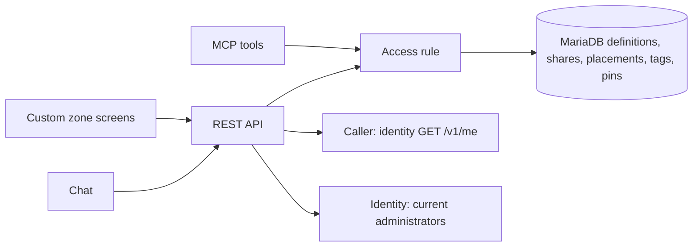
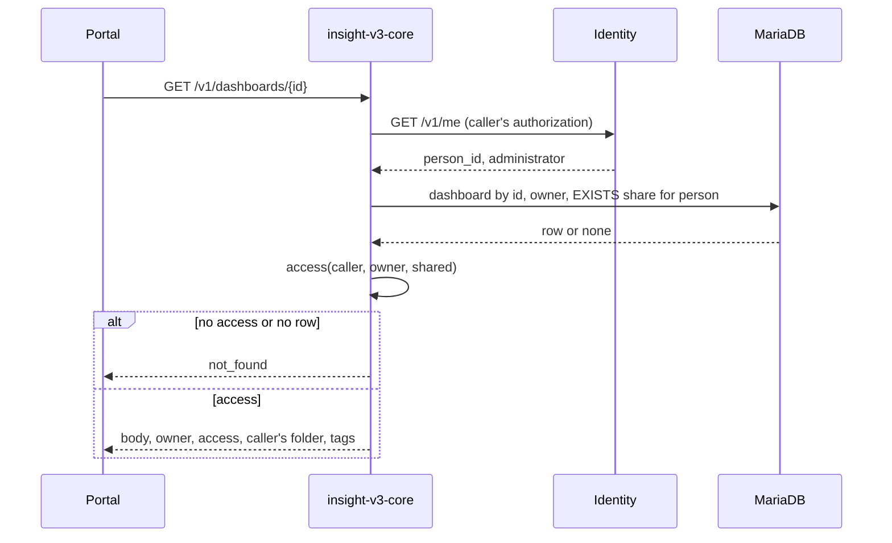

# Technical Design — Insight v3 Dashboard Ownership and Sharing

Every definition, folder and tag gets a generated id ([ADR-0010](../ADR/0010-definitions-are-addressed-by-generated-identity.md)); dashboards, folders and tags get a nullable owner. One access rule, read per dashboard and applied in list `WHERE` clauses, decides what each caller sees and may do, so pages and totals count only visible rows.

<!-- toc -->

- [1. Architecture Overview](#1-architecture-overview)
  - [1.1 Architectural Vision](#11-architectural-vision)
  - [1.2 Architecture Drivers](#12-architecture-drivers)
  - [1.3 Architecture Layers](#13-architecture-layers)
- [2. Principles & Constraints](#2-principles--constraints)
  - [2.1 Design Principles](#21-design-principles)
  - [2.2 Constraints](#22-constraints)
- [3. Technical Architecture](#3-technical-architecture)
  - [3.1 Domain Model](#31-domain-model)
  - [3.2 Component Model](#32-component-model)
  - [3.3 API Contracts](#33-api-contracts)
  - [3.4 Internal Dependencies](#34-internal-dependencies)
  - [3.5 External Dependencies](#35-external-dependencies)
  - [3.6 Interactions & Sequences](#36-interactions--sequences)
  - [3.7 Database Schemas & Tables](#37-database-schemas--tables)
  - [3.8 Deployment Topology](#38-deployment-topology)
- [4. Additional Context](#4-additional-context)
  - [Upgrade Procedure](#upgrade-procedure)
  - [Verification and Observability](#verification-and-observability)
  - [Open Questions](#open-questions)
- [5. Traceability](#5-traceability)

<!-- /toc -->

- [ ] `p1` - **ID**: `cpt-insightspec-v3-sharing-design-core`

## 1. Architecture Overview

### 1.1 Architectural Vision

Ownership lives in `insight-v3-core`'s MariaDB beside the definitions, as folders, tags and pins do. Ids replace names as keys in the same release, because privacy depends on it.

### 1.2 Architecture Drivers

The parent [separate-service ADR](../ADR/0001-separate-service.md) still applies.

#### Functional Drivers

| Requirement | Design Response |
|-------------|-----------------|
| `cpt-insightspec-v3-sharing-fr-identity` | `id` keys: UUIDv7 for new rows, the former name for older ones; routes, tools and body references take ids |
| `cpt-insightspec-v3-sharing-fr-upgrade` | Re-runnable migrations that rewrite no reference ([Upgrade Procedure](#upgrade-procedure)) |
| `cpt-insightspec-v3-sharing-fr-owner` | `owner_person_id` from the caller; no route or tool accepts an owner |
| `cpt-insightspec-v3-sharing-fr-visibility` | `Access` per dashboard; the visibility predicate in every dashboard query |
| `cpt-insightspec-v3-sharing-fr-owner-actions` | The operation matrix |
| `cpt-insightspec-v3-sharing-fr-library` | Administrator-wide access; filtered dependents |
| `cpt-insightspec-v3-sharing-fr-share` | `dashboard_shares`; targets checked against identity, which also bounds shares per dashboard |
| `cpt-insightspec-v3-sharing-fr-unshare` | One transaction deletes share, pin and placement |
| `cpt-insightspec-v3-sharing-fr-transfer` | Orphaned listing from identity; conditional owner update |
| `cpt-insightspec-v3-sharing-fr-folders` | `folders.owner_person_id`, `dashboard_placements` |
| `cpt-insightspec-v3-sharing-fr-tags` | `tags.owner_scope` |
| `cpt-insightspec-v3-sharing-fr-pins` | `dashboard_pins` by dashboard id |
| `cpt-insightspec-v3-sharing-fr-ownerless` | Null owner as `Owner::Unowned`; `dashboards.folder_id` |
| `cpt-insightspec-v3-sharing-fr-retire-ownerless` | [Owner assignment](#assigning-an-owner-by-hand) and a [guarded step](#retiring-ownerless-rows) |
| `cpt-insightspec-v3-sharing-fr-assistant` | MCP as the token's subject, chat as the session's person |

#### NFR Allocation

| NFR ID | Allocated To | Design Response | Verification Approach |
|--------|--------------|-----------------|-----------------------|
| `cpt-insightspec-v3-sharing-nfr-isolation` | Access rule, dashboard queries | One function, one predicate, one `not_found` | Surface walk |
| `cpt-insightspec-v3-sharing-nfr-audit` | Sharing | `granted_by`; info logs | Handler tests over log lines |
| `cpt-insightspec-v3-sharing-nfr-upgrade-integrity` | Migrations | [Upgrade Procedure](#upgrade-procedure) | Live MariaDB upgrade tests |
| `cpt-insightspec-v3-sharing-nfr-list-latency` | List queries | Predicate: an indexed `OR` of owner, null owner and `EXISTS` on shares | `EXPLAIN`; synthetic load against the parent target |
| `cpt-insightspec-v3-nfr-security` | Dependencies | No new dependency | Required scans |
| `cpt-insightspec-v3-nfr-efficiency` | Store | Three small tables, four columns | Parent baseline comparison |

### 1.3 Architecture Layers

- [ ] `p1` - **ID**: `cpt-insightspec-v3-sharing-tech-layers`



| Layer | Responsibility | Technology |
|-------|----------------|------------|
| Interface | Routes and tools by id; caller resolution | Existing Rust REST and MCP |
| Application/domain | `Access`, the operation matrix, share and transfer rules | Pure Rust over values |
| Infrastructure | Ownership columns, link tables, the predicate, migrations | MariaDB through SeaORM |

## 2. Principles & Constraints

### 2.1 Design Principles

#### One Access Rule

- [ ] `p1` - **ID**: `cpt-insightspec-v3-sharing-principle-one-rule`

Every REST route, MCP tool and chat context uses the same `access` function and list predicate, so a new surface inherits the rule.

#### Ownership Outside the Body

- [ ] `p1` - **ID**: `cpt-insightspec-v3-sharing-principle-outside-body`

Owner, shares, placements, tags and pins are columns and rows beside the body, so no body write changes them.

#### Invisible Is Absent

- [ ] `p1` - **ID**: `cpt-insightspec-v3-sharing-principle-invisible-absent`

A dashboard the caller may not see gets the same error, timing path and fields as an id matching nothing. Only a caller who sees a dashboard learns a change was refused.

### 2.2 Constraints

#### Administrators Only

- [ ] `p1` - **ID**: `cpt-insightspec-v3-sharing-constraint-admin-gate`

Every definition route keeps `require_admin`, which now returns `Caller { person_id }`. MCP keeps its own gate, reading the role and subject off the token, so a person whose role is withdrawn keeps MCP access until the token expires, as today.

#### No Identity Writes

- [ ] `p1` - **ID**: `cpt-insightspec-v3-sharing-constraint-identity-read-only`

Identity is read with the caller's forwarded authorization, through routes an administrator may already call.

## 3. Technical Architecture

### 3.1 Domain Model

- `DefinitionId`: the id of a metric, widget or dashboard, parsed at the boundary by the former name rule (`^[A-Za-z0-9_-]{1,128}$`, which a UUID satisfies); a malformed id is absent. `FolderId` and tag ids are UUIDs, as before. A dataset's identity is its unique name.
- `PersonId`: identity's person UUID, the gateway JWT `sub`.
- `Owner`: `Unowned` (`NULL`, predates ownership) or `Person(PersonId)`.
- `Access`: `Owner`, `Viewer` or `Ownerless`; none means absent.

```text
access(caller, owner, shared_with_caller) =
  Owner::Person(p) if p == caller  -> Some(Owner)
  Owner::Person(_) if shared       -> Some(Viewer)
  Owner::Person(_)                 -> None
  Owner::Unowned                   -> Some(Ownerless)
```

| Operation | `Owner` | `Viewer` | `Ownerless` |
|-----------|---------|----------|-------------|
| Open, run its widgets, pin | yes | yes | yes |
| Edit body, rename, delete, duplicate | yes | refused | yes |
| Set tags | yes, owner's tags | refused | yes, ownerless tags |
| File in a folder | personal folders | personal folders | ownerless folders |
| Share, withdraw, list shares | yes | refused | refused |
| Transfer | — | — | refused |

Transfer needs no access: the owner must not be a current administrator, and the target must be one.

- `Folder`, `Tag`: `id`, `name`, `owner`. A placement is one person's filing of one dashboard. A personal folder holds its owner's placements; an ownerless folder holds ownerless dashboards through `dashboards.folder_id`. A dashboard carries its owner's tags, or ownerless tags if ownerless.

A name is non-empty after trimming and at most 128 characters for metrics, widgets and dashboards, 64 for folders, 32 for tags, as the columns allow; slug characters are no longer required. A dataset name keeps its rules and stays unique: producers address it on `POST /v1/raw-data`, and its physical table is named after it.

A duplicate gets the caller as owner, the original's body, the requested name, the original's tag names in the caller's tag scope, and the caller's placement of the original if in a caller's folder, so a copy of an ownerless dashboard lands in no folder.

### 3.2 Component Model

#### Access

- [ ] `p1` - **ID**: `cpt-insightspec-v3-sharing-component-access`

##### Why this component exists

Visibility must be identical on every surface.

##### Responsibility scope

`access`, the operation matrix and the list predicate.

##### Responsibility boundaries

Takes a resolved `Caller`; does not authenticate.

##### Related components (by ID)

- `cpt-insightspec-v3-sharing-component-sharing`: consults it before every share operation

#### Sharing

- [ ] `p1` - **ID**: `cpt-insightspec-v3-sharing-component-sharing`

##### Why this component exists

Shares and transfers change who sees a dashboard and depend on identity.

##### Responsibility scope

Share, withdraw, list shares, list orphaned, transfer.

##### Responsibility boundaries

Reads identity; writes only `dashboard_shares`, `dashboard_pins`, `dashboard_placements` and `dashboards.owner_person_id`.

##### Related components (by ID)

- `cpt-insightspec-v3-sharing-component-access`: decides who may share
- `cpt-insightspec-v3-sharing-component-upgrade`: creates its tables

#### Upgrade

- [ ] `p1` - **ID**: `cpt-insightspec-v3-sharing-component-upgrade`

##### Why this component exists

Every name reference must become an id reference without loss.

##### Responsibility scope

The [Upgrade Procedure](#upgrade-procedure) migrations and the later retirement step.

##### Responsibility boundaries

Runs in the service's `migrate` step (the chart's pre-install and pre-upgrade hook) through the migration ledger, while the previous build may still serve; assigns no owners.

##### Related components (by ID)

- `cpt-insightspec-v3-sharing-component-access`: reads its columns

### 3.3 API Contracts

- [ ] `p1` - **ID**: `cpt-insightspec-v3-sharing-interface-rest`

The contract is the service's drift-checked OpenAPI document. `{kind}` is `metrics`, `widgets` or `dashboards`; datasets keep their lifecycle routes, by name.

| Operation | Request | Response | Permission |
|-----------|---------|----------|------------|
| `GET /v1/{kind}` | `q`, `limit`, `offset`; dashboards also `folder`, `tag` (repeatable, by name), `owned` (`me` or `shared`; absent lists everything visible, ownerless included) | A page of `{id, name, updated_at}`, dashboards also `owner_person_id` (null if ownerless) and `access`; a total | Any; dashboards filtered |
| `POST /v1/{kind}` | `{name, body}` | `{id}` | Any; a dashboard is owned by the caller |
| `GET /v1/{kind}/{id}` | — | `{id, name, body, clock, updated_at}`, dashboards also `owner_person_id`, `access`, the caller's `folder`, and `tags` | Any who can see it |
| `PUT /v1/{kind}/{id}` | `{name, body}` | No content | Dashboards: `Owner` or `Ownerless` |
| `DELETE /v1/{kind}/{id}` | — | No content; refused while referenced, naming visible holders, counting the rest | Dashboards: `Owner` or `Ownerless` |
| `GET /v1/{kind}/{id}/dependents` | — | `{holders: [{kind, id, name}], hidden}`, `hidden` counting dashboards the caller cannot see | Any who can see it |
| `POST /v1/dashboards/{id}/duplicate` | `{name}` | `{id}` of the copy | `Owner` or `Ownerless` |
| `PUT /v1/dashboards/{id}/folder` | `{folder}`: a folder id or null | No content | Any who can see it; the folder is the caller's, or ownerless for an ownerless dashboard |
| `PUT /v1/dashboards/{id}/tags` | `{tags}`: names | No content | `Owner` or `Ownerless` |
| `GET /v1/dashboards/{id}/shares` | — | `[{person_id, granted_by, created_at}]` | `Owner` |
| `PUT /v1/dashboards/{id}/shares/{person_id}` | — | No content; idempotent | `Owner`; the person is a current administrator and not the owner |
| `DELETE /v1/dashboards/{id}/shares/{person_id}` | — | No content; idempotent | `Owner` |
| `GET /v1/orphaned-dashboards` | `limit`, `offset` | One page of `{id, name, owner_person_id, updated_at}` | Any |
| `POST /v1/dashboards/{id}/transfer` | `{to}`: a person id | No content | Any; the dashboard is orphaned and `to` is a current administrator |
| `GET /v1/folders`, `POST /v1/folders`, `PATCH /v1/folders/{id}`, `DELETE /v1/folders/{id}` | as today | The caller's and the ownerless folders, each with `owner_person_id` and its visible dashboard count, plus the caller's visible unfiled count | Personal: its owner; ownerless: any |
| `GET /v1/tags` | — | Names of tags on visible dashboards, each with a count of those dashboards | Any |
| `GET /v1/pins`, `PUT /v1/pins/{dashboard_id}`, `DELETE /v1/pins/{dashboard_id}` | as today | Ids and names of the caller's still-visible pins | Any; pinning needs sight |
| `POST /v1/metrics/{id}/run`, `/drilldown` | as today | as today | Any |

Routes by name, including `POST /v1/{kind}/{name}/rename`, are removed; a rename is a `PUT` with a new `name`. `q` searches names and bodies as today. Caps are per scope: `MAX_FOLDERS` per person, `MAX_TAGS` per owner scope, the ownerless scope included; nobody sees or exhausts another's.

| Case | Refusal |
|------|---------|
| An id that is malformed, missing, or names a dashboard the caller cannot see | `not_found`, with the same body in every case |
| A change by a viewer | `permission_denied`: only the owner may change the dashboard |
| A share target who is not a current administrator, or is the owner | `invalid_argument` on `person_id` |
| A transfer of a dashboard that is not orphaned | `failed_precondition` |
| A transfer to a person who is not a current administrator | `invalid_argument` on `to` |
| A folder or tag that does not fit the dashboard's ownership | `invalid_argument` on `folder` or `tags` |
| Identity unreachable | `internal`, never a permit |

#### MCP Tools

- [ ] `p1` - **ID**: `cpt-insightspec-v3-sharing-interface-mcp`

Tools take and return ids and act as the token's subject:

- `list_definitions` and `search_definitions` return `{id, name}`, dashboards filtered.
- `get_definition`, `delete_definition`, `arrange_dashboard` and `run_metric` take an id.
- `put_metric`, `put_widget` and `put_dashboard` take an optional `id`: without it they create and return one; with it they replace, if the subject may change that definition.
- `move_dashboard` takes a dashboard id and a folder id or null; `set_dashboard_tags` an id and tag names.
- `list_folders` and `create_folder` cover the subject's and the ownerless folders; `list_tags` returns visible tags.
- Alert tools take a metric id.

#### Chat

- [ ] `p1` - **ID**: `cpt-insightspec-v3-sharing-interface-chat`

`store_proposed`, which stores the model's proposals, receives the caller from `require_admin`, so every write goes through the access rule. The chat context lists metrics, widgets and datasets with ids, and the person's visible dashboards.

A proposal replaces a definition by naming its id and creates one by carrying none. Definitions created together refer to each other by proposal-local keys; the service generates their ids and writes them into those references in one batch. A reference that is neither a local key nor a visible id, or a replacement the person may not make, is refused through the existing repair round.

#### Portal Screens

- [ ] `p1` - **ID**: `cpt-insightspec-v3-sharing-interface-portal`

| Page | Route | Change |
|------|-------|--------|
| Dashboards | `/portal/custom` | Owner per row; `Owned by me` and `Shared with me` filters; the caller's and ownerless folders |
| Dashboard | `/portal/custom/$name`, the segment holding the id | Actions as the matrix allows; owner named |
| Share | dialog on the dashboard | Shares with remove; a picker of current administrators except the owner |
| Orphaned | `/portal/custom/orphaned` | Name, owner, last change; transfer with an administrator picker |
| Editors | `/portal/custom/edit/$kind/$name`, `/portal/custom/new/$kind`, metric and widget pages, the `$name` segment holding the id | Free-text names; body pickers store ids, show names |

The picker searches `GET /v1/persons?q=` and offers only current administrators, read once (§3.5); the server rechecks the target. Owner names come from `GET /v1/persons?q=<person id>`, one read per distinct owner on the page, cached. `POST /v1/profiles/batch` is not used: it is limited to the caller's org-chart visibility.

### 3.4 Internal Dependencies

| Dependency | Interface Used | Purpose |
|------------|----------------|---------|
| [API authorization](../../../../../src/backend/services/insight-v3-core/src/api/mod.rs) | `require_admin` returning the caller | Who every operation acts as |
| [MCP authorization](../../../../../src/backend/services/insight-v3-core/src/mcp/auth.rs) | The token's subject | Who MCP acts as |
| [Identity client](../../../../../src/backend/services/insight-v3-core/src/store/identity.rs) | `/v1/me`, administrator assignments | Caller, share targets, orphaned dashboards |
| [Chat storage](../../../../../src/backend/services/insight-v3-core/src/api/chat.rs) | `store_proposed` | Gains the caller and the access rule |
| [In-use refusal](../../../../../src/backend/services/insight-v3-core/src/domain/surfaces.rs) | `CustomError::InUse` | Holder names filtered to visible ones |
| [Definition store](../../../../../src/backend/services/insight-v3-core/src/store/definitions/sql/) | Migration ledger and scripts | New columns and tables |
| [Alerts](../alerts/DESIGN.md) | `alert_rules.metric`, `alert_notifications.metric` and `metric_name` | `metric` holds the metric id; a notification also records the metric's name |
| [Usage telemetry](../../../../../src/frontend/src/telemetry.ts) | `screenPath` masks UUID segments | Dashboard names stop reaching usage |

### 3.5 External Dependencies

#### Identity Service

| Call | Used for |
|------|----------|
| `GET /v1/me` | Caller and administrator role, as today; returns active roles only |
| `GET /v1/person-roles?role=<admin role id>&person=<id>&active=true` | Whether one person holds the role now: share targets, a transfer's owner and target |
| `GET /v1/person-roles?role=<admin role id>&active=true&limit=500` | The current administrators: the orphaned listing and the portal's picker |
| `GET /v1/persons?q=` | Administrator-only person search with display names, tenant-wide, ignoring org-chart visibility; read by the portal |

Every call carries the caller's forwarded authorization, which holds the administrator role. `active=true` is required, or withdrawn assignments are listed. The listing returns at most 500 with no cursor, so a full page may be truncated: then the orphaned listing and the picker refuse with `internal` rather than treat an administrator beyond the page as orphaned.

### 3.6 Interactions & Sequences

#### Open a Dashboard

**ID**: `cpt-insightspec-v3-sharing-seq-open`



#### Share a Dashboard

**ID**: `cpt-insightspec-v3-sharing-seq-share`

The service reads the dashboard with the caller's access, requires `Owner` and a person other than the owner, asks identity for that person's active administrator assignment, and inserts the share, ignoring one that exists.

#### Transfer an Orphaned Dashboard

**ID**: `cpt-insightspec-v3-sharing-seq-transfer`

The service reads the owner, asks identity whether owner and target hold the role, sets `owner_person_id` to the target only where it still equals the owner read, and deletes any share the target held. A concurrent transfer loses the conditional update and gets `failed_precondition`.

### 3.7 Database Schemas & Tables

- [ ] `p1` - **ID**: `cpt-insightspec-v3-sharing-db-ownership`

A new definition's id is a service-generated UUIDv7; an older one's is its former name, in the same `VARCHAR(128)` column. Person ids are `CHAR(36)`. Timestamps are UTC `DATETIME(6)`.

#### Table: metrics, widgets, dashboards

| Field | Type | Description |
|-------|------|-------------|
| `id` | String | Primary key: a UUIDv7, or the former name of an older row |
| `name` | String | Label, indexed for search, not unique |
| `body` | String (JSON) | As today; references inside are ids |
| `owner_person_id` | String | Dashboards only; null while ownerless; indexed |
| `folder_id` | String | Dashboards only; an ownerless dashboard's ownerless folder; always null on an owned one |

Datasets are unchanged: their unique `name` stays the key.

#### Table: dashboard shares

| Field | Type | Description |
|-------|------|-------------|
| `dashboard` | String | Primary key part; cascades on dashboard delete |
| `person` | String | Primary key part; indexed with `dashboard` for the list predicate |
| `granted_by` | String | The owner who shared |
| `created_at` | DateTime | When shared |

#### Table: dashboard placements

| Field | Type | Description |
|-------|------|-------------|
| `person` | String | Primary key part; the folder's owner |
| `dashboard` | String | Primary key part; cascades on dashboard delete |
| `folder_id` | String | A folder owned by `person`; cascades on folder delete |

#### Table: folders and tags

- `folders` gains `owner_person_id` (null while ownerless) and drops its unique name key.
- `tags` gains `owner_person_id` and a stored generated `owner_scope` (`COALESCE(RTRIM(owner_person_id), '')`); its unique key becomes `(owner_scope, name)` under the existing case-insensitive collation.
- `dashboard_tags.dashboard` and `dashboard_pins.dashboard` keep their names and hold dashboard ids.
- The `tags_lock` and `pins_lock` serialization is unchanged.

### 3.8 Deployment Topology

No new process, service or configuration.

## 4. Additional Context

### Upgrade Procedure

MariaDB commits each DDL statement on its own, so the upgrade cannot be one transaction. Ledger migrations run in the pre-upgrade hook while the previous build still serves. Each does only what is left, so a run stopped at any statement and restarted ends in the same state.

1. **Ids.** Refuse to start unless the global `sql_mode` includes `STRICT_TRANS_TABLES` or `STRICT_ALL_TABLES`. On metrics, widgets and dashboards, rename the `name` column to `id` (InnoDB keeps the primary key and the foreign keys that point at it), add a `name` label column filled from `id`, and index it. An old name already satisfies the id rule, so every reference to one — in a body, `dashboard_pins.dashboard`, `dashboard_tags.dashboard`, `alert_rules.metric` and `alert_notifications.metric` — is already a valid id, and nothing is rewritten. From here an insert by the previous build names no `id`, and strict mode refuses it until that build is replaced.
2. **Ownership.** Add `owner_person_id` to dashboards, folders and tags, and `owner_scope` with its unique key `(owner_scope, name)` to tags; drop the unique name keys on folders and tags; create `dashboard_shares` and `dashboard_placements`. Every existing row stays ownerless.
3. **Metric names on notifications.** Add a nullable `alert_notifications.metric_name`, recorded from the metric's label when a check owes a notification; a row without one shows its metric id, which for an older metric is its former name.

While the rollout replaces the previous build, its pods still list every dashboard to every administrator. They cannot create owned dashboards, so the exposure lasts only as long as the rollout and covers only dashboards created on the new build meanwhile.

#### Assigning an Owner by Hand

The operator procedure, documented with the service, runs in one transaction per dashboard:

1. Set `dashboards.owner_person_id`.
2. If `folder_id` is non-null and the operator names one of the new owner's own folders to receive the dashboard, insert a `dashboard_placements` row for the new owner in that folder; if none is named, the dashboard ends up in no folder. Then clear `folder_id`.
3. For each ownerless tag on the dashboard, find or create the new owner's tag of the same name and relink.

Ownerless folders and tags get owners the same way, or are removed once empty.

#### Retiring Ownerless Rows

The later retirement step counts dashboards, folders and tags with a null owner, owned dashboards with a non-null `folder_id`, and owned dashboards carrying an ownerless tag. While any count is non-zero it refuses and reports the counts; otherwise it sets the owner columns `NOT NULL` and drops `dashboards.folder_id`. It ships when the product owner decides to retire ownerless dashboards, not in this release.

### Verification and Observability

- Table-driven tests of `access` and the matrix over every owner, share and operation combination.
- Live MariaDB tests of the upgrade from a seeded previous-release schema, where each former name becomes the id and the label and a second run changes nothing; of the retirement guard and owner assignment; and of the list predicate over owned, shared, ownerless and invisible dashboards across paging, totals, folders, tags and search, `EXPLAIN` using the owner and share indexes.
- A surface walk as an administrator who is neither owner nor viewer: every route, tool and chat answer that can mention a dashboard finds nothing of a private one, counts, caps and the in-use refusal included, with errors identical to a missing id's.
- Chat: a proposal creating a metric, widgets and a dashboard linked by local keys lands with ids and the caller as owner; replacing a dashboard the caller may not change is refused.
- Handlers: share, repeated share, withdraw, transfer races, identity unreachable as `internal`.
- Portal components: owner column and filters, share dialog, orphaned page, access-hidden actions.

Shares, withdrawals and transfers log at info with `actor_person_id`, `dashboard_id` and `person_id`. Refusals for invisible dashboards log nothing naming the dashboard to the caller.

### Open Questions

- Does identity end a person's role assignments when their roster status turns inactive? If not, a leaver's dashboards stay off the orphaned list until the role is revoked. For the identity team to confirm.
- Will the assignment listing gain a cursor? Until then, 500 or more administrators block the orphaned list and the picker, with an `internal` refusal.

## 5. Traceability

- **Local PRD**: [Dashboard Ownership and Sharing](./PRD.md); decisions in its §11.
- **Parent PRD**: [Insight v3](../PRD.md), §5.4.
- **Parent DESIGN**: [Insight v3](../DESIGN.md), §3.7.
- **Applicable ADRs**: [Separate service](../ADR/0001-separate-service.md), [Definitions are addressed by generated identity](../ADR/0010-definitions-are-addressed-by-generated-identity.md), [UUIDv7 as universal primary key](../../../../shared/glossary/ADR/0001-uuidv7-primary-key.md).
- **Implementation**: `src/backend/services/insight-v3-core/src/api`, `src/mcp`, `src/chat`, `src/domain`, `src/store/definitions`; portal in `src/frontend/src/routes/portal.custom.*`, `src/frontend/src/components/custom`, `src/frontend/src/api/custom-client.ts`.
