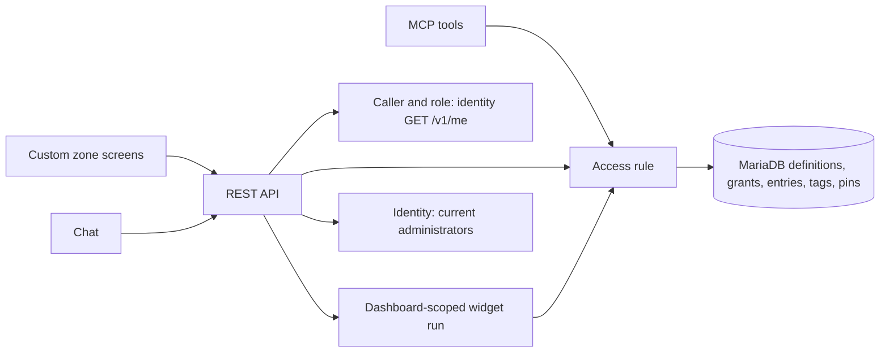
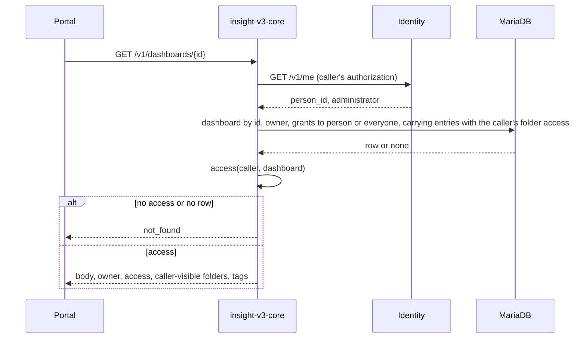

# Technical Design — Insight v3 Dashboard Ownership and Sharing

**Status:** Revision 0.5 adds viewer and editor grants to a person or everyone on dashboards and folders, folder entries that carry a folder's audience while their placer owns or holds an editor grant on the dashboard, orphaned folders, and the `/grants` and folder entry routes.

Every definition, folder and tag has an id, a new one a generated UUIDv7 and an older one its former name ([ADR-0010](../ADR/0010-definitions-are-addressed-by-generated-identity.md)); dashboards, folders and tags get a nullable owner. Dashboards and folders carry grants, and folders hold dashboards through entries. One access rule, read per dashboard and folder and applied in list `WHERE` clauses, decides what each caller sees and may do, so pages and totals count only visible rows. Every signed-in person reaches the dashboard and folder routes; the caller's role decides whether the library, authoring, sharing, chat and MCP are reachable too.

<!-- toc -->

- [1. Architecture Overview](#1-architecture-overview)
  - [1.1 Architectural Vision](#11-architectural-vision)
  - [1.2 Architecture Drivers](#12-architecture-drivers)
  - [1.3 Architecture Layers](#13-architecture-layers)
- [2. Principles & Constraints](#2-principles--constraints)
  - [2.1 Design Principles](#21-design-principles)
  - [2.2 Constraints](#22-constraints)
- [3. Technical Architecture](#3-technical-architecture)
  - [3.1 Domain Model](#31-domain-model)
  - [3.2 Component Model](#32-component-model)
  - [3.3 API Contracts](#33-api-contracts)
  - [3.4 Internal Dependencies](#34-internal-dependencies)
  - [3.5 External Dependencies](#35-external-dependencies)
  - [3.6 Interactions & Sequences](#36-interactions--sequences)
  - [3.7 Database Schemas & Tables](#37-database-schemas--tables)
  - [3.8 Deployment Topology](#38-deployment-topology)
- [4. Additional Context](#4-additional-context)
  - [Upgrade Procedure](#upgrade-procedure)
  - [Verification and Observability](#verification-and-observability)
  - [Open Questions](#open-questions)
- [5. Traceability](#5-traceability)

<!-- /toc -->

- [ ] `p1` - **ID**: `cpt-insightspec-v3-sharing-design-core`

## 1. Architecture Overview

### 1.1 Architectural Vision

Ownership, grants and entries live in `insight-v3-core`'s MariaDB beside the definitions, as tags and pins do. Ids replace names as keys in the same release, because privacy depends on it.

### 1.2 Architecture Drivers

The parent [separate-service ADR](../ADR/0001-separate-service.md) still applies.

#### Functional Drivers

| Requirement | Design Response |
|-------------|-----------------|
| `cpt-insightspec-v3-sharing-fr-identity` | `id` keys: UUIDv7 for new rows, the former name for older ones; routes, tools and body references take ids |
| `cpt-insightspec-v3-sharing-fr-upgrade` | Re-runnable migrations that rewrite no reference; placements copied into entries ([Upgrade Procedure](#upgrade-procedure)) |
| `cpt-insightspec-v3-sharing-fr-owner` | `owner_person_id` from the caller; no route or tool accepts an owner |
| `cpt-insightspec-v3-sharing-fr-visibility` | `access` and `folder_access`; the visibility predicate in every dashboard and folder query |
| `cpt-insightspec-v3-sharing-fr-editor-cap` | The role cap applied last in both functions |
| `cpt-insightspec-v3-sharing-fr-owner-actions` | The operation matrices |
| `cpt-insightspec-v3-sharing-fr-render` | Dashboard-scoped widget reads and runs; library routes behind `require_admin`; generic errors for members |
| `cpt-insightspec-v3-sharing-fr-library` | Administrator-only routes; filtered dependents |
| `cpt-insightspec-v3-sharing-fr-share` | `dashboard_grants`, `folder_grants`; a person target checked to exist in identity, or `everyone`; no cap |
| `cpt-insightspec-v3-sharing-fr-share-onward` | Grant routes accept `Owner` and `Editor` |
| `cpt-insightspec-v3-sharing-fr-unshare` | Deletes the one grant row and demotes the entries it qualified; pins and entries stay and are filtered at read |
| `cpt-insightspec-v3-sharing-fr-transfer` | Orphaned listings from identity; conditional owner update on dashboards and folders |
| `cpt-insightspec-v3-sharing-fr-folders` | `folders.owner_person_id`, `folder_entries` |
| `cpt-insightspec-v3-sharing-fr-entries` | `folder_entries.carries`, set from the placer's qualification when the entry is added and cleared in the transaction that ends it |
| `cpt-insightspec-v3-sharing-fr-tags` | `tags.owner_scope`, always the dashboard owner's |
| `cpt-insightspec-v3-sharing-fr-pins` | `dashboard_pins` by dashboard id, filtered at read |
| `cpt-insightspec-v3-sharing-fr-ownerless` | Null owner as `Owner::Unowned`; ownerless folders hold only ownerless dashboards |
| `cpt-insightspec-v3-sharing-fr-retire-ownerless` | [Owner assignment](#assigning-an-owner-by-hand) and a [guarded step](#retiring-ownerless-rows) |
| `cpt-insightspec-v3-sharing-fr-assistant` | MCP as the token's subject, chat as the session's person |

#### NFR Allocation

| NFR ID | Allocated To | Design Response | Verification Approach |
|--------|--------------|-----------------|-----------------------|
| `cpt-insightspec-v3-sharing-nfr-isolation` | Access rule, dashboard and folder queries | Two functions, one predicate each, one `not_found` | Surface walk |
| `cpt-insightspec-v3-sharing-nfr-reach` | Caller resolution, dashboard-scoped routes | `Caller.role` gates every library and sharing route; a widget run resolves through the dashboard body; member errors generic | Surface walk as a member |
| `cpt-insightspec-v3-sharing-nfr-audit` | Sharing | `granted_by`, `placed_by`; info logs | Handler tests over log lines |
| `cpt-insightspec-v3-sharing-nfr-upgrade-integrity` | Migrations | [Upgrade Procedure](#upgrade-procedure) | Live MariaDB upgrade tests |
| `cpt-insightspec-v3-sharing-nfr-list-latency` | List queries | Predicate: an indexed `OR` of owner, null owner, `EXISTS` on grants to the caller or `everyone`, and `EXISTS` on carrying entries in folders the caller sees | `EXPLAIN`; synthetic load against the parent target |
| `cpt-insightspec-v3-nfr-security` | Dependencies | No new dependency | Required scans |
| `cpt-insightspec-v3-nfr-efficiency` | Store | Three small tables, four columns | Parent baseline comparison |

### 1.3 Architecture Layers

- [ ] `p1` - **ID**: `cpt-insightspec-v3-sharing-tech-layers`



| Layer | Responsibility | Technology |
|-------|----------------|------------|
| Interface | Routes and tools by id; caller resolution | Existing Rust REST and MCP |
| Application/domain | `access`, `folder_access`, the operation matrices, grant, entry and transfer rules | Pure Rust over values |
| Infrastructure | Ownership columns, grant and entry tables, the predicates, migrations | MariaDB through SeaORM |

## 2. Principles & Constraints

### 2.1 Design Principles

#### One Access Rule

- [ ] `p1` - **ID**: `cpt-insightspec-v3-sharing-principle-one-rule`

Every REST route, MCP tool and chat context uses the same `access` and `folder_access` functions and list predicates, so a new surface inherits the rule.

#### Ownership Outside the Body

- [ ] `p1` - **ID**: `cpt-insightspec-v3-sharing-principle-outside-body`

Owner, grants, entries, tags and pins are columns and rows beside the body, so no body write changes them.

#### Invisible Is Absent

- [ ] `p1` - **ID**: `cpt-insightspec-v3-sharing-principle-invisible-absent`

A dashboard or folder the caller may not see gets the same error, timing path and fields as an id matching nothing. Only a caller who sees it learns a change was refused.

### 2.2 Constraints

#### Who Reaches What

- [ ] `p1` - **ID**: `cpt-insightspec-v3-sharing-constraint-admin-gate`

The gateway already admits any browser session to `/api/v3`; the service decides. Every route resolves the caller through identity `GET /v1/me` into `Caller { person_id, role }`, `role` being `Administrator` or `Member`. Library reads and writes, creation of definitions, dependents, direct metric runs, drilldowns of either kind, datasets, tables, chat, alerts, every grant route, the orphaned listings and transfer keep `require_admin`, checked before any lookup, so a member's refusal there says only that the role is required. Dashboard reads, dashboard-scoped widget reads and runs, pins, folders, folder entries and tag listings take any caller. MCP keeps its own gate, reading the role and subject off the token: an MCP access token lives at most `access_token_ttl_seconds` (600 by default) and a refresh re-reads the person's active roles, so a withdrawn role outlives its last token by at most that long. The window is accepted; MCP tokens cannot be forwarded to identity.

#### No Identity Writes

- [ ] `p1` - **ID**: `cpt-insightspec-v3-sharing-constraint-identity-read-only`

Identity is read with the caller's forwarded authorization, through routes an administrator may already call.

## 3. Technical Architecture

### 3.1 Domain Model

- `DefinitionId`: the id of a metric, widget or dashboard, parsed at the boundary by the former name rule (`^[A-Za-z0-9_-]{1,128}$`, which a UUID satisfies); a malformed id is absent. `FolderId` and tag ids are UUIDs, as before. A dataset's identity is its unique name.
- `PersonId`: identity's person UUID, the gateway JWT `sub`.
- `Caller`: a `PersonId` and a `Role`, `Administrator` or `Member`.
- `Owner`: `Unowned` (`NULL`, predates ownership) or `Person(PersonId)`.
- `Grantee`: `Person(PersonId)` or `Everyone`, stored as the person UUID or the literal `everyone`.
- `Level`: `Viewer` below `Editor`. A grant is a grantee, a level, `granted_by` and `created_at`.
- `Access` (to a dashboard) and `FolderAccess`: `Owner`, `Editor`, `Viewer` or `Ownerless`; none means absent.
- `Entry`: a folder, a dashboard, `placed_by` and `carries`.

```text
folder_access(C, F):
  F unowned          -> Ownerless if C is Administrator, else none
  F owned by C       -> Owner, whatever C's role
  otherwise          -> cap(strongest grant on F to C or to everyone)

access(C, D):
  D unowned          -> Ownerless if C is Administrator, else none
  otherwise          -> cap(strongest of:
                          Owner   if D is owned by C and C is Administrator
                          each grant on D to C or to everyone, at its level
                          each carrying entry (F, D) where folder_access(C, F) is
                            Owner or Editor -> Editor
                            Viewer          -> Viewer)

cap(a) = Viewer if a is Editor and C is Member, else a
```

An owner who lost the role gets no `Owner` on their dashboards, which are then orphaned; they reach them only as grants or folders allow. Ownerless folders hold only ownerless dashboards, so an entry never lifts an ownerless dashboard past its first line.

A placer qualifies to carry an owned dashboard while they own it or hold an `editor` grant on it to themselves or to `everyone`; `Editor` reached through a folder does not qualify. INVARIANT: an entry with `carries` true on an owned dashboard has a qualifying `placed_by`. Every grant withdrawal or lowering, `everyone`'s included, and every transfer of the dashboard sets `carries` false, in the same transaction, on its entries whose placer no longer qualifies. A placer's loss of the administrator role is not followed; withdrawing their grant demotes their entries. Entries of ownerless dashboards keep `carries` as placed.

| Dashboard operation | `Owner` | `Editor` | `Viewer` | `Ownerless` |
|---------------------|---------|----------|----------|-------------|
| Open, draw its widgets, pin | yes | yes | yes | yes |
| Drilldown | yes | yes | administrators only | yes |
| Edit body, rename, arrange, set tags, duplicate | yes | yes | refused | yes |
| List, add, change and withdraw grants | yes | yes | refused | refused |
| Delete | yes | refused | refused | yes |
| Add to a folder | carrying | carrying through a grant to them or `everyone`, else filing | filing | carrying, ownerless folders only |

| Folder operation | `Owner` | `Editor` | `Viewer` | `Ownerless` |
|------------------|---------|----------|----------|-------------|
| List its dashboards | yes | yes | yes | yes |
| Rename, add and remove entries | yes | yes | refused | yes |
| List, add, change and withdraw grants | administrators | yes | refused | refused |
| Delete | yes | refused | refused | yes |

Transfer needs no access: the dashboard or folder must be orphaned, the caller any administrator and the target a current administrator. An orphaned folder is one with at least one grant whose owner holds no administrator role. Tags set by an editor stay in the owner's tag scope.

An entry is added by a caller with `Owner`, `Editor` or `Ownerless` on the folder who sees the dashboard; it carries when the caller has `Ownerless` on the dashboard, or has `Owner` or `Editor` and qualifies as above, and files otherwise. An owned dashboard goes only into owned folders, an ownerless one only into ownerless folders. A folder lists, and counts, only entries whose dashboard the reader sees; a filing entry therefore shows nobody a dashboard they could not see.

A name is non-empty after trimming and at most 128 characters for metrics, widgets and dashboards, 64 for folders, 32 for tags, as the columns allow; slug characters are no longer required. A dataset name keeps its rules and stays unique: producers address it on `POST /v1/raw-data`, and its physical table is named after it.

A duplicate is owned by the caller, an administrator, with the original's body, the requested name and the original's tag names in the caller's tag scope, and gets a carrying entry in each owned folder holding the original that the caller can edit. A copy of an ownerless dashboard therefore lands in no folder.

### 3.2 Component Model

#### Access

- [ ] `p1` - **ID**: `cpt-insightspec-v3-sharing-component-access`

##### Why this component exists

Visibility must be identical on every surface.

##### Responsibility scope

`access`, `folder_access`, the operation matrices and the list predicates.

##### Responsibility boundaries

Takes a resolved `Caller`; does not authenticate.

##### Related components (by ID)

- `cpt-insightspec-v3-sharing-component-sharing`: consults it before every grant, entry and transfer operation
- `cpt-insightspec-v3-sharing-component-render`: consults it before every widget read or run

#### Dashboard Rendering

- [ ] `p1` - **ID**: `cpt-insightspec-v3-sharing-component-render`

##### Why this component exists

A viewer who may not open the library still has to see the page.

##### Responsibility scope

The widgets a visible dashboard holds, in its order, and running one of them with the existing metric runner.

##### Responsibility boundaries

Reads the library on the caller's behalf only for widgets the dashboard body names; never lists it.

##### Related components (by ID)

- `cpt-insightspec-v3-sharing-component-access`: decides whether the dashboard is visible

#### Sharing

- [ ] `p1` - **ID**: `cpt-insightspec-v3-sharing-component-sharing`

##### Why this component exists

Grants, entries and transfers change who sees a dashboard or folder and depend on identity.

##### Responsibility scope

Grant, change level, withdraw and list grants on dashboards and folders; add and remove folder entries; list orphaned dashboards and folders; transfer.

##### Responsibility boundaries

Reads identity; writes only `dashboard_grants`, `folder_grants`, `folder_entries` and the owner columns of dashboards and folders.

##### Related components (by ID)

- `cpt-insightspec-v3-sharing-component-access`: decides who may share and whether an entry carries
- `cpt-insightspec-v3-sharing-component-upgrade`: creates its tables

#### Upgrade

- [ ] `p1` - **ID**: `cpt-insightspec-v3-sharing-component-upgrade`

##### Why this component exists

Every name reference must become an id reference, and every placement an entry, without loss.

##### Responsibility scope

The [Upgrade Procedure](#upgrade-procedure) migrations and the later retirement step.

##### Responsibility boundaries

Runs in the service's `migrate` step (the chart's pre-install and pre-upgrade hook) through the migration ledger, while the previous build may still serve; assigns no owners.

##### Related components (by ID)

- `cpt-insightspec-v3-sharing-component-access`: reads its columns

### 3.3 API Contracts

- [ ] `p1` - **ID**: `cpt-insightspec-v3-sharing-interface-rest`

The contract is the service's drift-checked OpenAPI document. `{kind}` is `metrics`, `widgets` or `dashboards`; datasets keep their lifecycle routes, by name. `{grantee}` is a person id or `everyone`; `{level}` is `viewer` or `editor`; `access` is `owner`, `editor`, `viewer` or `ownerless`.

| Operation | Request | Response | Permission |
|-----------|---------|----------|------------|
| `GET /v1/{kind}` | `q`, `limit`, `offset`; dashboards also `folder` (a folder id, or `unfiled` for none of the caller's visible folders), `tag` (repeatable, by name), `owned` (`me` or `shared`; absent lists everything visible, ownerless included), `sort` (`name`, the default, or `recent` for last changed first) | A page of `{id, name, updated_at}`, `updated_at` in UTC to the millisecond; metrics and widgets also `body`, and widgets `metric_name` (the name of the metric the body's `metric` names, or null when none by that id exists; one read per page); dashboards also `owner_person_id` (null if ownerless), `owner_name` (the owner's display name, or their email when identity holds no name; one identity read per page, and null when identity names nobody or does not answer within two seconds), `access` and `visibility` (`private`, `people` or `everyone`, from the dashboard's own grants and, for each folder whose entry carries it, that folder's owner and grants); a total | Dashboards: any caller, filtered; metrics and widgets: administrators |
| `POST /v1/{kind}` | `{name, body}` | `{id}` | Administrators; a dashboard is owned by the caller |
| `GET /v1/{kind}/{id}` | — | `{id, name, body, clock, updated_at}`, dashboards also `owner_person_id`, `owner_name`, `access`, `visibility` (as in the listing), `folders` (`[{id, name}]`, the caller-visible folders holding it), `tags` and `carries` (whether an entry the caller adds now would carry) | Dashboards: any who can see it; metrics and widgets: administrators |
| `PUT /v1/{kind}/{id}` | `{name, body}` | No content | Administrators; dashboards also `Owner`, `Editor` or `Ownerless` |
| `DELETE /v1/{kind}/{id}` | — | No content; refused while referenced, naming visible holders, counting the rest | Administrators; dashboards also `Owner` or `Ownerless` |
| `GET /v1/{kind}/{id}/dependents` | — | `{holders: [{kind, id, name}], hidden}`, `hidden` counting dashboards the caller cannot see | Administrators who can see it |
| `GET /v1/dashboards/{id}/widgets` | — | `{items: [{id, name, body, clock}]}`: the widgets the dashboard holds, in its order; one it names that is missing is left out | Any who can see it |
| `POST /v1/dashboards/{id}/widgets/{widget_id}/run` | as `POST /v1/metrics/{id}/run` | The widget's metric result, as that route answers it; `resource_exhausted` when every run slot stays busy | Any who can see it; the widget is one the dashboard holds; runs share a bounded number of slots |
| `POST /v1/dashboards/{id}/widgets/{widget_id}/drilldown` | as `POST /v1/metrics/{id}/drilldown` | The rows of the widget's `detail` metric, or its `metric` when it has none, as that route answers them | Administrators who can see it; the widget is one the dashboard holds |
| `POST /v1/dashboards/{id}/duplicate` | `{name}` | `{id}` of the copy | Administrators; `Owner`, `Editor` or `Ownerless` |
| `PUT /v1/dashboards/{id}/tags` | `{tags}`: names | No content | Administrators; `Owner`, `Editor` or `Ownerless`; names resolve in the owner's scope |
| `GET /v1/dashboards/{id}/grants`, `GET /v1/folders/{id}/grants` | — | `{items: [{grantee, level, granted_by, created_at}]}` | Administrators; `Owner`, or on a dashboard an `Editor` by a grant to them or to everyone, on a folder any `Editor` |
| `PUT /v1/dashboards/{id}/grants/{grantee}`, `PUT /v1/folders/{id}/grants/{grantee}` | `{level}` | No content; idempotent, sets the level; lowering a dashboard grant demotes the entries it qualified | Administrators; as listing grants, checked in the write; a person grantee is one identity knows and not the owner |
| `DELETE /v1/dashboards/{id}/grants/{grantee}`, `DELETE /v1/folders/{id}/grants/{grantee}` | — | No content; idempotent; on a dashboard, demotes the entries it qualified | Administrators; as listing grants, checked in the write |
| `GET /v1/folders` | — | The caller-visible folders, each `{id, name, owner_person_id, access, dashboards}`, `dashboards` counting the visible ones it holds; plus the caller's visible unfiled count | Any caller |
| `POST /v1/folders` | `{name}` | The folder: `{id, name, owner_person_id, access}` | Any caller, who owns it; at most `MAX_FOLDERS` per owner |
| `PATCH /v1/folders/{id}` | `{name}` | The folder under its new name, as `POST` answers it | `Owner`, `Editor` or `Ownerless` |
| `DELETE /v1/folders/{id}` | — | No content; its entries go, its dashboards stay | `Owner` or `Ownerless` |
| `PUT /v1/folders/{id}/dashboards/{dashboard_id}` | — | `{carries}`: whether the entry carries, as the [domain model](#31-domain-model) decides | `Owner`, `Editor` or `Ownerless` on the folder; sight of the dashboard; matching ownership |
| `DELETE /v1/folders/{id}/dashboards/{dashboard_id}` | — | No content | `Owner`, `Editor` or `Ownerless` on the folder |
| `GET /v1/orphaned-dashboards`, `GET /v1/orphaned-folders` | `limit`, `offset` | One page of `{id, name, owner_person_id, updated_at}` | Administrators |
| `POST /v1/dashboards/{id}/transfer`, `POST /v1/folders/{id}/transfer` | `{to}`: a person id | No content | Administrators; orphaned, and `to` is a current administrator |
| `GET /v1/tags` | — | Names of tags on visible dashboards, each with a count of those dashboards | Any caller |
| `GET /v1/datasets` | `q`, `limit`, `offset` | `{names, items, total}`: one page of ready datasets by name; `items` follows `names` in order, each `{name, title, fields, updated_at}`, `title` from the declaration (null if absent), `fields` the count it declares; one read per page | Administrators |
| `GET /v1/pins`, `PUT /v1/pins/{dashboard_id}`, `DELETE /v1/pins/{dashboard_id}` | as today | Ids and names of the caller's pins whose dashboards are visible now | Any caller; pinning needs sight |
| `POST /v1/metrics/{id}/run`, `/drilldown` | as today | as today | Administrators |

Routes by name, including `POST /v1/{kind}/{name}/rename`, are removed; a rename is a `PUT` with a new `name`. A dashboard has no single folder, so no route sets one. `q` searches names and bodies as today. Caps are per scope: `MAX_FOLDERS` per owner, `MAX_TAGS` per owner scope, the ownerless scope included; nobody sees or exhausts another's. Adding a pin or a filing entry checks sight in the same statement that inserts it, so a grant withdrawn meanwhile leaves nothing behind.

| Case | Refusal |
|------|---------|
| An id that is malformed, missing, or names a dashboard or folder the caller cannot see | `not_found`, with the same body in every case |
| A change to a dashboard by a viewer | `permission_denied`: only the owner or an editor can change this dashboard |
| Deleting a dashboard as an editor or viewer | `permission_denied`: only the owner can delete this dashboard |
| A change to a folder by a viewer, or deleting it as an editor or viewer | `permission_denied`, naming who may: the owner or an editor, or the owner alone to delete |
| Sharing or transferring an ownerless dashboard or folder | `failed_precondition` |
| A grantee identity does not know, or the owner | `invalid_argument` on `grantee` |
| A dashboard and folder of different ownership in one entry | `invalid_argument` on the folder |
| A member on an administrator route | `permission_denied`: administrator role required, as today |
| A widget run or drilldown naming a widget the dashboard does not hold | `not_found`, as a missing dashboard |
| A widget run that fails for a member | The status the metric route answers, with a generic message; the cause logged |
| A transfer of a dashboard or folder that is not orphaned | `failed_precondition` |
| A transfer to a person who is not a current administrator | `invalid_argument` on `to` |
| A tag that does not fit the dashboard's ownership | `invalid_argument` on `tags` |
| Identity unreachable | `internal`, never a permit |

The administrator gate is checked first, so a member on an administrator route hears only that the role is required, whatever the dashboard or folder.

#### MCP Tools

- [ ] `p1` - **ID**: `cpt-insightspec-v3-sharing-interface-mcp`

Tools take and return ids and act as the token's subject, an administrator:

- `list_definitions` and `search_definitions` return `{id, name}`, dashboards filtered.
- `get_definition`, `delete_definition`, `arrange_dashboard` and `run_metric` take an id; a dashboard read answers the caller-visible folders holding it.
- `put_metric`, `put_widget` and `put_dashboard` take an optional `id`: without it they create and return one; with it they replace, if the subject may change that definition.
- `add_to_folder` and `remove_from_folder` take a dashboard id and a folder id and add or remove an entry by the rules of the folder entry routes; `set_dashboard_tags` takes an id and tag names.
- `list_folders` lists the subject's visible folders and `create_folder` makes one the subject owns; `list_tags` returns visible tags.
- No tool lists or changes grants or transfers (PRD D9).
- Alert tools take a metric id.

#### Chat

- [ ] `p1` - **ID**: `cpt-insightspec-v3-sharing-interface-chat`

`store_proposed`, which stores the model's proposals, receives the caller from `require_admin`, so every write goes through the access rule. The chat context lists metrics, widgets and datasets with ids, and the person's visible dashboards.

A proposal replaces a definition by naming its id and creates one by carrying none. Definitions created together refer to each other by proposal-local keys; the service generates their ids and writes them into those references in one batch. A reference that is neither a local key nor a visible id, or a replacement the person may not make, is refused through the existing repair round.

#### Portal Screens

- [ ] `p1` - **ID**: `cpt-insightspec-v3-sharing-interface-portal`

| Page | Route | Change |
|------|-------|--------|
| Custom zone | `/portal/custom` | Open to every signed-in person; the library, editors, chat, alerts, datasets, sharing and orphaned entries shown to administrators only |
| Dashboards | `/portal/custom` | Owner per row; `Owned by me` and `Shared with me` filters; a folder pane of the caller-visible folders, own, shared and, for an administrator, ownerless, each with its visible count, plus unfiled; creating a folder for everyone; a member sees their visible dashboards, pins and folders |
| Dashboard | `/portal/custom/$name`, the segment holding the id | Widgets drawn through the dashboard-scoped routes; actions as the matrix allows; the folders holding it, with add and remove where the caller can edit the folder; owner named where the caller can resolve the person; drilldown for administrators |
| Folder | folder pane | Its visible dashboards; rename and remove entries for its owner and editors; delete for its owner; share for administrators who own or edit it |
| Share | dialog on a dashboard or folder | Grants with level and remove; a picker over every person identity knows except the owner, with a level; a separate `Everyone` choice, off until picked |
| Who gains access | notice before an entry goes into a folder with grants while the dashboard's `carries` is true, or before a grant is added to a folder holding carrying entries | The folder's people who will see the dashboard, or the dashboards they will see; confirm or cancel |
| Orphaned | the unfiltered dashboard list and the folder pane, administrators only | An `Orphaned` group after the dashboards, each with owner and last change; orphaned folders after the folders, marked `Orphaned`; neither opens; transfer with an administrator picker |
| Editors | `/portal/custom/edit/$kind/$name`, `/portal/custom/new/$kind`, metric and widget pages, the `$name` segment holding the id | Free-text names; body pickers store ids, show names |

The picker searches `GET /v1/persons?q=` and offers every person it returns except the owner; the server rechecks that the target exists. For an administrator, owner names come from `GET /v1/persons?q=<person id>`, one read per distinct owner on the page, cached. A member reads `GET /v1/people/{person_id}`, which answers only people their org-chart visibility reaches; an owner it refuses is shown as no owner. `POST /v1/profiles/batch` is not used: it is limited to the caller's org-chart visibility.

### 3.4 Internal Dependencies

| Dependency | Interface Used | Purpose |
|------------|----------------|---------|
| [API authorization](../../../../../src/backend/services/insight-v3-core/src/api/mod.rs) | `caller`, resolving any signed-in person and their role; `require_admin` over it | Who every operation acts as, and what they may reach |
| [Metric runs](../../../../../src/backend/services/insight-v3-core/src/api/metric_run.rs) | The stored-metric run and drilldown | What a dashboard-scoped widget run executes |
| [MCP authorization](../../../../../src/backend/services/insight-v3-core/src/mcp/auth.rs) | The token's subject | Who MCP acts as |
| [Identity client](../../../../../src/backend/services/insight-v3-core/src/store/identity.rs) | `/v1/me`, administrator assignments | Caller, grant targets, orphaned dashboards and folders |
| [Chat storage](../../../../../src/backend/services/insight-v3-core/src/api/chat.rs) | `store_proposed` | Gains the caller and the access rule |
| [In-use refusal](../../../../../src/backend/services/insight-v3-core/src/domain/surfaces.rs) | `CustomError::InUse` | Holder names filtered to visible ones |
| [Definition store](../../../../../src/backend/services/insight-v3-core/src/store/definitions/sql/) | Migration ledger and scripts | New columns and tables |
| [Alerts](../alerts/DESIGN.md) | `alert_rules.metric`, `alert_notifications.metric` and `metric_name` | `metric` holds the metric id; a notification also records the metric's name |
| [Usage telemetry](../../../../../src/frontend/src/telemetry.ts) | `screenPath` masks the segment after `/portal/custom` | An older dashboard's id is its former name, so masking UUIDs alone would let it reach usage |

### 3.5 External Dependencies

#### Identity Service

| Call | Used for |
|------|----------|
| `GET /v1/me` | Caller and role, for any signed-in person; returns active roles only |
| `GET /v1/persons?q=<person id>` | Whether a grant target exists, and owner names for an administrator; administrator-only, which the sharer always is |
| `GET /v1/people/{person_id}` | Owner names for a member, within their org-chart visibility; read by the portal |
| `GET /v1/person-roles?role=<admin role id>&person=<id>&active=true` | Whether one person holds the role now: a transfer's owner and target |
| `GET /v1/person-roles?role=<admin role id>&active=true&limit=500` | The current administrators: the orphaned listings and the transfer picker |
| `GET /v1/persons?q=` | Administrator-only person search with display names, tenant-wide, ignoring org-chart visibility; read by the portal |

Every call carries the caller's forwarded authorization; the role and person lookups are made by an administrator. `active=true` is required, or withdrawn assignments are listed. The listing returns at most 500 with no cursor, so a full page may be truncated: then the orphaned listings and the picker refuse with `internal` rather than treat an administrator beyond the page as orphaned.

### 3.6 Interactions & Sequences

#### Open a Dashboard

**ID**: `cpt-insightspec-v3-sharing-seq-open`



#### Grant a Dashboard or Folder

**ID**: `cpt-insightspec-v3-sharing-seq-share`

The service checks the administrator role, reads the dashboard or folder with the caller's access, requires `Owner` or `Editor` and an owned row, and for a person grantee requires someone other than the owner whom identity knows. It then inserts the grant or, if one exists, sets its level. Withdrawing deletes the one row. On a dashboard, a withdrawal or a lowering to `viewer` sets `carries` false, in the same transaction, on the entries whose placer it leaves unqualified.

#### Add a Dashboard to a Folder

**ID**: `cpt-insightspec-v3-sharing-seq-entry`

The service reads the folder with `folder_access` and requires `Owner`, `Editor` or `Ownerless`, then reads the dashboard with `access`, absent if unseen, and requires matching ownership. `carries` is true when that access is `Ownerless`, or `Owner` or `Editor` held through ownership or a grant to the caller or `everyone`. The insert repeats that qualification and, for a filing entry, the visibility condition in the same statement, as a pin's does, and answers `{carries}`.

#### Draw a Widget Through a Dashboard

**ID**: `cpt-insightspec-v3-sharing-seq-render`

The portal asks `GET /v1/dashboards/{id}/widgets`; the service resolves the caller and role, reads the dashboard with the caller's access, loads the widgets its body names and answers them in the dashboard's order. For each, `POST /v1/dashboards/{id}/widgets/{widget_id}/run` reads the dashboard with access again, refuses a widget the body does not name as missing, and runs the widget's metric as `/v1/metrics/{id}/run` would. Runs share a bounded set of slots, configured beside the drilldown's, so members opening dashboards cannot flood the warehouse; a run that finds none free answers busy and the portal offers to try again. A failure reaches a member as a generic message that names no library id and is logged with its cause; an administrator gets the metric route's own detail.

#### Transfer an Orphaned Dashboard or Folder

**ID**: `cpt-insightspec-v3-sharing-seq-transfer`

The service reads the owner, asks identity whether owner and target hold the role (and, for a folder, finds a grant on it), sets `owner_person_id` to the target only where it still equals the owner read, and deletes any grant the target held. Other grants and entries stay; on a dashboard, the same transaction sets `carries` false on entries whose placer no longer qualifies. A concurrent transfer loses the conditional update and gets `failed_precondition`.

### 3.7 Database Schemas & Tables

- [ ] `p1` - **ID**: `cpt-insightspec-v3-sharing-db-ownership`

A new definition's id is a service-generated UUIDv7; an older one's is its former name, in the same `VARCHAR(128)` column. Person ids are `CHAR(36)`. Timestamps are UTC `DATETIME(6)`. Every foreign key below cascades on delete.

#### Table: metrics, widgets, dashboards

| Field | Type | Description |
|-------|------|-------------|
| `id` | String | Primary key: a UUIDv7, or the former name of an older row |
| `name` | String | Label, indexed for search, not unique |
| `body` | String (JSON) | As today; references inside are ids |
| `owner_person_id` | String | Dashboards only; null while ownerless; indexed |
| `folder_id` | String | Dashboards only; read by nothing, dropped by the retirement step |

Datasets are unchanged: their unique `name` stays the key.

#### Table: dashboard grants

| Field | Type | Description |
|-------|------|-------------|
| `dashboard` | String | Primary key part; references `dashboards.id` |
| `grantee` | String, 36 | Primary key part; a person id or `everyone`; indexed with `dashboard` for the list predicate |
| `level` | String, 8 | `viewer` or `editor` |
| `granted_by` | String | The administrator who granted it |
| `created_at` | DateTime | When granted |

#### Table: folder grants

The same shape as dashboard grants, keyed by `folder_id`, which references `folders.id`, and `grantee`.

#### Table: folder entries

| Field | Type | Description |
|-------|------|-------------|
| `folder_id` | String | Primary key part; references `folders.id` |
| `dashboard` | String | Primary key part; references `dashboards.id`; indexed on its own |
| `placed_by` | String | Who added the entry, whose qualification `carries` tracks; null for one the upgrade copied onto an ownerless dashboard |
| `carries` | Boolean | Whether the entry carries the folder's audience to the dashboard; true on an owned dashboard only while `placed_by` qualifies |
| `created_at` | DateTime | When added |

#### Table: folders and tags

- `folders` gains `owner_person_id` (null while ownerless) and drops its unique name key.
- `tags` gains `owner_person_id` and a stored generated `owner_scope` (`COALESCE(RTRIM(owner_person_id), '')`); its unique key becomes `(owner_scope, name)` under the existing case-insensitive collation.
- `dashboard_tags.dashboard` and `dashboard_pins.dashboard` keep their names and hold dashboard ids.
- The `tags_lock` and `pins_lock` serialization is unchanged.

### 3.8 Deployment Topology

No new process, service or configuration.

## 4. Additional Context

### Upgrade Procedure

MariaDB commits each DDL statement on its own, so the upgrade cannot be one transaction. Ledger migrations run in the pre-upgrade hook while the previous build still serves. Each does only what is left, so a run stopped at any statement and restarted ends in the same state.

1. **Ids.** Refuse to start unless the global `sql_mode` includes `STRICT_TRANS_TABLES` or `STRICT_ALL_TABLES`. On metrics, widgets and dashboards, rename the `name` column to `id` (InnoDB keeps the primary key and the foreign keys that point at it), add a `name` label column filled from `id`, and index it. An old name already satisfies the id rule, so every reference to one — in a body, `dashboard_pins.dashboard`, `dashboard_tags.dashboard`, `alert_rules.metric` and `alert_notifications.metric` — is already a valid id, and nothing is rewritten. From here every definition write of the previous build fails until that build is replaced: those writes are all inserts (`INSERT ... ON DUPLICATE KEY UPDATE`), which name no `id`, and strict mode refuses them; its rename is one transaction of such writes, so a refusal rolls the whole rename back and no reference is rewritten.
2. **Ownership** (`m20261021_000011_dashboard_ownership`). Add `owner_person_id` to dashboards, folders and tags, and `owner_scope` with its unique key `(owner_scope, name)` to tags; drop the unique name keys on folders and tags; create `dashboard_grants`, `folder_grants` and `folder_entries`; copy every non-null `dashboards.folder_id` into `folder_entries` as a carrying entry with no placer, skipping entries already there. Every existing row stays ownerless. This migration has shipped in no release, so it is changed in place and no step drops tables it no longer creates.
3. **Metric names on notifications.** Add a nullable `alert_notifications.metric_name`, recorded from the metric's label when a check owes a notification; a row without one shows its metric id, which for an older metric is its former name.

While the rollout replaces the previous build, its pods still list every dashboard to every administrator. They cannot create owned dashboards, so the exposure lasts only as long as the rollout and covers only dashboards created on the new build meanwhile. Their folder move is an update by name that still matches the label, so it lands in `dashboards.folder_id`; after step 2 nothing reads that column, so such a move is ignored.

#### Assigning an Owner by Hand

The operator procedure, documented with the service, runs in one transaction per dashboard:

1. Set `dashboards.owner_person_id`.
2. Delete its entries in ownerless folders. For each folder of the new owner the operator names to receive it, insert a carrying entry placed by the new owner; if none is named, it ends up in no folder.
3. For each ownerless tag on the dashboard, find or create the new owner's tag of the same name and relink.

Ownerless folders and tags get owners the same way, or are removed once empty.

#### Retiring Ownerless Rows

The later retirement step counts dashboards, folders and tags with a null owner, owned dashboards with an entry in an ownerless folder, and owned dashboards carrying an ownerless tag. While any count is non-zero it refuses and reports the counts; otherwise it sets the owner columns `NOT NULL` and drops `dashboards.folder_id`. It ships when the product owner decides to retire ownerless dashboards, not in this release.

### Verification and Observability

- Table-driven tests of `access`, `folder_access` and both matrices over every owner, role, grant, level, `everyone` and entry combination, the role cap included.
- Live MariaDB tests of the upgrade from a seeded previous-release schema, where each former name becomes the id and the label, each placement becomes one carrying entry, and a second run changes nothing; of the retirement guard and owner assignment; and of the list predicates over owned, granted, granted-to-everyone, folder-carried, filed-only, ownerless and invisible dashboards across paging, totals, folders, tags and search, `EXPLAIN` using the owner, grantee and entry indexes.
- Folder flow: a folder viewer sees a carried dashboard and a folder editor edits it; neither sees one only filed there; removing the carrying entry or withdrawing the folder grant ends both.
- `Everyone`: a grant reaches a member with no other grant and its withdrawal removes it; a refused grant to a stranger reveals nothing.
- Editors: an editor adds, changes and withdraws grants, `everyone`'s and other editors' included, and duplicates; is refused deletion; cannot withdraw the owner.
- Member cap: a member granted `editor` on a dashboard, on a folder carrying it, or through `everyone`, gets `viewer` access and is refused every change and every grant route.
- Withdrawal: a withdrawn person's pins and entries disappear from every listing and reappear when access returns; a pin or filing entry raced against a withdrawal is not stored.
- Entry demotion: withdrawing or lowering a placer's `editor` grant, withdrawing or lowering `everyone`, or transferring the dashboard turns that placer's carrying entries into filing ones in the same transaction, so neither they nor the folder's audience keep access through them; an editor whose `Editor` comes only through a folder adds filing entries; `carries` on the dashboard read matches what an add then answers.
- A surface walk as an administrator and as a member who is neither owner nor grantee: every route, tool and chat answer that can mention a dashboard or folder finds nothing of a private one, counts, caps and the in-use refusal included, with errors identical to a missing id's.
- A member walk: every administrator route, the dashboard-scoped drilldown included, answers `permission_denied`; a visible dashboard's widgets draw through the dashboard routes; a widget the dashboard does not hold is `not_found`; a failing widget's message names no warehouse table or column, or dataset; a former administrator who still owns a dashboard neither sees nor changes it unless a grant or folder gives access.
- Chat: a proposal creating a metric, widgets and a dashboard linked by local keys lands with ids and the caller as owner; replacing a dashboard the caller may not change is refused.
- Handlers: grant, repeated grant at another level, withdraw, entry add as carrying and as filing, transfer races for dashboards and folders, identity unreachable as `internal`.
- Portal components: owner column and filters, folder pane, share dialog with level and `Everyone`, the who-gains-access notice, orphaned dashboards and folders, access-hidden actions, the member navigation.

Grants, level changes, withdrawals, entries added, removed or demoted, and transfers log at info with `actor_person_id`, `dashboard_id` or `folder_id`, `grantee` and `level`. Refusals for invisible dashboards and folders log nothing naming them to the caller.

### Open Questions

- Does identity end a person's role assignments when their roster status turns inactive? If not, a leaver's dashboards and folders stay off the orphaned lists until the role is revoked. For the identity team to confirm.
- Will the assignment listing gain a cursor? Until then, 500 or more administrators block the orphaned lists, with an `internal` refusal.
- Member authoring over the shared library, the next step after this revision: which metrics a member may run on their own, and whether they see the library at all.
- Should identity offer any signed-in person a display name by person id, regardless of org-chart visibility? Until it does, a member may see a shared dashboard without its owner's name.

## 5. Traceability

- **Local PRD**: [Dashboard Ownership and Sharing](./PRD.md); decisions in its §11.
- **Parent PRD**: [Insight v3](../PRD.md), §5.4.
- **Parent DESIGN**: [Insight v3](../DESIGN.md), §3.7.
- **Applicable ADRs**: [Separate service](../ADR/0001-separate-service.md), [Definitions are addressed by generated identity](../ADR/0010-definitions-are-addressed-by-generated-identity.md), [UUIDv7 as universal primary key](../../../../shared/glossary/ADR/0001-uuidv7-primary-key.md).
- **Implementation**: `src/backend/services/insight-v3-core/src/api`, `src/mcp`, `src/chat`, `src/domain`, `src/store/definitions`; portal in `src/frontend/src/routes/portal.custom.*`, `src/frontend/src/components/custom`, `src/frontend/src/api/custom-client.ts`.
